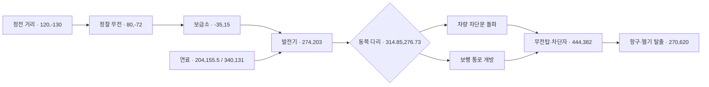

# v109 좀비 미션 구현 계획

일반 경기의 Actor·Player·Ballistics·투척물·총·손은 재사용하고, 메뉴에서 선택했을 때만 `js/zombies/entry.js`를 불러온다. 일반 시작에서 쓰지 않는 OutputPass 가져오기를 제거해 공통 연결 코드의 전송량을 상쇄한다.

## 실제 지형을 확인한 경로

중앙 시가지 북동쪽 (120,-130) → 시가지 보급소 (-35,15 주변 도로) → 동쪽 다리 앞 발전기 → 실제 다리 (314.85,276.73) → 동쪽 발전소 외곽 평지 무전탑 (높이 14m의 공간까지 검사해 위치 선정) → 남동쪽 항구 (270,620). 다리의 실제 축·노면 높이와 충돌 상자를 기준으로 입구와 출구를 계산한다. 서쪽 하천에는 다리가 없으므로 경로에 넣지 않는다.

보통 난이도는 각 단계 진입 때 저장한다. 생존자는 연료 투입 중에도 저장하고, 악몽은 정전 거리·발전기·무전탑·항구, 최후의 날은 정전 거리·발전기·무전탑에서만 저장한다.

| 목표 | 정상 설계 시간 | 완료 조건 |
|---|---:|---|
| 정전 거리 | 1~2분 | 무전·첫 전투·전진 |
| 보급소 | 2~3분 | 입구 개방·확보·보급 |
| 발전기 | 3~4분 | 연료 2개 운반·90초 방어 |
| 다리 | 2~3분 | 차량 돌파 또는 도보 우회 |
| 무전탑 | 2~3분 | 계단 등반·송출·보스 처치 |
| 항구 | 2~3분 | 헬기 방어·탑승·탈출 |

위 시간은 목표이며 검증 결과가 아니다. 실제 자동 조작 실행의 단계별 기록을 별도로 남긴다.

## 구현·커밋 단계

1. 선택 UI·지연 로딩·진입과 종료.
2. 기존 Patch/MakeHuman CC0 인체의 Blender 파생 좀비, 실제 뼈대 클립, LOD와 공유 GPU 애니메이션, 기본 AI.
3. 목표·상호작용·체크포인트와 난이도별 저장.
4. 전용 잔해·발전기·다리 분기·탑·헬기 탈출.
5. 러너·탱커·비명자·폭발형·약점 보스와 부위 반응.
6. 위치 음향·음악·한국어 무전·경고·모바일 조작과 전환.
7. 전체 자동 진행·실제 프레임/메모리 측정·기존 검사 회귀 확인.
8. BUILD와 version.txt를 109로 올린다.

## 자원과 성능

원본 `assets/patch/people/survivor-cargo.glb`, `survivor-sweater.glb`의 CC0 출처·작가·해시를 확인했다. Blender로 만든 감염 외형·클립과 직접 합성한 음원은 파생 파일별로 patch.json credits에 기록한다. 모델·음원·전용 장식은 좀비 진입 시에만 받는다.

공유 뼈대 행렬을 텍스처로 굽고 인스턴스에서 보간한다. 가까운 적은 자세하게, 먼 적은 저해상도 모델과 낮은 AI 갱신 빈도를 쓴다. 동시 적·시체·음원 수에 상한을 두고 다음 구역의 배치 자료를 미리 받는다. 공유 셰이더·텍스처는 로딩에서 나누어 준비하며 진행 중에 다시 컴파일하지 않는다.

검증 환경의 GPU는 SwiftShader 소프트웨어 렌더러다. 실측 FPS·1% 저점·50ms 초과·메모리·구역 전환은 공개하되 중간 사양 PC 60FPS 충족으로 해석하지 않는다. 큰 산출물은 `/workspace/artifacts/v109-zombies` 등 저장소 밖에 둔다. 기존 검증 미디어나 Git 히스토리는 지우지 않는다.
