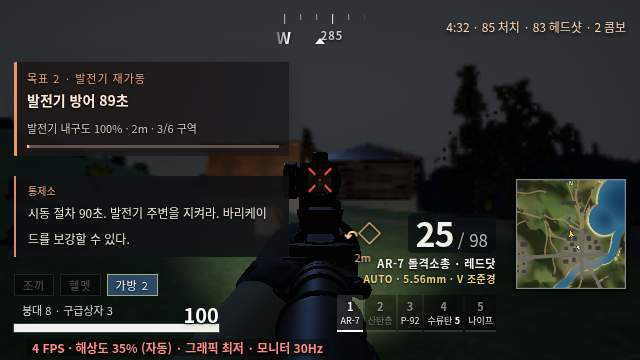
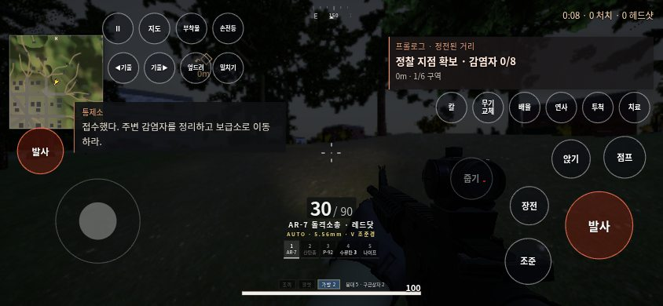

# v109 좀비 미션 구현·검증

정전된 도시 탈출을 일반 모드와 함께 고를 수 있다. 도시 정찰 → 보급소 → 연료 두 개·발전기 90초 방어 → 차량 돌파/보행 다리 → 실제 계단·무전탑·차단자 → 항구 방어·헬기 탑승·결과를 연결했다. 난이도 네 단계, 난이도별 체크포인트·진행·최고 기록·업적, 기존 30총·6칼·투척물·부착물·검은 장갑/녹색 소매를 재사용한다.

새 모드 파일·에셋은 선택/진입 후에만 요청한다. 일반 초기 부트에서 좀비 요청 0개를 검사했다. 공통 코드 증가 2,964B에서 사용하지 않는 OutputPass/OutputShader 3,791B를 제거해 초기 원문 합계는 827B 줄었다. 전용 자원은 5,567,885B이며 meshopt·WebP·gzip·공유 텍스처/뼈대를 사용한다.

## 실제 미션 소요 시간

| 단계 | 생존자 | 감염 구역 | 악몽 | 최후의 날 (실패 시도) |
|---|---:|---:|---:|---:|
| 정전 거리 | 0:26 | 0:27 | 0:25 | 0:30 |
| 보급소 | 0:49 | 0:49 | 0:36 | 0:40 |
| 연료·발전기 | 4:21 | 4:45 | 3:43 | 4:09 |
| 다리 | 0:59 | 0:52 | 0:45 | 1:48 |
| 무전탑·보스 | 1:58 | 4:56 | 1:19 | 2:16 |
| 항구 탈출 | 3:24 | 3:25 | 5:39 | 3:05 |
| 게임 시계 총 진행 | 11:58 | 15:15 | 12:29 | 12:31 |
| 벽시계 측정 전체 | 12:00 | 15:21 | 12:35 | 미측정 |
| 체크포인트 재시작 | 0 | 2 | 1 | 0 |
| 완료 상태 | 탈출 | 탈출 | 탈출 | 항구에서 사망 |
| 사용한 총기 | AR-7 · P-92 | AR-7 · P-92 | AR-7 · P-92 · MG-60 | AR-7 · P-92 · MG-60 |

생존자·감염 구역·악몽은 실제 자동 입력으로 탈출했다. 최후의 날 열은 첫 실제 사망까지의 실패 시도이며, 탈출 시간으로 해석하면 안 된다. 해당 시도 뒤 체크포인트 재시도 중 해안 경로 예외가 확인되어 검사를 중단했다. 게임 난이도를 낮추거나 승리 결과를 강제로 만들지 않았다. 최후의 날 자동 완주 기록은 남은 한계다. 재시도 중단 시간은 첫 실패 시도 열에 넣지 않았다. 장비 선택과 전투 상황이 달라 순수한 난이도 성능 비교는 아니다. 무적·위치 순간 이동·목표/타이머 건너뛰기를 쓰지 않고 전 구간을 실행했다. 보통은 10분 이상·6단계 순서·중도 일시정지 없음·15장 이상을 검사한다. 단계 시간은 전환 시점의 게임 시계를 누적해 실패 구간·재시작도 해당 단계에 포함한다. 별도의 벽시계 측정에는 촬영·측정 준비 비용도 포함된다. 사람이 처음 플레이했을 때의 12~18분은 별도 사용자 시험이 필요하다.

## 그래픽별 성능

640×360, 감염 구역, 발전기 방어에서 40마리 이상을 보충하며 게임 시간 60초 이상 실행한 시험이다. 느린 소프트웨어 GPU에서는 게임의 긴 프레임 시간 제한 때문에 벽시계 소요 시간이 더 길다. 자동 입력·관측·스크린샷 수집 비용도 포함한다. DRS를 켰고 표의 렌더 %는 종료 시 실제 장면 해상도다. 값은 단일 실행의 관측치이며 적 구성·DRS 차이가 포함된다.

| 그래픽 | 벽시계 초 | 평균 FPS | 99백분위 ms | 하위 1% FPS | 50ms 초과 | 평균/최대 적 | 렌더 % | JS 힙 MiB | 렌더러/GPU RSS MiB |
|---|---:|---:|---:|---:|---:|---:|---:|---:|---:|
| 최저 | 60.7 | 3.53 | 733.3 | 1.20 | 208 | 41.4/44 | 35 | 558 | 1696/2057 |
| 낮음 | 81.2 | 0.83 | 2116.6 | 0.47 | 65 | 41.8/44 | 55 | 532 | 1609/2139 |
| 중간 | 123.6 | 0.53 | 5983.0 | 0.17 | 61 | 42.2/44 | 85 | 519 | 1567/2228 |
| 높음 | 181.4 | 0.36 | 8516.3 | 0.12 | 61 | 41.9/44 | 85 | 530 | 1599/2249 |

**SwiftShader 소프트웨어 GPU 결과이며, 이 실행은 60FPS·99백분위 33ms 이하·50ms 초과 0개 목표에 미달했다. 실제 중간 사양 PC GPU와 갤럭시 S24 FE 실기 성능은 이 환경에서 검사하지 못했다.** JS 힙은 브라우저 관측값, RSS는 Linux 렌더러 프로세스 합계와 GPU 프로세스를 각각 기록했다.

| 난이도 | 모드 준비 초 | 준비 중 최대 긴 작업 ms | 긴 작업 수 | 초기 무기 준비 초 | 실제 미션 FPS | 99백분위 ms |
|---|---:|---:|---:|---:|---:|---:|
| 생존자 | 18.6 | 1710 | 30 | 5.5 | 4.13 | 433.3 |
| 감염 구역 | 19.2 | 1714 | 26 | 5.6 | 3.93 | 433.4 |
| 악몽 | 18.1 | 1775 | 25 | 5.4 | 3.89 | 516.6 |

| 전환 | 최대 프레임 ms (전후 1.5초) |
|---|---:|
| 정전 거리 | 716.7 |
| 보급소 | 350.0 |
| 연료·발전기 | 300.0 |
| 다리 | 383.3 |
| 무전탑·보스 | 266.6 |
| 항구 탈출 | 416.6 |

준비는 모델·텍스처·셰이더를 프레임 사이에 나누고 다음 두 구역의 배치를 미리 받는다. 소프트웨어 GPU에서는 로딩 중 긴 작업과 50ms를 넘는 플레이 프레임이 남아 있다. 실제 GPU 목표 확인은 `ZOMBIE_GPU=hardware ZOMBIE_REQUIRE_TARGETS=1 ZOMBIE_WIDTH=1920 ZOMBIE_HEIGHT=1080 npm run check:zombie`로 별도 수행해야 한다.

## 에셋·라이선스

| 파일 | 출처·작가 | 라이선스 |
|---|---|---|
| infected-*-lod*.glb, palette-* | 기존 Patch human-0348/0408, MakeHuman team·Cortu·MargaretToigo. Blender 감염 외형·11개 동작·3 LOD는 LAST ZONE 파생 제작 | CC0-1.0 |
| city-kit.glb, sector-*.json, nav-grid.bin.gz | LAST ZONE의 Blender 전용 소품·배치와 기존 월드 기반 경로 자료 | CC0-1.0 |
| audio/*.ogg | LAST ZONE 직접 합성 신음·호흡·발소리·공격·무전 잡음·4종 음악 | CC0-1.0 |

구체적 원본 URL·작가·파일·변경 내용은 [patch.json](../patch.json)의 recipe.credits와 [제작 도구](../tools/zombies/README.md)에 있다. 실사형 인체 2종, 53개 뼈대, 걷기·달리기·공격·피격·쓰러짐·기어가기 등 11개 클립을 쓰며 원거리 모델의 중복 텍스처·사용하지 않는 애니메이션 자료를 제거했다.

## 화면·한계

전체 미션의 사진·원시 프레임·프로세스 메모리·입력 추적·독립 HTML 사진 갤러리는 저장소 밖 `/workspace/artifacts/v109-zombies`에 남겼다. 저장소에는 위 작은 JPG 두 장만 추가했다. 기존 검증 미디어·Git 히스토리는 삭제하지 않았다.

기존 섬 도시·실제 다리·발전소·항구를 전용 바리케이드·잔해·조명·소품으로 재구성했다. 한국어 음성은 기기에 한국어 음성합성 목소리가 있을 때 재생하고, 없으면 자막과 무전 잡음을 쓴다. 신음·음악은 직접 합성했다. 절단·시체 래그돌 대신 부위 피격·기어가기·쓰러짐·제한된 시체 페이드를 사용한다. 실제 초보자 분량, 최후의 날 자동 탈출, 실기 GPU 성능 인증은 남아 있다.

## 전체 검사

먼저 `CHECK_OUT=/workspace/artifacts/v109-zombies/final-checks npm run check`로 기존 60개와 새 3개를 모두 통과했다. 소품 치수·착륙 표지판·탈출 위치 수정은 지연 로딩된 좀비 장면과 해당 검사 도구만 바꿨다. 그 뒤 관련 3개를 재검사했다. 마지막으로 해안에서 육지 경로가 없을 때 빈 경로를 반환하고 갱신을 계속하도록 수정한 뒤 `CHECK_ONLY=check-zombie-ai.cjs,check-zombie-mode.cjs,check-zombie-perf.cjs CHECK_OUT=/workspace/artifacts/v109-zombies/post-boundary-checks npm run check`로 관련 검사를 실행했다. 이때 첫 보통 실행은 보스 처치 직후 사망해 탈출 조건을 통과하지 못했고, AI 검사 한 항목도 실제 밀침 대신 긴 경직을 기대해 실패했다. 이후 밀쳐내기의 실제 이동을 확인하도록 검증 조건을 바로잡은 AI 검사를 `CHECK_ONLY=check-zombie-ai.cjs CHECK_OUT=/workspace/artifacts/v109-zombies/ai-final-2 npm run check`로 다시 통과했다. 전체 미션은 `ZOMBIE_RETRY=1 ZOMBIE_MAX_RETRIES=2 node tools/check-zombie-perf.cjs`로 실제 체크포인트 재시도를 허용해 다시 탈출까지 검증했다. 이 최종 검사에는 해안에서 6초 실시간 갱신과 감염 구역 전체 자동 탈출이 포함된다. 일반 경기 실제 재진입과 터치 조작도 모드 검사에 포함했다. 악몽의 실제 발전기 90초 방어 부분 검사와 최종 탈출 연출 촬영도 별도로 완료했다. 아래 표는 기존 60개와 관련 좀비 3개의 실제 결과이며 총 63개다. 장전 관통의 작동 중 3mm/복귀 10mm 기준을 완화하지 않았다. 기능/실제 완주 통과와 성능 목표 충족은 구분한다.

| 검사 | 결과 | 초 | 이유 |
|---|---|---:|---|
| check-aim.cjs | 통과 | 91 | 오류 없음 |
| check-air-hud.cjs | 통과 | 24.6 | 오류 없음 |
| check-air-visibility.cjs | 통과 | 29 | 오류 없음 |
| check-airdrop.cjs | 통과 | 43.5 | 오류 없음 |
| check-artifact-paths.cjs | 통과 | 0.1 | 오류 없음 |
| check-attachments.cjs | 통과 | 45.2 | 오류 없음 |
| check-auto-quality.cjs | 통과 | 37.5 | 오류 없음 |
| check-bundled-viewmodels.cjs | 통과 | 135.4 | 오류 없음 |
| check-cabin-instruments.cjs | 통과 | 31.5 | 오류 없음 |
| check-cabin-model.cjs | 통과 | 29.7 | 오류 없음 |
| check-cabin-mounts.cjs | 통과 | 29.6 | 오류 없음 |
| check-cabin-steering.cjs | 통과 | 29.7 | 오류 없음 |
| check-classic-hands.cjs | 통과 | 60.4 | 오류 없음 |
| check-clearance.cjs | 통과 | 7.1 | 오류 없음 |
| check-combat-environment.cjs | 통과 | 47.2 | 오류 없음 |
| check-combat.cjs | 통과 | 59.8 | 오류 없음 |
| check-driving-controls.cjs | 통과 | 28.6 | 오류 없음 |
| check-driving-input.cjs | 통과 | 28.4 | 오류 없음 |
| check-expanded-motion.cjs | 통과 | 36.3 | 오류 없음 |
| check-fire-flipbook.cjs | 통과 | 66.7 | 오류 없음 |
| check-gameplay-polish.cjs | 통과 | 49.8 | 오류 없음 |
| check-glock-import.mjs | 통과 | 1.1 | 오류 없음 |
| check-graphics-recovery.cjs | 통과 | 48.8 | 오류 없음 |
| check-hand-poses.cjs | 통과 | 146.2 | 오류 없음 |
| check-knife-motions.cjs | 통과 | 64.5 | 오류 없음 |
| check-knife-touch.cjs | 통과 | 29.1 | 오류 없음 |
| check-knives.cjs | 통과 | 62.6 | 오류 없음 |
| check-live-session.cjs | 통과 | 129.6 | 오류 없음 |
| check-m4-model.mjs | 통과 | 1.1 | 오류 없음 |
| check-map-drive.cjs | 통과 | 44.3 | 오류 없음 |
| check-map-hydrology.cjs | 통과 | 6.8 | 오류 없음 |
| check-mobile-models.cjs | 통과 | 0.2 | 오류 없음 |
| check-mobile-scene.cjs | 통과 | 125.6 | 오류 없음 |
| check-mobile-stability.cjs | 통과 | 155.5 | 오류 없음 |
| check-native-reticle.cjs | 통과 | 37.7 | 오류 없음 |
| check-original-weapon-audio.cjs | 통과 | 3 | 오류 없음 |
| check-patch-people.cjs | 통과 | 98.7 | 오류 없음 |
| check-plane-model.cjs | 통과 | 34.4 | 오류 없음 |
| check-primary-scopes.cjs | 통과 | 27.1 | 오류 없음 |
| check-quality-performance.cjs | 통과 | 57.9 | 오류 없음 |
| check-reloads.cjs | 통과 | 47.6 | 오류 없음 |
| check-render-clarity.cjs | 통과 | 129.6 | 오류 없음 |
| check-render-prep.cjs | 통과 | 68.1 | 오류 없음 |
| check-scope-models.mjs | 통과 | 0.9 | 오류 없음 |
| check-session-polish.cjs | 통과 | 44.2 | 오류 없음 |
| check-shot-hearing.cjs | 통과 | 28.1 | 오류 없음 |
| check-smoke-trail.cjs | 통과 | 26.6 | 오류 없음 |
| check-spectator-prep.cjs | 통과 | 26.3 | 오류 없음 |
| check-startup.cjs | 통과 | 45.9 | 오류 없음 |
| check-throwable-motion.cjs | 통과 | 31.2 | 오류 없음 |
| check-training-range.cjs | 통과 | 102.5 | 오류 없음 |
| check-validation-reports.cjs | 통과 | 0 | 오류 없음 |
| check-vehicle-cabin.cjs | 통과 | 32.8 | 오류 없음 |
| check-vehicle-physics.cjs | 통과 | 31 | 오류 없음 |
| check-vehicle-throwable-vfx.cjs | 통과 | 34.4 | 오류 없음 |
| check-vehicle-tuning.cjs | 통과 | 28.7 | 오류 없음 |
| check-vehicle-wheels.cjs | 통과 | 26.7 | 오류 없음 |
| check-weapon-audio.cjs | 통과 | 42.2 | 오류 없음 |
| check-weapon-catalog.cjs | 통과 | 78.7 | 오류 없음 |
| check-weapon-surface.cjs | 통과 | 44.1 | 오류 없음 |
| check-zombie-ai.cjs | 통과 | 52.5 | 오류 없음 |
| check-zombie-mode.cjs | 통과 | 124.2 | 오류 없음 |
| check-zombie-perf.cjs | 통과 | 961.1 | 실제 체크포인트 재시도를 허용한 전체 미션 |

최종 게임 코드·자원 지문은 `5bed8465065ef5a168873b9d2cf5c31a78566f181d434ca3ed9696dd940f7c73`다. 생존자·악몽·네 그래픽 부하는 해안 예외 수정 전 `38f91e42f214552afb81f07ce3fa8ae3f7cea6320001da616356c5a5d8951005`에서 실측했다. 마지막 게임 수정은 `js/zombies/navigation.js` 하나이며, 육지 경로가 없는 깊은 물에서 빈 경로를 반환하도록 했다. 최종 감염 구역 완주와 관련 회귀 검사는 수정 후 코드에서 다시 실행했다. 원시 보고서의 지문·측정치를 바꾸지 않았고, 변경 파일의 이전/이후 SHA-256은 `boundary-patch-provenance.json`에 별도로 기록했다. 따라서 네 그래픽 표는 마지막 경계 처리 수정 전 성능 관측치다. 최후의 날은 실제 항구 사망과 재시도 중 경로 예외로 미완주이며, `doomsday-interrupted.json` 및 `doomsday-final-v4`의 오류·입력 추적·사진을 그대로 남겼다. 이전 자동 조작 개발 중 실패·정체한 실행도 최종 탈출 기록에 섞지 않았다.

원래 전체 63개 결과는 `final-checks/results.json`, 최종 관련 결과는 `post-boundary-checks/results.json`의 모드 검사·`ai-final-2/results.json`·`final-normal/report.json`, 생존자는 `release-benchmarks/whole-survivor/perf.json`, 악몽·품질은 `release-benchmarks-v6/*/perf.json`에 있다. 어려운 난이도의 검사 조작은 실제 보급 메뉴의 MG-60과 짧은 달리기·정조준 사격 교대·실제 H 치료를 쓴다. 무적·순간 이동·시간 가속·목표 건너뛰기는 쓰지 않았다. 최후의 날 검사 도구의 탑 아래 폭발형에 대한 과도한 회피와 가까운 적 밀쳐내기 입력도 별도 회귀로 확인했다.

최종 화면 검토에서 압축된 Int16 위치에 행렬을 직접 적용해 치수가 잘리는 문제를 발견했다. 변환 전에 Float32로 풀어 11m 회전익·12m 착륙장·9.2m 기체 길이를 보존하며 원본 경계 상자와 2mm 이내 일치를 검사한다. 착륙장 표지판도 기체 밖으로 옮겼고 결과 전환 때 이륙 위치가 되돌아가는 문제를 검사한다.
