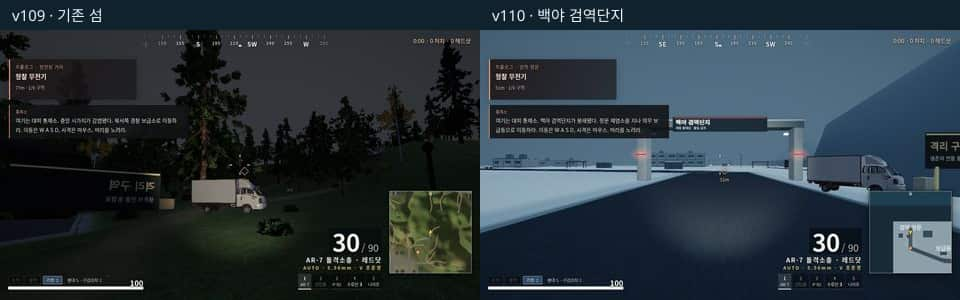
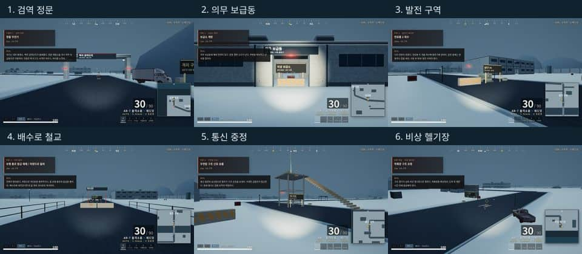

# v110 백야 검역단지

v109의 좀비 모드는 일반 섬을 그대로 생성하고 그 위에 소품·목표를 놓았다. `World.init()`의 지형·도시·충돌·미니맵을 공유했고 `mission.js`의 목표 좌표도 그 섬에 고정되어 있었다. v110은 독립된 설원 군사 연구단지로 교체한다.

## 새 맵과 동선

녹지·해변·주택 대신 검역 정문, 의무 보급동, 격리 병동, 배관·연료 설비, 폐화차, 배수로 철교, 통신 중정과 남측 비상 헬기장을 직접 만들었다. 차가운 새벽빛·눈·제설 도로·붉은 경고등을 사용한다. 지형·건물·충돌 격자·길찾기·미니맵·환경맵·목표 좌표가 모두 전용이다.

| 구역 | 좌표 X/Z | 진행 |
|---|---|---|
| 검역 정문 | -185 / -310 → -185 / -265 | 무전·정찰·첫 전투 |
| 의무 보급동 | -80 / -245 | 실제 출입구 개방·보급 확보 |
| 발전 구역 | 110 / -105 | 연료 두 곳 회수·90초 방어 |
| 연료 저장소 | -65 / -160, 200 / -190 | 운반 중 주무기 제한 유지 |
| 배수로 철교 | 110 / 0 | 차량 돌파 또는 보행 통로 |
| 통신 중정 | -110 / 130 | 실제 계단·송신탑·보스 |
| 비상 헬기장 | 100 / 300 | 구조 요청·방어·헬기 탈출 |

전용 지면은 높이 8m, 배수로 바닥은 2m다. 철교의 시각 모델과 실제 바닥은 8.2m로 맞췄다. 배수로 양 끝에 정비 경사로를 두어 추락해도 복귀할 수 있다. 착륙장 주변 건물·컨테이너는 헬기 접근 경로를 피한다.

사진은 실제 브라우저에서 1280×720, 렌더 해상도 고정 100%로 촬영했다. 전후는 각 맵의 동일한 미션 단계이며 맵 좌표와 배치는 다르다. 구역 구성 검토용 일시정지 촬영은 실제 미션 소요 시간·성능 측정과 구분한다. 원본 사진과 독립 HTML 갤러리는 저장소 밖 `/workspace/artifacts/v110-zombie-map`에 있다.

## 로딩·복귀·저장

일반 부트에서는 새 좀비 모듈·자원을 요청하지 않는다. 좀비 선택 시 `quarantine-map.js`가 기존 섬의 렌더 객체를 장면 밖에 보관하고 새 맵을 장착한다. 일반 선택 시 같은 섬 객체·충돌·미니맵·조명 참조를 복원한다. 반복 진입은 전용 모델·텍스처를 재사용한다. 품질을 바꿔도 섬의 풀·나무가 새 맵에 다시 생기지 않는다.

새 맵은 `lz_zombie_save_v110_whiteout`·`lz_zombie_records_v110_whiteout`을 사용한다. 이전 섬의 체크포인트·최고 기록은 삭제하지 않고 분리한다. 기존 업적은 유지한다. 일반과 좀비를 번갈아 선택할 때와 일반 경기 실제 재진입을 브라우저 검사에 포함했다.

## 에셋과 구성 비용

| 항목 | 값 |
|---|---:|
| 건물 | 18동 |
| 배치 인스턴스 | 1,158개 |
| 전용 정적 충돌 상자 | 828개 |
| 건축 재질·종류 배치 | 48개 |
| 건축 원본 모듈 삼각형 합계 | 10,036개 |
| meshopt 건축 GLB | 243,784B |
| 배치·6구역·경로 포함 새 맵 자원 | 424,290B |
| 새 길찾기 격자 | 1,440,000칸 |
| 새 gzip 길찾기 캐시 | 9,507B |
| 기존 섬용 길찾기 캐시 | 3,315,425B, 보관하되 새 미션에서 요청하지 않음 |
| 일반 공통 JS 원문 증가 | 1,241B |

배치의 정적 충돌과 게임 중 문·계단·차량 등 동적 충돌은 구분한다. 배치 수나 삼각형 원본 합계는 화면의 실제 그리기 호출 수가 아니다. 재질·종류별 인스턴싱과 거리·프러스텀 컬링, 품질별 눈 입자 수 조절을 사용한다. 추가 경고등은 발광 재질이며 광원 수를 늘리지 않는다.

건축·설비는 Blender에서 직접 제작하고 meshopt로 압축했다. 위치·법선·UV를 Float32로 복원한 뒤 변환·병합해 양자화 정수 속성의 치수 손실을 피한다. 눈·제설 얼룩·표지판·미니맵은 직접 생성한다. 신규 외부 다운로드는 없다. 새 자원은 LAST ZONE 프로젝트 제작 CC0-1.0이며 제작 파일·출처는 [patch.json](../patch.json)과 [제작 도구](../tools/zombies/README.md)에 기록했다. 기존 좀비·총기·차량·음향은 원래 크레딧을 유지한다.

## 검사

최종 전체 검사와 실제 미션 결과는 아래에 기록한다. 새 `check-zombie-map.cjs`는 섬 객체 분리, 네 품질 단계, 독립 지형·충돌·미니맵, 모든 목표 경로, 철교 높이, 이전 저장 분리, 헬기 접근 공간, 일반 복원과 반복 재사용을 검사한다. 기존 장전 관통의 작동 중 3mm·복귀 10mm 기준은 변경하지 않는다.

전체 실행과 원본 조준 재검사를 연결한 최종 결과는 64개 중 64개 통과다. 전체 실행 명령은 `CHECK_OUT=/workspace/artifacts/v110-zombie-map/full-checks npm run check`이며 [원시 결과 요약](validation/v110-map-checks.json)에 명령·결과·로그 경로를 남겼다. 첫 실패 기록은 삭제하지 않고 재검사 결과와 함께 보관한다.

첫 전체 실행은 63개 통과·조준 1개 실패였다. `check-aim.cjs`가 100m 실사격 직전 카메라 광선 불일치를 기록했고, 같은 원본 도구를 변경 없이 다시 실행해 92.9초에 통과했다. 10·50·100m 실제 사격과 30종 총기의 조준·반동·장전 검사가 모두 통과했다. 최초 불일치의 원인은 확정하지 못했다. 최종 표는 전체 실행과 이 재검사 결과를 연결하며, JSON의 `firstAttempt`에 최초 실패를 보존한다.

### 실제 미션

감염 구역 난이도로 실제 탈출했다. 위치 순간 이동·무적·목표/타이머 건너뛰기·중도 일시정지를 사용하지 않는다. 체크포인트 재시작 1회, 실제 화면 31장, 게임 시계 16:14, 벽시계 16:17를 기록했다. 단계 시간에는 재시도한 구간도 포함한다. 신호 송출 후 검사 조종사가 계단 주변을 약 1분 반복한 구간도 포함한다. 실제 자동 우회로 보스를 처치하고 계속 진행했으며, 실행 중 조종 코드와 게임 규칙은 변경하지 않았다. 초보자 체감 시간은 별도 사용자 시험이 필요하다.

| 단계 | 소요 시간 |
|---|---:|
| 검역 정문 | 0:20 |
| 의무 보급동 | 0:48 |
| 연료·발전기 | 4:49 |
| 배수로 철교 | 1:00 |
| 통신탑·보스 | 6:01 |
| 비상 헬기장 | 3:16 |

640×360·최저 품질·DRS 활성화에서 관측한 소프트웨어 GPU 결과다.

| 평균 FPS | 99백분위 ms | 하위 1% FPS | 50ms 초과 프레임 | JS 힙 MiB | 렌더러/GPU RSS MiB |
|---:|---:|---:|---:|---:|---:|
| 6.28 | 300.00 | 2.83 | 6027 | 554.54 | 1726.83 / 2030.42 |

렌더러: `ANGLE (Google, Vulkan 1.3.0 (SwiftShader Device (Subzero) (0x0000C0DE)), SwiftShader driver)`. 소프트웨어 GPU 수치는 실제 중간 사양 PC나 갤럭시 S24 FE 성능으로 해석할 수 없다. 이번 소프트웨어 GPU 실행은 60FPS·99백분위 33ms 이하·50ms 초과 0개 목표에 미달했다. 원시 보고서의 `performanceTargets`에도 별도로 기록했다. 실제 하드웨어 GPU 성능 인증은 이번 환경에서 하지 못했다.

| 구역 전환 | 전후 1.5초 최대 프레임 ms |
|---|---:|
| 검역 정문 | 666.70 |
| 의무 보급동 | 233.30 |
| 연료·발전기 | 333.40 |
| 배수로 철교 | 200.00 |
| 통신탑·보스 | 183.40 |
| 비상 헬기장 | 566.70 |

게임 코드·자원 지문: `ad469ce924d276b2e8f04bb0ccbd5726b4fa0d14e1fce7cf4e2095107de49451`. 최종 버전 파일을 포함해 측정한 코드와 최종 커밋 파일이 같다.

### 전체 결과

| 검사 | 결과 | 초 | 이유 |
|---|---|---:|---|
| check-aim.cjs | 통과 | 92.9 | 오류 없음 |
| check-air-hud.cjs | 통과 | 27.1 | 오류 없음 |
| check-air-visibility.cjs | 통과 | 29.3 | 오류 없음 |
| check-airdrop.cjs | 통과 | 42.3 | 오류 없음 |
| check-artifact-paths.cjs | 통과 | 0.1 | 오류 없음 |
| check-attachments.cjs | 통과 | 45.9 | 오류 없음 |
| check-auto-quality.cjs | 통과 | 37.7 | 오류 없음 |
| check-bundled-viewmodels.cjs | 통과 | 140.2 | 오류 없음 |
| check-cabin-instruments.cjs | 통과 | 31.4 | 오류 없음 |
| check-cabin-model.cjs | 통과 | 29.8 | 오류 없음 |
| check-cabin-mounts.cjs | 통과 | 30.3 | 오류 없음 |
| check-cabin-steering.cjs | 통과 | 30.1 | 오류 없음 |
| check-classic-hands.cjs | 통과 | 57.8 | 오류 없음 |
| check-clearance.cjs | 통과 | 7.1 | 오류 없음 |
| check-combat-environment.cjs | 통과 | 47.6 | 오류 없음 |
| check-combat.cjs | 통과 | 61.2 | 오류 없음 |
| check-driving-controls.cjs | 통과 | 31.5 | 오류 없음 |
| check-driving-input.cjs | 통과 | 29.2 | 오류 없음 |
| check-expanded-motion.cjs | 통과 | 37.9 | 오류 없음 |
| check-fire-flipbook.cjs | 통과 | 66.7 | 오류 없음 |
| check-gameplay-polish.cjs | 통과 | 51.3 | 오류 없음 |
| check-glock-import.mjs | 통과 | 0.5 | 오류 없음 |
| check-graphics-recovery.cjs | 통과 | 49.1 | 오류 없음 |
| check-hand-poses.cjs | 통과 | 151.5 | 오류 없음 |
| check-knife-motions.cjs | 통과 | 60.7 | 오류 없음 |
| check-knife-touch.cjs | 통과 | 27.1 | 오류 없음 |
| check-knives.cjs | 통과 | 63.8 | 오류 없음 |
| check-live-session.cjs | 통과 | 144 | 오류 없음 |
| check-m4-model.mjs | 통과 | 0.9 | 오류 없음 |
| check-map-drive.cjs | 통과 | 44 | 오류 없음 |
| check-map-hydrology.cjs | 통과 | 6.5 | 오류 없음 |
| check-mobile-models.cjs | 통과 | 0.1 | 오류 없음 |
| check-mobile-scene.cjs | 통과 | 130.2 | 오류 없음 |
| check-mobile-stability.cjs | 통과 | 161.4 | 오류 없음 |
| check-native-reticle.cjs | 통과 | 38.1 | 오류 없음 |
| check-original-weapon-audio.cjs | 통과 | 2.9 | 오류 없음 |
| check-patch-people.cjs | 통과 | 110.7 | 오류 없음 |
| check-plane-model.cjs | 통과 | 36.8 | 오류 없음 |
| check-primary-scopes.cjs | 통과 | 27.6 | 오류 없음 |
| check-quality-performance.cjs | 통과 | 62 | 오류 없음 |
| check-reloads.cjs | 통과 | 47.6 | 오류 없음 |
| check-render-clarity.cjs | 통과 | 137.7 | 오류 없음 |
| check-render-prep.cjs | 통과 | 70.2 | 오류 없음 |
| check-scope-models.mjs | 통과 | 1.6 | 오류 없음 |
| check-session-polish.cjs | 통과 | 47 | 오류 없음 |
| check-shot-hearing.cjs | 통과 | 31.2 | 오류 없음 |
| check-smoke-trail.cjs | 통과 | 28.3 | 오류 없음 |
| check-spectator-prep.cjs | 통과 | 31.6 | 오류 없음 |
| check-startup.cjs | 통과 | 48.4 | 오류 없음 |
| check-throwable-motion.cjs | 통과 | 34.2 | 오류 없음 |
| check-training-range.cjs | 통과 | 91.7 | 오류 없음 |
| check-validation-reports.cjs | 통과 | 0 | 오류 없음 |
| check-vehicle-cabin.cjs | 통과 | 35.8 | 오류 없음 |
| check-vehicle-physics.cjs | 통과 | 34.3 | 오류 없음 |
| check-vehicle-throwable-vfx.cjs | 통과 | 36.2 | 오류 없음 |
| check-vehicle-tuning.cjs | 통과 | 31.8 | 오류 없음 |
| check-vehicle-wheels.cjs | 통과 | 28.5 | 오류 없음 |
| check-weapon-audio.cjs | 통과 | 43.4 | 오류 없음 |
| check-weapon-catalog.cjs | 통과 | 86.8 | 오류 없음 |
| check-weapon-surface.cjs | 통과 | 44.4 | 오류 없음 |
| check-zombie-ai.cjs | 통과 | 47.7 | 오류 없음 |
| check-zombie-map.cjs | 통과 | 50 | 오류 없음 |
| check-zombie-mode.cjs | 통과 | 106.2 | 오류 없음 |
| check-zombie-perf.cjs | 통과 | 1016.2 | 오류 없음 |

기존 검증 미디어·Git 히스토리를 정리하지 않았다. 저장소에는 작은 JPG 두 장과 문서·요약만 추가하며, 전체 미션 사진·프레임·메모리·입력 추적은 저장소 밖에 둔다.

## 일반 모드 실시간 검사

훈련장과 40명 경기(수송기 → 자유낙하 → 낙하산 → 착지)를 일시정지 없이 각각 30초 이상 실행했다. 아래 값은 SwiftShader 소프트웨어 GPU에서의 관측치다. 준비 호출 시간은 로딩 화면을 포함한 비동기 준비 시간이며, 그 전체가 메인 스레드 정지 시간이라는 뜻은 아니다.

| 구간 | FPS | 99백분위 ms | JS 힙·버퍼 합 MiB | 렌더러 RSS MiB | 준비 호출 초 | 무기 준비 초 | 첫 플레이 프레임 지연 ms |
|---|---:|---:|---:|---:|---:|---:|---:|
| 훈련장 | 4.55 | 316.70 | 478.63 | 1550.96 | 13.37 | 8.97 | 35.00 |
| 40명 경기 | 4.12 | 566.70 | 466.14 | 1530.25 | 12.65 | 8.32 | 37.90 |

프레임·메모리 원시 기록은 `full-checks/check-live-session/report.json`에 있다. 이 값은 휴대폰이나 실제 PC GPU의 FPS 인증이 아니다.
