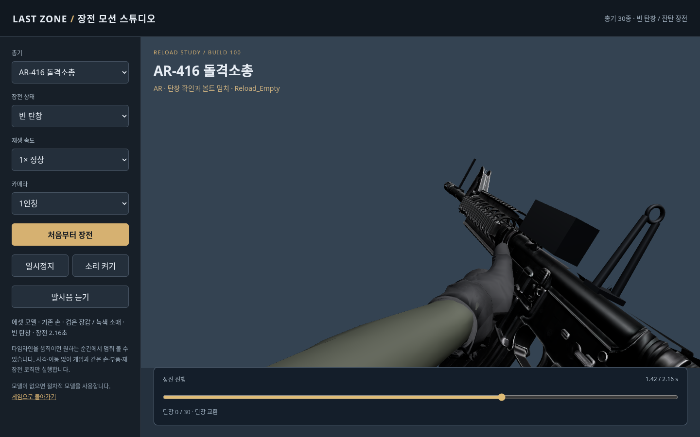

# v100 기존 검은 장갑·녹색 소매

사용자가 확인한 기존 손은 BarcodeGames M4의 검은 전술 장갑과 녹색 소매입니다. v99 `b6c293e`의 신규 총기 15종 조준·장전을 유지하며 같은 모델을 연결했습니다.

## 확인과 변경

- v99 게임에서는 신규 15종에 M4 손을 사용했지만, 독립 장전 화면은 `real-arms.js`·`SkeletonUtils`·M4 원본을 불러오지 않아 절차적 손을 표시했습니다. 이제 장전 화면도 같은 원본 형상·텍스처·색과 `RealArms`의 손목·손가락 구동기를 사용합니다. 권총 손가락 기준 자세도 게임과 같이 기존 Glock 대기 자세에서 가져옵니다.
- 신규 총기의 손 선택은 총기 목록에서 결정합니다. 모션 확장 모듈이 없거나 실사 팔 설정이 꺼져 있어도 이 15종에는 기존 장갑·소매를 유지합니다. 총기별 접촉 보정과 공유 스킨은 유지합니다.
- 기본 손 비교는 `tools/reloads.html?arms=procedural`, 선택형 Patch 팔은 `?arms=patch`로 유지합니다. 손 원본 로드에 실패하면 기본 손으로 장전을 계속하며 상태에 표시합니다.
- 새 손 에셋이나 게임의 추가 다운로드를 만들지 않았습니다. [기존 모델 출처](../../assets/models/viewmodels/CREDITS.md)의 M4·Glock 파일을 재사용합니다.

## 실제 렌더

[게임의 손 리그](v100/game-normal.png) · [장갑·소매 확대](v100/game-detail.png) · [장전 화면](v100/studio-ar416.png)



위 그림은 브라우저의 실제 1인칭 모델을 렌더링한 화면입니다. 확대 그림은 확인용 카메라를 손 가까이 옮긴 화면이며, 인게임 시야각은 바꾸지 않았습니다.

## 검증

Chromium / Three.js r160 / SwiftShader에서 확인했습니다.

- [손 모델 연결 검사](v100/classic-hands.json): 게임의 신규 15종과 장전 화면의 빈 총·잔탄 30개 조합에서 모델 표시, 기본 손 숨김, 유효한 변환, 장전 완료를 확인했습니다. 원본과 위치·법선·UV 버퍼의 해시 및 두 재질(`Hand_D`, `Glove_D`)이 일치합니다. 텍스처 로딩과 기존 장갑·소매 색 셰이더도 확인합니다. 기본 손 비교와 M4 파일 404 대체 경로를 통과했습니다.
- [게임의 조준·장전 검사](v100/motion-checks.json): 15종 × 빈 총/잔탄 × 30/60/144FPS의 90개 조합과 무기 선택 순서 검사를 통과했습니다. 기존 조준 광축·탄약 보존·손목 연속성·작동부를 확인했습니다.
- [기존 장전 검사](v100/reloads.log): 총기 30종의 장전 60개, 팔 동작 20,857프레임, 탄약·소리 720개 사례를 통과했습니다.

추가로 실행한 `check-clearance.cjs`는 통과하지 않았습니다. V-45·CX-9·SM-45·AR-416·MS-56·SR-25의 잔탄 장전 복귀에서 팔뚝의 근사 충돌 영역이 10mm 기준을 넘는 14항목입니다. v99 `b6c293e`의 변경 전 장전 화면을 그대로 재생한 180개 조합·32,334프레임의 결과와 모든 측정값이 일치했습니다. 이번 모델 연결로 추가된 실패는 없으나 기존 팔뚝 간격 문제는 남아 있습니다. [전후 비교 기록](v100/clearance-comparison.json) · [전체 측정](v100/clearance.json)

```bash
REPORT=/tmp/classic-hands.json SHOTS=/tmp/classic-hands node tools/check-classic-hands.cjs
REPORT=/tmp/motion-checks.json node tools/check-expanded-motion.cjs
node tools/check-reloads.cjs
```

`NODE_PATH`, `THREE_DIR`, `CHROME_BIN`은 기존 브라우저 검사와 같이 설정합니다. 실제 휴대폰 FPS 측정은 이번 손 모델 연결 검사에 포함하지 않습니다.
