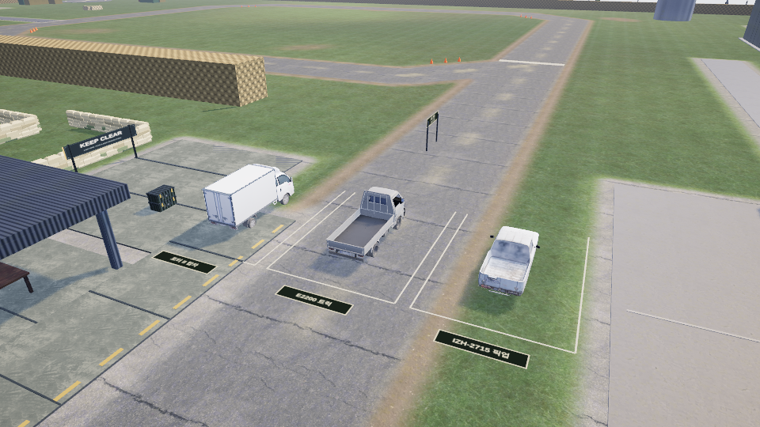

# v102 차량 물리와 훈련장 전체 차량

기준: v101 `63e9437cbaf8c177d7b448ed3b36a5a0005103ca`. 기존 경량 차량 시뮬레이션의 접지·충돌·공중 관성을 개선했습니다.

## 확인한 원인

- 벽에 닿으면 차의 전진·옆 속도를 함께 감쇠했습니다. 정면 충돌 뒤에도 큰 전진 속도가 남았고, 약하게 옆으로 스칠 때는 진행 속도까지 급격히 사라졌습니다. 피해는 충돌 방향이 아닌 전체 속도로 계산했습니다.
- `grounded` 하나로 구동·제동·조향·접지력을 결정해 바퀴 둘만 닿아도 네 바퀴 접지력을 사용했습니다. 지면에서 떨어진 바퀴도 실제 지상 이동 거리로 굴렀습니다.
- 내리막 중력은 앞쪽 2.2m 지형으로 계산했습니다. 바퀴가 아직 평지에 있어도 앞의 낮은 턱 때문에 속도가 늘어나는 재현이 나왔습니다.
- 공중에서는 조향 각속도를 즉시 0으로 만들어 도약 직전의 회전이 멈췄습니다.
- 하차한 차는 차체 앞뒤가 아닌 중앙의 작은 충돌 범위만 검사했습니다. 충돌 높이도 1.7m, 주차 상자는 최대 1.9m로 고정해 높은 차체에 맞지 않았습니다.
- 실제 차량 목록은 3종인데 훈련장은 IZH와 E2200 두 종류를 직접 지정하고 있었습니다.

## 변경

- 차체의 앞·중간·뒤 접촉에서 벽의 법선 방향 운동을 제거하고 작은 반동만 남깁니다. 접선 방향은 약한 마찰로 유지합니다. 정면 충돌 직후 속도가 줄어 후진 입력으로 빠져나올 수 있습니다. 모서리나 상자 안에서 시작하는 접촉도 가장 가까운 면으로 해결합니다.
- 피해는 실제 벽 안쪽으로 들어가는 속도로 계산합니다. 빠르게 달리더라도 약한 측면 접촉에는 정면 충돌 피해를 주지 않습니다.
- 기존 서스펜션 위치 계산에서 바퀴별 접지를 측정합니다. 접지 수에 비례해 구동·제동·옆 접지력·조향 반응을 줄입니다. 공중 바퀴는 이전 굴림 관성을 유지합니다.
- 내리막 힘은 실제 바퀴로 정한 차체 기울기를 사용합니다. 전방 지형 검색은 가파른 오르막 차단에 유지합니다.
- 지상 조향은 각속도로 부드럽게 따라가며, 도약 시에는 기존 각속도가 감쇠하며 이어집니다. 공중의 핸들·가속 입력은 차체를 임의로 돌리거나 가속하지 않습니다.
- 빈 차도 동일한 차체 충돌과 최대 1/120초 간격의 수평·수직 계산을 사용합니다. 공중에서는 주차 감속을 적용하지 않습니다. 움직이는 차와 주차 차량 모두 실제 모델 높이를 사용합니다.

## 훈련장

사격대 뒤 운전 코스 진입로에 **포터 II 탑차·E2200 트럭·IZH-2715 픽업**을 한 대씩 배치했습니다. 현재 차량 목록을 순회하므로 차종을 별도로 중복 관리하지 않습니다. 주차 칸 간격은 6.2m로 탑승·출차와 재생성에 여유를 두었습니다.

[실제 훈련장 배치 화면](v102/training-vehicles.png)



차종 이름을 바닥 표지와 F키 탑승 안내에 표시합니다. 파괴 후 기존 재생성 규칙으로 같은 차종이 원래 칸에 돌아옵니다. 주차선 9개는 인스턴스 드로 하나로 그리고, 종료 시 인스턴스 버퍼와 표지 재질·텍스처를 정리합니다. 기존에 로딩하던 차량 에셋을 재사용하며 새 차량 파일을 추가하지 않았습니다.

## 전후 수치

동일한 고정 바닥·벽에서 실제 IZH 모델과 플레이어/봇 공용 물리를 60FPS 간격으로 실행한 결과입니다. 렌더 성능이나 실제 휴대폰 FPS 측정이 아닙니다.

| 조건 | v101 | v102 |
|---|---:|---:|
| 정면 충돌 직후 속도 크기 | 15.84m/s 전진 | 0.41m/s의 작은 반동 |
| 충돌 직후 0.5초간 후진한 거리 | 0.027m | 0.967m |
| 벽을 0.5초 스친 뒤 벽과 평행한 속도 | 1.69m/s | 13.37m/s |
| 같은 측면 접촉의 차량 내구도 손실 | 42.05 | 0 |
| 두 바퀴만 접지한 상태에서 1/60초 기동 시 속도 증가 | 0.189m/s | 0.079m/s |

포터와 E2200에서도 같은 경향을 확인했습니다. [변경 전 재현](v102/baseline-checks.json) · [변경 후 측정](v102/physics-checks.json)

## 검증

Chromium / Three.js r160 / SwiftShader에서 검사했습니다.

- [차량 물리](v102/physics-checks.json): 실제 3종과 대체 차량의 정면·측면 충돌, 후진, 부분 접지, 절벽 접근, 공중 관성, 높이별 차체 충돌, 하차 차량의 범퍼 충돌 등 44개 조건을 통과했습니다. 정면·측면 충돌은 30/60/144FPS로 검사했습니다.
- 실제 키보드의 F·W 입력으로 3종 탑승·주행·하차를 훈련장 재입장 3회에 걸쳐 총 9번 확인했습니다. 매번 3종·주차 칸 3개·충돌 상자 3개가 있고 파괴 후 차종·내구도·타이어가 복구됨을 확인했습니다.
- [차량 모델 누락 경로](v102/fallback-checks.json): GLB 요청을 모두 404로 만든 상태에서도 같은 물리 44개 조건과 탑승·주행·하차·재생성·재입장을 통과했습니다.
- [기존 낙차·다리 검사](v102/map-drive-checks.json): 고저차 주행 24개 조건, 공중 하차 후 착지, 실제 다리 3곳을 통과했습니다. 기존 물·집·나무 배치 검사도 통과했습니다.
- [기존 바퀴 검사](v102/wheel-checks.json): 실제 3종·대체 차량 × 총기 30종의 타이어 피격 120개 조합, 굴림·후진·애커먼 조향·핸드브레이크·파손·재생성을 확인했습니다. 반복 생성/삭제 뒤 장면 객체·지오메트리·텍스처 증가가 0이었습니다.
- [기존 훈련장 검사](v102/training-range.log): 키 바인딩, 전리품·사격·엄폐·통로·재입장·경사면 주행과 추적 카메라 24개 조건을 통과했습니다.

```bash
REPORT=/tmp/physics.json node tools/check-vehicle-physics.cjs
VEHICLE_FALLBACK=1 REPORT=/tmp/fallback.json node tools/check-vehicle-physics.cjs
REPORT=/tmp/map-drive.json node tools/check-map-drive.cjs
REPORT=/tmp/wheels.json node tools/check-vehicle-wheels.cjs
node tools/check-training-range.cjs
node tools/capture-training-vehicles.cjs
```

기존 브라우저 검사와 같이 `NODE_PATH`, `THREE_DIR`, `CHROME_BIN`을 설정합니다.
