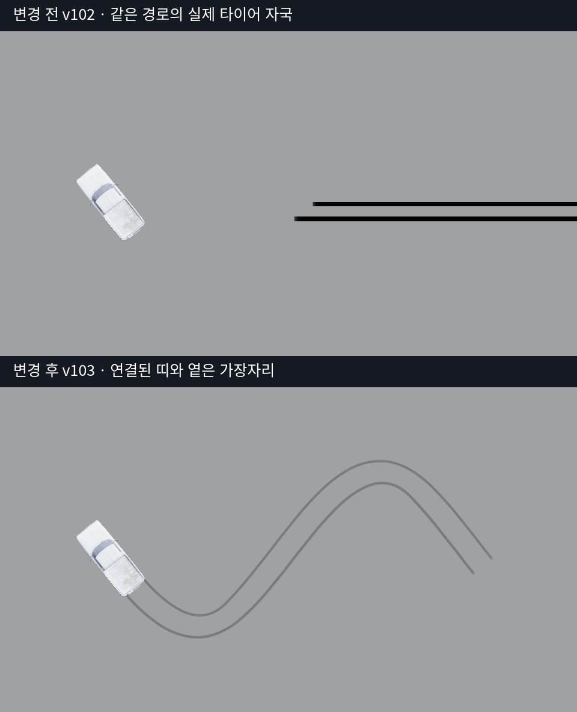

# v103 Space 전용 드리프트·Shift 가속·타이어 자국

기준: v102 `6a98b65e38f6486cb21aeef7b8c732b841a81834`. 세 차종과 모델 누락 시의 대체 차량에 공통 적용합니다.

## 확인한 원인

- 드리프트 판정은 옆 속도·전진 속도·접지만 확인했습니다. Space를 누르지 않아도 일반 조향으로 옆 속도가 커지면 연기·자국·소리가 발생했습니다. 일반 조향에도 미끄러짐을 늘리는 추가 회전이 있었습니다.
- 플레이어 운전에서 Shift 입력을 물리에 전달하지 않아 가속할 수 없었습니다.
- 기존 자국은 가장자리가 단단한 사각형 700개를 겹쳐 찍었습니다. `skidMark(last, _o)`가 전달받은 끝점과 같은 임시 벡터 `_o`를 중점 계산에 다시 사용해 끝점을 덮어썼습니다. 이후 방향 계산과 다음 시작점 갱신에도 잘못된 위치가 남았습니다. 동일한 곡선 경로에서 자국이 한곳에 길게 겹치는 현상을 실제 렌더로 재현했습니다.

## 변경

- Space를 누른 상태에서 접지·속도·옆 미끄러짐 조건을 만족해야 드리프트가 됩니다. 키를 놓으면 새 자국·타이어 연기·소리를 멈추고 접지력을 부드럽게 복귀시킵니다. 일반 주행은 접지력을 높이고 과도한 회전을 제한합니다.
- 전진 중 왼쪽 또는 오른쪽 Shift를 누르면 구동력을 35% 높이고 최고속도를 21 → 28m/s로 올립니다. Shift를 놓으면 일반 제한까지 서서히 감속합니다. Space 제동이 우선하며, 정지 상태의 Shift 단독 입력·후진·공중·깊은 물에서는 추가 가속하지 않습니다. 기존 내구도·타이어 파손에 따른 제한은 유지합니다.
- 실제 뒷바퀴 위치에서 자국을 냅니다. 각 띠의 끝점과 다음 띠의 시작점을 공유해 곡선의 틈·겹침을 없앴습니다. 폭 방향 가장자리와 시작·끝은 옅게 처리하고, 생성 후 8~12초 사이에 서서히 사라집니다. 공중 바퀴·먼 차량·드리프트 해제·큰 위치 이동에서는 경로를 끊습니다.
- 자국은 텍스처 없이 한 메시·고정 4,096구간 버퍼를 재사용합니다. 구간이 다 차면 오래된 위치를 덮어쓰며, 모두 오래되면 그리기를 비웁니다. GPU에 올리는 지오메트리 버퍼는 약 0.48MiB이고 별도 렌더 타깃은 없습니다.
- 모바일은 탑승 중 기존 장전 버튼을 **가속**, 점프 버튼을 **드리프트**로 표시합니다. 조이스틱의 도보 자동 달리기가 차량 가속으로 이어지지 않게 했습니다. 하차하면 장전·점프 표시로 복귀합니다.

## 전후 화면



위는 v102, 아래는 v103입니다. 실제 게임의 `Vehicles.tires()`에 동일한 곡선 바퀴 경로를 공급하고 같은 차량·바닥·카메라로 확대한 화면입니다. 운전 성능이나 실제 플레이 FPS 측정이 아닌 자국 렌더 비교입니다.

[변경 전 원본](v103/skids-before.png) · [변경 후 원본](v103/skids-after.png) · [GPU 변경 전](v103/skids-before.json) · [GPU 변경 후](v103/skids-after.json)

실제 GPU 픽셀 검사에서도 변경 전 자국은 시간이 지나도 그대로 남았고, 변경 후는 10초 추가 경과 시 어두운 픽셀의 합이 117,304 → 11,815로 줄고 13초 추가 경과 시 0이 됐습니다. 브라우저 셰이더 오류는 없었습니다.

## 운전 수치

평지의 실제 IZH 차량에서 60FPS 간격으로 같은 물리를 실행한 결과입니다. [변경 전 재현](v103/baseline-controls.json) · [변경 후 검사](v103/driving-controls.json)

| 조건 | v102 | v103 |
|---|---:|---:|
| W+A만 3초: 드리프트 발생 | 발생 | 없음 |
| 같은 조건의 최대 옆 속도 | 5.51m/s | 0.52m/s |
| 같은 조건의 자국 생성 수 | 637 | 0 |
| 일반 전진 최고속도 | 75.6km/h | 75.6km/h |
| Shift 전진 최고속도 | 75.6km/h | 100.8km/h |
| 가속 중 Shift 해제 1프레임 후 | 75.6km/h | 100.56km/h |

Space 드리프트·뒷바퀴 잠김·해제 후 접지 복귀도 모두 통과했습니다. 30·60·144FPS는 물리 호출 간격이며, 실제 휴대폰 FPS를 뜻하지 않습니다.

## 검증

Chromium / Three.js r160 / SwiftShader에서 확인했습니다. 모바일 검사는 S24 FE의 Android Chrome 화면·터치 조건을 사용한 에뮬레이션이며 실기기 성능 측정이 아닙니다.

- [운전 공통 검사](v103/driving-controls.json): 실제 3종과 대체 차량 × 30·60·144FPS × 일반 조향·Space·Shift, 총 36조건. 입력 우선순위·후진·수면·파손 제한과 공중 무가속도 통과했습니다. 자국 연결점 오차 0, 6,443구간 생성 뒤 고정 4,096구간 유지, 버퍼 재사용·유한 좌표·시간 만료를 확인했습니다.
- [실제 키보드](v103/keyboard-input.json): 일반 조향, Space 드리프트·해제, 양쪽 Shift, 가속 해제와 Space 우선순위를 확인했습니다. 플레이어의 실제 운전 경로와 HUD를 사용합니다.
- [모바일 다중 터치](v103/touch-input.json): Chrome의 실제 터치 이벤트로 조이스틱 단독 일반 주행, 두 번째 손가락 가속, 세 번째 손가락 드리프트, 각각의 버튼 해제, 전체 터치 취소와 하차 후 장전 버튼 복귀를 확인했습니다.
- [기존 차량 물리](v103/vehicle-physics.json): 충돌·후진·부분 접지·절벽 접근·공중 관성·차체 높이 등 44조건과 훈련장 3종의 탑승·주행·하차·재생성·재입장을 통과했습니다.
- [기존 바퀴 검사](v103/wheel-checks.json): 실제 3종·대체 차량 × 총기 30종의 타이어 피격 120조합, 굴림·조향·뒷바퀴 잠김·파손·재생성을 통과했습니다. 반복 생성/삭제 뒤 장면 객체·지오메트리·텍스처 증가가 0입니다.
- [기존 고저차 주행](v103/map-drive.json): 24개 고저차 조건·공중 하차 착지·실제 다리 3곳과 기존 맵 배치를 통과했습니다.
- [기존 모바일 검사](v103/mobile-checks.json): 세로·가로 전환, 터치 사격·신규 15종 장전·투척 4종·칼, 스코프·품질 4단계·고정 해상도, WebGL 컨텍스트 손실과 복구, 재입장 및 40명 매치 착지를 통과했습니다. 페이지 충돌·브라우저 오류가 없었습니다.

```bash
REPORT=/tmp/driving.json node tools/check-driving-controls.cjs
REPORT=/tmp/keyboard.json node tools/check-driving-input.cjs
DRIVE_MOBILE=1 REPORT=/tmp/touch.json node tools/check-driving-input.cjs
SHOTS=/tmp/skids-before.png node tools/capture-skid-trails.cjs before
SHOTS=/tmp/skids-after.png node tools/capture-skid-trails.cjs after
REPORT=/tmp/physics.json node tools/check-vehicle-physics.cjs
REPORT=/tmp/wheels.json node tools/check-vehicle-wheels.cjs
REPORT=/tmp/map-drive.json node tools/check-map-drive.cjs
MOBILE_SHOTS=/tmp/mobile node tools/check-mobile-stability.cjs
```

기존 브라우저 검사와 같이 `NODE_PATH`, `THREE_DIR`, `CHROME_BIN`을 설정합니다. 변경 전 화면은 기준 커밋이 로컬 Git에 있어야 재현할 수 있습니다.
