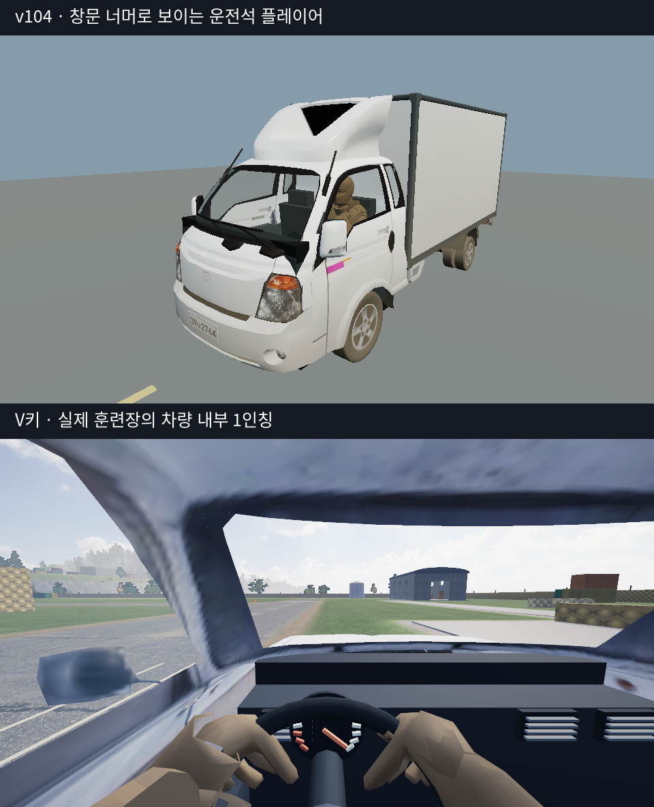

# v104 차량 운전자와 내부 1인칭 시점

기준: v103 `118ceec7ce0dd63f9d1d22bcc6db10e72dd620dc`. 포터 II 탑차·E2200 트럭·IZH-2715 픽업과 모델 누락 시의 기본 차량에 적용했습니다.

## 확인한 원인

- `Game.syncModels()`가 플레이어의 차량 탑승과 봇의 `inVehicle` 상태에서 캐릭터를 모두 숨겼습니다. 차량에 운전석 위치나 운전 자세를 연결하는 경로도 없었습니다.
- `Vehicles.drive()`에는 외부 추적 카메라만 있었습니다. 운전 중에는 지상 조작 함수가 일찍 반환해 V키의 차량 동작도 없었습니다.
- 원본 포터 유리는 불투명도 약 0.88, E2200은 0.7이었습니다. IZH는 창문까지 차체와 같은 불투명 재질·메시를 사용했습니다. 원본 모델과 내부 렌더를 확인하니 E2200에는 실내가 있지만 포터와 IZH는 보완이 필요했습니다.
- 내부 시점 구현 후 실제 렌더에서 손·팔이 사라지는 현상을 추가로 확인했습니다. 군인 모델의 바인드 자세 경계가 가까운 내부 카메라의 시야와 겹치지 않아 몸 전체를 컬링했습니다. 내부 시점의 본인 캐릭터만 이 판정을 생략하고 외부 시점·하차 시 원래 설정으로 복귀합니다.

## 동작

- 기존 캐릭터 객체를 운전석에 앉힙니다. 무기와 낙하산은 접고, 실제 골반을 차량별 좌석 위치에 맞춥니다. 캐릭터와 카메라는 차량 메시의 위치·기울기·서스펜션 이동을 함께 따릅니다.
- 양팔은 손목 원점 대신 손바닥이 핸들 림에 닿도록 계산합니다. 좌우 손 방향과 손가락 굽힘을 구분하며 핸들 조향을 따릅니다. 실사 캐릭터의 다리는 원본 뼈 길이를 사용해 페달 위치로 맞춥니다.
- **V키**로 외부 3인칭 ↔ 내부 1인칭을 전환합니다. 내부에서 마우스·터치 드래그로 좌우와 위아래를 볼 수 있습니다. 본인의 머리는 내부 카메라를 가리지 않도록 처리하고 외부 시점에서 복구합니다.
- 운전 중 V키는 조준경을 바꾸지 않습니다. HUD와 조작법·키 설정에 차량 시점을 표시하고, 모바일에서는 기존 배율 버튼을 **시점**으로 표시합니다. 하차 시 원래 동작으로 돌아옵니다.
- 한 게임 안에서는 마지막 차량 시점을 기억하고, 새 게임은 외부 시점으로 시작합니다. 하차·게임 종료 시 카메라 근거리 범위·머리 크기·컬링·손 회전을 복구합니다.

## 차량 실내

- 포터와 E2200은 실제 유리 재질만 교체합니다. IZH는 원본의 앞·옆·뒤 창 영역을 기하학적으로 분리해 투명 유리를 적용하고, 차체의 UV·법선·흙먼지 속성을 보존합니다.
- E2200은 기존 실내를 유지하며 원본 고정 핸들 영역을 정리하고 조향 핸들을 연결했습니다. 포터와 IZH에는 좌석·대시보드·환기구·페달·핸들 축을 보완했습니다. 기본 대체 차량도 캐빈을 비우고 실내를 연결했습니다.
- 핸들은 조향을 따르고 속도계 바늘은 현재 속도를 표시합니다. 원본 GLB와 외부 에셋 파일은 바꾸지 않았습니다.

## 실제 화면



위는 동일한 게임 캐릭터를 운전석에 배치한 외부 확대 화면, 아래는 실제 훈련장의 내부 시점입니다. 외부 확대 화면은 모델과 자세를 보기 위한 별도 조명 장면이며, 아래는 게임의 렌더 경로를 사용했습니다.

[포터 내부](v104/porter-inside.png) · [E2200 내부](v104/e2200-inside.png) · [IZH 내부](v104/izh-inside.png) · [아래를 봤을 때 손과 핸들](v104/izh-hands.png) · [훈련장 원본 화면](v104/training-inside.png)

## 자원 사용

- 새로운 캐릭터를 중복 생성하지 않고 기존 플레이어·봇 모델을 사용합니다. 실내는 첫 탑승 때 만들고 차종별 지오메트리와 재질을 공유합니다. 보완 실내의 정적 부품은 메시 하나로 합치고, 핸들과 속도계 바늘만 분리했습니다.
- 실내와 유리에 새 이미지 텍스처·렌더 타깃을 추가하지 않았습니다. 창문 분리와 고정 핸들 정리는 원본 지오메트리마다 한 번 계산해 공유합니다. 먼 운전자는 90m 밖에서 생략합니다.
- 같은 차량·캐릭터의 내외부 시점을 미리 렌더한 뒤 재탑승 8회를 측정했습니다. GPU 지오메트리와 텍스처 증가가 각각 **0**이었습니다. 맵의 지연 업로드가 수치에 섞이지 않도록 이 검사는 차량과 캐릭터만 있는 장면에서 진행했습니다. [렌더·자원 기록](v104/captures.json)

## 검증

Chromium / Three.js r160 / SwiftShader에서 확인했습니다. 모바일은 Android Chrome 화면·터치 에뮬레이션으로, 휴대폰 실기기의 FPS 측정은 아닙니다.

- [키보드·좌석·시점](v104/cabin-checks.json): 실제 F키 탑승·하차, V키 전환과 길게 누르기, 운전 중 조준경 유지, 차종별 골반·손바닥·머리 위치, 경사면에서의 캐릭터·카메라 위치와 회전, 실제 GPU 렌더, 머리·컬링·손 회전 복귀, 게임 종료를 확인했습니다.
- [모바일 차량 조작](v104/cabin-mobile.json): 3종과 대체 차량에서 실제 터치의 **시점** 버튼으로 동일한 전환·복귀를 확인했습니다.
- 실사 캐릭터 4가지와 절차적 대체 캐릭터를 왼쪽·중앙·오른쪽 조향으로 검사했습니다. 손바닥이 핸들 목표를 따르는지 실제 뼈 위치로 확인했습니다. 이 결과는 위 두 기록에 포함됩니다.
- [기존 차량 물리](v104/vehicle-physics.json): 정면·측면 충돌, 후진, 부분 접지, 절벽, 공중 관성과 훈련장 3종 탑승·주행·재입장을 통과했습니다.
- [기존 바퀴](v104/wheel-checks.json): 4가지 모델 경로 × 총기 30종의 타이어 피격 120조합, 조향·굴림·파손·재생성을 통과했습니다.
- [기존 운전 조작](v104/driving-controls.json): 30·60·144FPS 호출 간격의 36조건에서 Space 드리프트·Shift 가속·해제·자국 연결을 통과했습니다.
- [기존 모바일 검사](v104/mobile-checks.json): 사격·15종 장전·4종 투척·칼·배율, 화면 회전, 품질 4단계, WebGL 손실·복구, 40명 매치 강하·착지를 통과했습니다. 개별 GPU 저장소 목록은 생략하고 합계와 결과를 보존했습니다.

```bash
REPORT=/tmp/cabin.json node tools/check-vehicle-cabin.cjs
CABIN_MOBILE=1 REPORT=/tmp/cabin-mobile.json node tools/check-vehicle-cabin.cjs
SHOTS=/tmp/cabins node tools/capture-vehicle-cabins.cjs
REPORT=/tmp/physics.json node tools/check-vehicle-physics.cjs
REPORT=/tmp/wheels.json node tools/check-vehicle-wheels.cjs
REPORT=/tmp/driving.json node tools/check-driving-controls.cjs
MOBILE_SHOTS=/tmp/mobile node tools/check-mobile-stability.cjs
```

기존 브라우저 검사와 같이 `NODE_PATH`, `THREE_DIR`, `CHROME_BIN`을 설정합니다.
