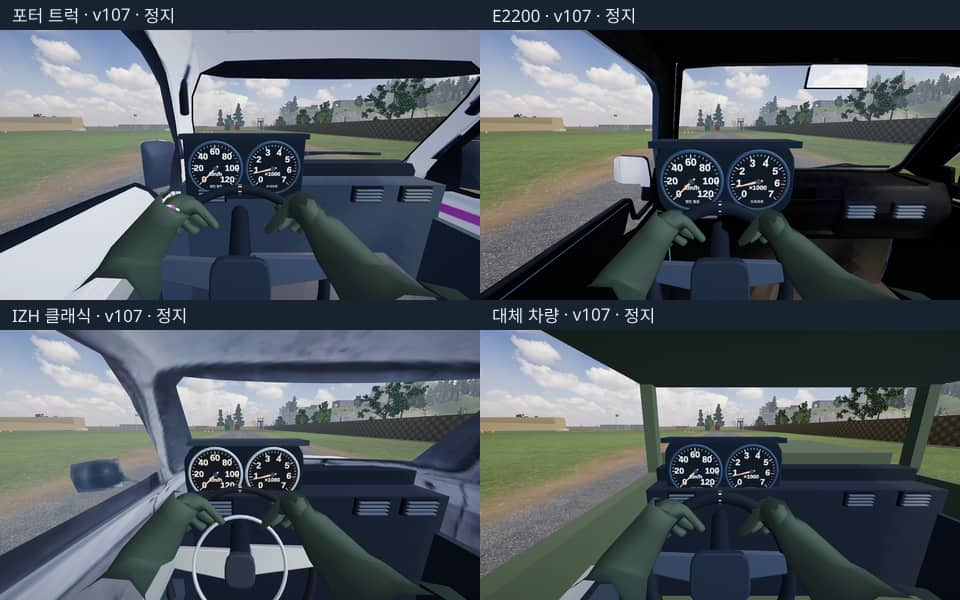

# v107 운전석 핸들·계기판

실제 A 입력은 `steer > 0`, yaw 증가, 앞바퀴 좌회전이었다. 실내만 `-(v.steer||0)*.72`로 뒤집혀 있었다. 핸들 축의 +Z가 운전자를 향하므로 음수를 제거했다. 양손 접촉점·손목이 같은 각도를 쓰며, 키보드와 모바일 스틱으로 0.5초씩 확인했다.

핸들 위치와 -0.43rad 기울기는 유지했다. 트럭의 접촉 반지름은 235mm, 나머지는 219mm이며 모델 표면과 IK가 같은 규격을 공유한다. 포터는 큰 얇은 테두리, E2200/대체 차량은 그립이 두꺼운 3개 살, IZH는 얇은 테두리·2개 살·크롬 경적 링이다. 모두 둥근 패드와 12시 표시가 있고 외부 파일을 받지 않았다.

| 차종 | 핸들 삼각형 | 림과 손바닥 접촉점 간격(최대) | 실내 그리기 호출 전 → 후 |
| --- | ---: | ---: | ---: |
| porter | 1,376 | 0.39mm | 3 → 6 |
| e2200 | 1,376 | 0.81mm | 3 → 6 |
| izh | 1,828 | 0.45mm | 3 → 6 |
| 대체 | 1,376 | 0.74mm | 3 → 6 |

계기판은 속도계(0~120km/h)와 회전계(0~7천 회전) 두 개다. `hypot(speed, lat)*3.6`으로 후진·옆 미끄러짐까지 속도에 반영한다. 기존에 변속기/RPM·연료 시뮬레이션은 없었다. RPM은 물리 시간 간격으로 속도대·가속/Shift 입력을 완만하게 추종하는 표시값이며 연료 잔량을 꾸며 내지 않았다. 체력 30% 미만은 빨간 엔진 점검등, Space는 노란 드리프트등이다.

차양·테는 기존 정적 실내 메시로 합쳤다. 숫자는 일반/고전 색상 두 아틀라스를 처음 한 번 그려 공유하고, 모바일은 처음부터 512×256으로 만든다(PC 1024×512). 밉맵·최대 16배 비등방성 필터를 쓴다. 두 바늘은 회전만 하고, 두 표시등은 한 인스턴스 메시로 상태가 바뀔 때 색만 갱신한다. 밤은 발광 강도만 바꾸며 광원은 추가하지 않았다. 차량을 제거할 때 표시등 전용 버퍼를 해제하며 공유 템플릿은 보존한다.

눈 위치를 등받이 쪽으로 12cm 조정하고 기본 내려다보기 각도를 -0.22rad로 맞췄다. 4차종·조향 -1/0/+1에서 양쪽 계기판 숫자의 투영 범위·높이와 손/테두리 가림을 검사한다. 캐릭터 5종×조향 3각도를 4차종에 적용해 손 접촉도 검사한다.

검사 환경은 로컬 Chromium/SwiftShader다. 모바일은 Chrome 터치 환경·844×390 재현이며 갤럭시 실기기 FPS 측정은 아니다. 그리기 호출은 맵·그림자·후처리를 제외한 동일한 실내 장면으로 측정했다.

촬영 도구는 실제 훈련장 코스의 같은 출발점에서 4차종을 각각 정지/A/D 고속으로 기록하고 외부 운전자·야간 장면도 남긴다. `SHOTS=/tmp/cabins node tools/capture-vehicle-cabins.cjs`, 모바일은 `CABIN_MOBILE=1`, 과거 코드는 `BASELINE=eaf46b2`를 추가한다. 렌더 해상도는 100%로 고정해 비교한다. PNG 원본과 상세 로그는 저장소 밖 `/workspace/artifacts/v107-cockpit/`에 보관하고, 아래 작은 JPG만 저장소에 남겼다.

전체 결과표와 재현 명령은 `v107-cockpit-checks.json`에 기록한다. 이 작업은 기존 v107 수정 브랜치에서 이어졌으며, `version.txt`와 `index.html` BUILD는 모두 107이다.

| 검사 | 결과 |
| --- | --- |
| check-cabin-instruments.cjs | 통과 |
| check-cabin-model.cjs | 통과 |
| check-cabin-steering.cjs | 통과 |
| check-clearance.cjs | 통과 |
| check-driving-controls.cjs | 통과 |
| check-driving-input.cjs | 통과 |
| check-mobile-scene.cjs | 통과 |
| check-validation-reports.cjs | 통과 |
| check-vehicle-cabin.cjs | 통과 |
| check-vehicle-physics.cjs | 통과 |
| check-vehicle-wheels.cjs | 통과 |
| 모바일 계기판 | 통과 |
| 모바일 조향 | 통과 |
| 모바일 다중 터치 | 통과 |
| 모바일 F/V·승하차 | 통과 |
| PC 실제 훈련장 캡처 | 통과 |
| 모바일 실제 훈련장 캡처 | 통과 |

PC와 모바일 각각 필수 12장, 외부·야간을 포함해 20장씩 촬영했다. D 고속 주행은 네 차종 모두 약 76.6km/h였고, 재탑승 8회 뒤 지오메트리·텍스처 증가는 두 환경 모두 0이었다.
