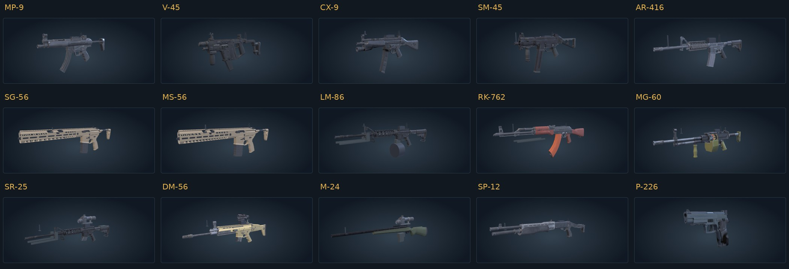
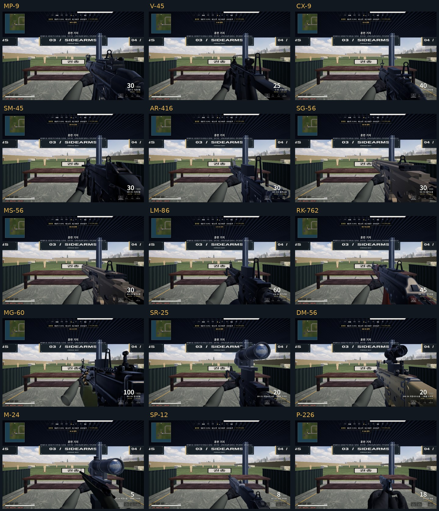
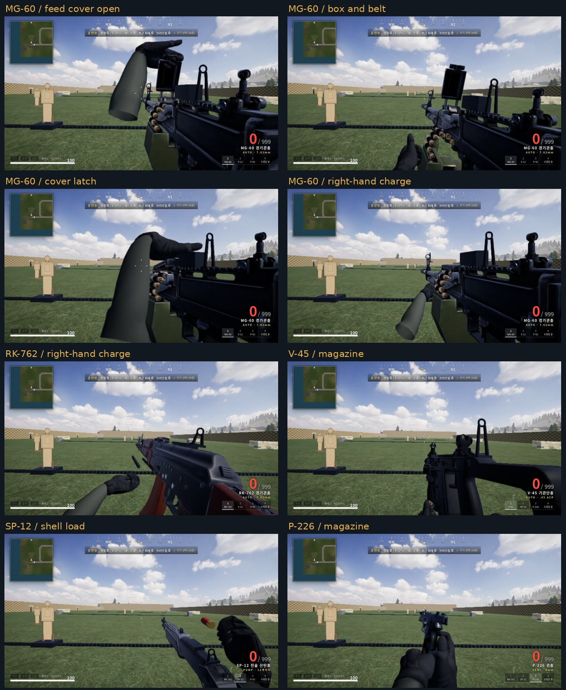

# v77 신규 총기 모델·장전 모션 검증

v76의 신규 15종을 GitHub 공개 배포본의 CC BY 4.0 모델과 계열별 수정 모델로 교체했다. 플레이어·도감·전리품·다른 캐릭터가 같은 총기 데이터를 사용한다. 모델과 곡선은 게임에 포함하며 플레이 중 외부 에셋 서비스에서 내려받지 않는다.

- [모델·애니메이션 출처, 라이선스, 수정 내역](../../assets/models/guns/EXPANSION-CREDITS.md)
- [고정 원본 URL·리비전·SHA-256·클립 대응](../../tools/guns/expansion-sources.json)
- [측정 요약과 출력 모델 SHA-256](v77-imported-weapon-checks.json)

## 적용 화면

무기 도감의 신규 15종:



실제 훈련장에서 장착한 화면:



급탄 덮개·탄통·오른손 장전과 탄창/산탄 장전:



이름이 같은 실총의 정확한 복제품을 모두 확보한 것은 아니다. MP-9/CX-9는 MP5 계열, AR-416/LM-86/SR-25는 AR 계열, SG-56/MS-56는 SIG MCX 계열, DM-56는 SCAR-L을 바탕으로 길이·탄창·역할에 맞게 수정했다. 각 원본 명칭과 변경 내용은 출처 표에 기록했다.

## 구현

- 15개 GLB를 미터 단위·방아쇠 원점·총구 −Z로 정규화했다. 최대 1K WebP와 meshopt 압축을 사용한다. MCX/R700의 원래 단색 PBR 재질에는 투영 UV와 약한 표면 질감을 추가했다.
- 실제 탄창·슬라이드·펌프·볼트·장전 손잡이를 분리하고 손 접촉점·총구·조준선·레일을 맞췄다. 조준경 받침대가 총몸에 닿게 했으며, 다른 캐릭터의 경량 총기에는 텍스처 대표색을 반영했다.
- 원본 손목·총기 곡선 18개를 60 Hz로 추출해 신규 15종의 빈 탄창/잔탄 장전 30개에 대응시켰다. 모든 총에 전용 원본 클립이 있는 것은 아니며, 호환되는 계열의 곡선을 접촉 이벤트에 맞춰 리타겟했다. 탄창·손잡이·탄약 계산은 같은 시간표를 쓴다.
- V-45·SM-45의 수직 손잡이, M-24의 탈착식 탄창과 볼트, SP-12의 펌프와 장전구, P-226의 전체 탄창 몸체를 보정했다.
- MG-60은 100발 탄띠 방식이다. 덮개 개방 → 탄통 교체 → 탄띠 → 덮개 잠금 → 빈 총이면 오른손 장전 순서로 움직인다. 덮개를 잡은 손은 회전축을 따라가며 탄띠도 탄통을 따라간다. 덮개 소리는 볼트 이벤트와 구분한다.
- RK-762는 긴 총몸에 맞게 오른팔의 기준 어깨 위치를 조정했다. 팔 길이·동적 어깨 이동 한도·손목 한도·관통 허용치는 유지했다.
- 원본 스켈레톤과 게임 리그가 달라 손·부품을 별도로 맞췄다. 원본 팔을 모든 총에 그대로 복사하는 방식은 아니다. 에셋 또는 곡선을 읽지 못하면 기본 모델/장전 경로를 사용할 수 있다.
- 여러 재질의 glTF 부품이 Three.js 그룹으로 변환되는 경우 부모의 부품 태그를 읽도록 수정했다. 두 번째 UV도 보존해 일부 모델의 AO 셰이더 오류를 해결했다. 출처는 도감에서도 확인할 수 있다.

## 검증 결과

Node 24.22.3, Three.js r160, Chromium 156/SwiftShader에서 `.github/workflows/game-regressions.yml`과 같은 13개 검사를 실행했다. 모두 통과했다.

| 검사 | 결과 |
|---|---|
| 도감·장착 | 실제 GLB/텍스처/필수 부품/곡선, 15개 고유 모델, 30종 전리품, 종류·탄약 검색, 데스크톱·휴대폰 도감 통과 |
| 손 메시 | 30종의 지향·조준·이동·달리기·사격·장전 810개 사례와 반복 60개 통과 |
| 장전 리그 | 빈 탄창/잔탄 60개 사례·20,857프레임. 최대 접촉 오차 12.71 mm, 손목 86.38°. 연속성·어깨·팔꿈치·탄창 추종 통과 |
| 팔/총몸 간격 | 30/60/144 FPS의 180개 사례·32,334프레임. 조작 중 최대 0 mm, 복귀 중 최대 9.974 mm. 양손 장전 손잡이 추종 포함 |
| 조준·발사 | 16:9/4:3의 가늠쇠/레드닷/홀로 166개 조합·7,992샘플. 실제 마우스로 10/50/100m 표적 명중, 탄도 270개·단발 60개·연사 180개 통과 |
| 탄약·이벤트 | 탄약 보존·소리 이벤트 720개 통과. 잔탄 장전 중 볼트 조작 없음, MG-60 덮개 이벤트는 각 1회 |
| 신규 곡선 | 15종 × 빈 탄창/잔탄의 원본 클립 적용·손목 이동·곡선 누락 시 기본 경로 전환 확인 |
| 기존 총기·오디오 | Glock/M4 임포트, 번들 뷰모델, 전투 흐름, 30종 발사/장전·대체 경로·각 조작 큐 재생 통과 |
| 훈련장 | 정상 시설 에셋과 시설 에셋 누락 상태 모두 시설·사격·차량 경사·재입장·일반 매치 전환 통과 |

Pointer Lock 대기 시간 초과가 나온 일부 동시 실행은 단독 재실행해 통과를 확인했다. 손·팔·조준 허용치를 넓히지 않았다. 수치 검사는 샘플링한 자세와 프레임률을 검증한다.

## 재생성 및 재검사

```sh
python tools/guns/fetch-expansion-assets.py /path/to/sources
blender -b --python tools/guns/prepare-expansion-vector.py -- /path/to/sources
node tools/guns/import-expansion.cjs /path/to/sources
node tools/guns/extract-expansion-reloads.cjs /path/to/sources
node tools/check-weapon-catalog.cjs
node tools/check-aim.cjs
node tools/check-hand-poses.cjs
node tools/check-reloads.cjs
node tools/check-clearance.cjs
node tools/check-weapon-audio.cjs
```

Node 패키지 버전과 전체 출처는 [에셋 출처](../../assets/models/guns/EXPANSION-CREDITS.md)에 있다. 플레이에는 Blender나 변환 도구가 필요 없다.
