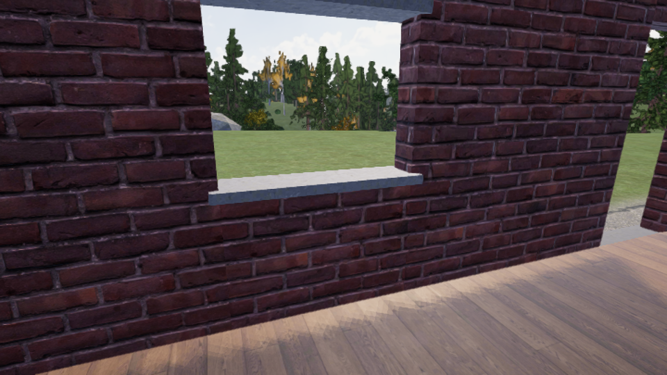

# v80 전투·환경 품질 개선

기준은 v79 통합 커밋 `a427bd89bcc80c9938bd0ab0850e2519b7721168`입니다. 웹 게임에 여섯 개선을 연결했으며 추가 외부 패키지나 에셋 다운로드는 없습니다. 노이즈·탄흔·광패치·룸 임펄스 응답은 포함된 코드로 생성합니다.

## 적용 동작

| 항목 | 현재 동작 |
| --- | --- |
| 공간 음향 | 기존 충돌 격자로 천장·벽·창문·층간 차폐를 판정합니다. 벽의 재질·두께와 두 번째 장애물에 따라 음량·고역을 줄이고, 방·복도·넓은 실내에 각각 0.48초·1.15초·1.7초의 잔향을 사용합니다. 총성·장전·발소리의 기존 출력 경로에 연결했습니다. |
| 피격 반응 | 피해 판정에서 방향·부위를 전달해 머리·어깨·몸통·다리를 다르게 구동합니다. 기존 자세를 복원한 후 반응을 더해 누적 변형을 막습니다. 사망 시 비어 있는 방향을 선택하고 경사면에 몸을 맞춥니다. 가까운 시체는 실제 스킨 접촉점으로 몸 높이를 보정하고 정착 후 계산을 멈춥니다. |
| 총기 벽 회피 | 실사·절차적 총기 30종의 실제 총구 위치로 길이를 구합니다. 벽 가까이에서 총·양손·장전 리그의 공통 부모를 손 근처 축으로 회전시킵니다. 소총·권총 자세를 구분하고 소음기 여유 길이를 더합니다. 막혔거나 자세 복귀 초반에는 발사·탄약 소비를 막습니다. |
| 탄착·탄흔 | 16칸 아틀라스로 콘크리트·나무·금속·지면의 흔적을 구분합니다. 입사각으로 길이를 조절하고 얇은 벽·창문 가장자리 안으로 제한합니다. 산탄은 작은 흔적을 남깁니다. 금속 불꽃, 목재·콘크리트 입체 파편, 얇은 분진을 연결했으며 움직이는 차량에 떠 있는 고정 탄흔을 남기지 않습니다. |
| 실내 조명 | 실제 개구부 2,497개의 위치와 햇빛 방향에서 가까운 창가 바닥 광패치를 구합니다. 바닥·주변 벽으로 범위를 자르고, 비·안개에서는 생략합니다. 노출 보정은 실내 구조를 기준으로 최대 16%(밤 10%) 안에서 천천히 바뀌므로 총구 섬광에 따라 밝기가 출렁이지 않습니다. |
| 표면 마모 | 건물의 바닥 높이에 따른 벽 하단 오염, 바닥 얼룩, 면 모서리 마모와 거칠기 변화를 기존 재질에 더합니다. 세계 좌표 노이즈와 건물별 강도를 사용하며 35~75m에서 사라집니다. 기존 텍스처·지오메트리 위치·정적 AO 베이크를 유지합니다. |

사망 동작은 기존 스켈레톤을 구동하는 절차적 자세입니다. 체력·액터 위치·히트박스는 피격 반응에 따라 이동하지 않습니다. 근접한 벽에 의한 발사 제한은 새 총기 벽 회피 동작에 포함됩니다.

## 실제 화면

| v79 | v80 |
| --- | --- |
|  |  |

[일반 총기 자세](v80-weapon-clear.png) · [벽 앞 소총](v80-weapon-wall.png) · [벽 앞 P-226](v80-pistol-wall.png) · [재질별 탄흔](v80-material-impacts.png) · [피격·사망 자세](v80-hit-and-death.png)

근접 검증 화면은 게임의 렌더러·모델·재질·리그로 만든 고정된 검사 장면입니다. `tools/capture-combat-environment.cjs`로 재생성할 수 있습니다.

## 검증

Node 24.22.3, Chromium 156 / ANGLE SwiftShader, Three.js r160에서 **검사 16종이 모두 통과**했습니다. [전체 검사 목록](v80-checks.json) · [통합 검사 수치](v80-combat-environment.json).

- 조준·영점·반동, 손 자세, 장전·접촉 여유, 원본 오디오·총기 오디오, 번들 모델과 M4·Glock 임포트, 훈련장·에셋 누락 복구, 무기 도감·전투, v78 화질·성능 계약, v79 보행·봇·LOD, 새 전투·환경 통합을 검사했습니다.
- 새 통합 검사는 열린 공간·벽·유리·열린 창문·층간 차폐와 실제 오프라인 오디오 렌더링의 잔향·고역 감쇠를 확인합니다. 5m 거리의 예에서 벽 뒤 직접음은 열린 경로의 약 31%, 저역 통과 한계는 1,050Hz였고 열린 창문은 직접음을 유지했습니다.
- 총기 30종 × 지향/정조준 **60가지**에서 벽 회피·발사/탄약 차단·자세 복귀를 확인했습니다. 같은 애니메이션 프레임에서 공간 확보 후 총구 위치가 그대로 복원되며, 공통 부모 변환에 의한 손의 상대 위치 오차는 `2.5e-16m` 이내였습니다. 실제 뷰모델 렌더링에서도 모든 자세가 화면에 남았습니다(160×90 검사에서 최소 1,662픽셀).
- 피격은 30·60·144fps에서 검사했고, 앉기·엎드리기·기절 자세에서도 부위를 구분합니다. 실사 군인 4종 × 네 방향 × 평지/12% 경사 **32가지**의 표시되는 스킨을 별도로 샘플링했습니다. 정착 후 최저 접촉점은 바닥 위 약 22mm였으며, 모두 지형 아래로 파고들지 않고 정착했습니다.
- 탄착 240회를 발생시켜 탄흔 200개·파편 48개의 풀 제한, 수명 만료, 지오메트리 증가 없음과 페이지·셰이더 오류 없음을 확인했습니다. 기존 정적 AO 394청크의 해시도 일치했습니다.

## 처리량과 비용

| 처리 | 제한 |
| --- | --- |
| 공간 판정·음향 | 방 캐시 96개/0.6초, 음향 경로 캐시 96개/0.18초, 약 16.7ms 구간당 새 차폐 경로 12개 |
| 총기 회피 | 짧은 충돌 레이 3개/자세 갱신. 발사 확인 시 최신 거리 재검사 |
| 시체 접촉 | 45m 안에서 준비된 스킨 표본과 분산된 바닥 접촉 8개 사용. 약 0.08초 간격으로 보정하고 정착 후 종료 |
| 탄착 | 가까운 40m 상세 효과, 24m 입체 파편, 70m 탄흔. 탄흔 200개, 파편 48개. 기존 탄흔 드로콜 재사용 |
| 창가 광패치 | 가까운 32m, 풀 6개, 약 0.28초 간격 재계산. 갱신당 최대 30개 레이 |
| 표면 마모 | 128² 공유 노이즈, 마모 계산은 근거리에서 실행. 별도 건물 메시·재질 복제 없음. 추가 정점 메타데이터 12,135,744바이트(약 11.6MiB) |

동일한 실내·카메라·960×540·낮음 품질의 [v79/v80 비교](v80-benchmark.json):

| 항목 | v79 | v80 |
| --- | ---: | ---: |
| 드로콜 | 127 | 128 |
| 삼각형 | 483,343 | 483,355 |
| 지오메트리/텍스처 | 208 / 191 | 210 / 193 |
| 셰이더 프로그램 | 142 | 152 |
| 소프트웨어 렌더링 7회 중앙값 | 1,192.3ms | 1,120.8ms |

이 시간은 강제 소프트웨어 렌더러의 진단 수치이며 실제 GPU FPS나 속도 향상의 근거로 사용하지 않습니다. 입체 파편이 활성화되면 풀 전체에 대해 드로콜 1개를 더 사용합니다. 원거리 캐릭터·건물 LOD, 압축 텍스처, 지연 모델 생성과 네이티브 뷰모델 합성은 기존 동작을 유지합니다.

```sh
node tools/check-combat-environment.cjs
node tools/capture-combat-environment.cjs /tmp/lz-v80-captures
node tools/bench-combat-environment.cjs /tmp/lz-v80-benchmark
```

Playwright·Three.js 경로와 Chromium 실행기는 기존 검사와 같은 `NODE_PATH`, `THREE_DIR`, `CHROME_BIN` 환경 변수를 사용합니다. 새 통합 검사를 GitHub Actions의 `Game regressions`에도 추가했습니다.
