# v81 화면 흐림·가는 선 끊김 수정

기준은 v80 `69bf2f2bca0c290287f5aff2823cad2d4bc2d75b`다. 먼저 원본 게임을 Chromium에서 측정하고, 같은 카메라·품질의 수정 후 화면과 비교했다. 주된 원인은 출력 DPR 제한, 품질 배율과 DRS의 중첩, 낮은 해상도에서의 샘플 누락이었다. 밉맵 전체가 꺼져 있다는 가설은 측정 결과와 달랐다.

## 확인한 원인

CSS 960×540, 브라우저 DPR 1.5에서 측정한 v80 값:

| 품질 | 출력 캔버스 | renderer DPR | composer DPR: 시작 → 하한 | 장면 크기: 시작 → 하한 | 실제 화면 대비 하한 |
| --- | --- | ---: | --- | --- | ---: |
| 최저 | 960×540 | 1 | 0.6 → 0.35 | 576×324 → 336×189 | 23.3% |
| 낮음 | 960×540 | 1 | 0.75 → 0.4125 | 720×405 → 약 396×223 | 27.5% |
| 중간 | 1440×810 | 1.5 | 1 → 0.55 | 960×540 → 528×297 | 36.7% |
| 높음 | 1440×810 | 1.5 | 1.25 → 0.6875 | 1200×675 → 약 660×371 | 45.8% |

원본 composer는 정수가 아닌 타깃 크기도 저장한다. 위의 `약` 표기는 저장값을 반올림한 것이며, GPU 저장 공간은 정수 픽셀이다. 수정 후에는 실제 정수 크기를 텍셀 간격 계산에도 사용한다. [DPR 1·1.25·1.5의 원본 측정](v81-diagnosis-before.json).

DRS 하한은 게임의 `DRS.frame()`에 50ms 프레임 입력을 반복해서 전달해 확인했다. 브라우저의 DPR·캔버스·렌더 타깃은 실제 값을 읽었다. 아래 성능 측정은 같은 장면에서 별도로 수행했다.

- 원본 DRS의 `scale` 하한은 최저 0.5, 나머지 0.55다. `max(0.35, base * scale)`이므로 최저의 적용 DPR은 0.35가 된다. 장면의 실제 화면 대비 비율과 DRS 내부 배율이 달랐다.
- 최저·낮음은 출력 DPR까지 1로 제한해 고밀도 화면에서 브라우저 확대가 추가됐다. 중간·높음도 장면을 작은 타깃에서 크게 확대했다.
- 원본 FXAA는 **업스케일 전 장면 해상도**에서 실행된다. 가는 메시가 그 단계에서 샘플을 잃으면 FXAA·EASU·샤프닝으로 원래 선을 복원할 수 없다.
- 재질 슬롯에서 확인한 일반 이미지 텍스처 124개는 모두 trilinear 밉 필터를 사용했다. 그중 65개는 anisotropy=1, 하드웨어 최대값은 16이었다. 기존 필터 함수는 이미 업로드된 텍스처를 건너뛰고 원래 anisotropy보다 높이지 않아 이 상태가 남았다.
- 2D 스코프는 `canvas.width = innerWidth`만 사용해 DPR 1.5에서도 CSS 크기로 그린 뒤 확대됐다. DPR을 스코프 재생성 키에도 포함하지 않았다.

## 수정된 동작

장면 해상도 %는 이제 **실제 출력 픽셀 대비 가로·세로 배율**이다. 픽셀 수 비율은 그 제곱이다.

| 품질 | 자동 시작 예산 | 자동 하한 | 앤티앨리어싱 |
| --- | ---: | ---: | --- |
| 최저 | 최대 60% | 35% | FXAA |
| 낮음 | 최대 75% | 55% | MSAA 2x 요청 |
| 중간 | 최대 100% | 85% | MSAA 2x 요청 |
| 높음 | 최대 100% | 85% | MSAA 4x 요청 |

모든 품질의 출력 캔버스 DPR은 `devicePixelRatio`다. 기존 픽셀 예산은 자동 시작 상한에만 반영하며 중간·높음의 85% 하한과 출력 캔버스를 줄이지 않는다. 정수 픽셀 반올림에 따른 1픽셀 미만 차이가 있을 수 있다.

같은 CSS 960×540, DPR 1.5의 수정 후 측정값은 다음과 같다. 출력 캔버스는 모든 품질에서 **1440×810**, renderer DPR은 **1.5**다. [수정 후 전체 측정](v81-diagnosis-after.json).

| 품질 | composer DPR: 시작 → 하한 | 장면 하한 | 실제 화면 대비 하한 |
| --- | --- | --- | ---: |
| 최저 | 0.9 → 0.525 | 504×283 | 35% |
| 낮음 | 1.125 → 0.825 | 792×445 | 55% |
| 중간 | 1.5 → 1.275 | 1224×688 | 85% |
| 높음 | 1.5 → 1.275 | 1224×688 | 85% |

- 그래픽 탭과 설정 창에서 자동 / 67% / 75% / 85% / 100%를 선택하고 저장한다. 고정 모드는 DRS와 품질 전환·창 크기 변경에도 값을 유지한다. 고정 67%·75%를 고르면 중간·높음에서도 해당 명시적 선택이 우선한다.
- 품질 자동 조절은 계속 작동한다. 고정 75% 상태에서 높은 품질 → 최저 → 낮음 전환을 실제 DRS 프레임 입력으로 검사했다. FPS 표시줄은 `해상도 75% (고정)`처럼 표시한다.
- EASU 업스케일 뒤 네이티브 화면에서 5탭 대비 적응형 선명화를 한 패스로 실행한다. 기본 강도 35%, 설정에서 0으로 끌 수 있다. 이전 장면 단계의 선명화는 중복 적용하지 않는다. 이웃 색 범위로 제한해 테두리 번짐을 막는다. 선명화가 필요 없으면 추가 네이티브 타깃을 해제한다.
- 일반 이미지·PBR·알파 텍스처와 셰이더 이미지 유니폼은 하드웨어 최대 16x 비등방성 필터를 사용한다. 일반 이미지는 밉맵을 생성하고, 압축 텍스처는 포함된 밉 체인을 보존한다. 깊이·정수 데이터·렌더 타깃·프레임버퍼 등 의미가 다른 텍스처는 보존한다. 늦게 로딩되거나 이미 업로드된 이미지도 보정한다.
- MSAA가 있으면 잎과 알파 테스트 재질에 alpha-to-coverage와 부드러운 알파 경계를 적용한다. MSAA 미지원 기기는 FXAA로 복구한다. Three.js r160의 일반 알파 테스트도 별도로 처리했다.
- 긴 울타리·난간·가는 막대는 래스터 정점 셰이더에서 단면을 최소 약 1.1 장면 픽셀로 넓힌다. 원래 정점·충돌·AO 베이크는 변경하지 않는다. 확대 조준의 투영 행렬과 현재 장면 높이를 사용한다. RT에서는 이 변위를 끄고 원래 메시를 사용한다.
- DOM HUD·조준선은 후처리 밖에 유지한다. 낮은 장면 해상도의 총·손·1인칭 레티클은 네이티브 해상도로 따로 합성한다. 2D 배율 스코프도 DPR에 맞는 캔버스와 좌표 변환을 사용한다.

레이트레이싱은 출력 캔버스를 줄이지 않고 공개 `setSize()`로 장면 크기를 전달한다. ThreeRT의 `renderScale`은 **조명 버퍼** 배율이므로 장면 배율로 잘못 덮어쓰지 않는다. 라이브러리의 조명·반사 자동 품질은 유지한다. RT 월드를 합성한 뒤 선명화하고 총·HUD는 그 뒤에 그린다.

## 브라우저 화면 비교

CSS 800×450, DPR 1.5, 원본 PNG 1200×675. 실제 게임의 같은 위치에서 촬영했다. 울타리·지붕은 중간 품질의 각 버전 DRS 하한이다. 따라서 v80 장면은 약 440×248, v81은 1020×573이며 개선과 비용에 이 차이가 포함된다.

| 장면 | v80 | v81 |
| --- | --- | --- |
| 가까운 울타리 | 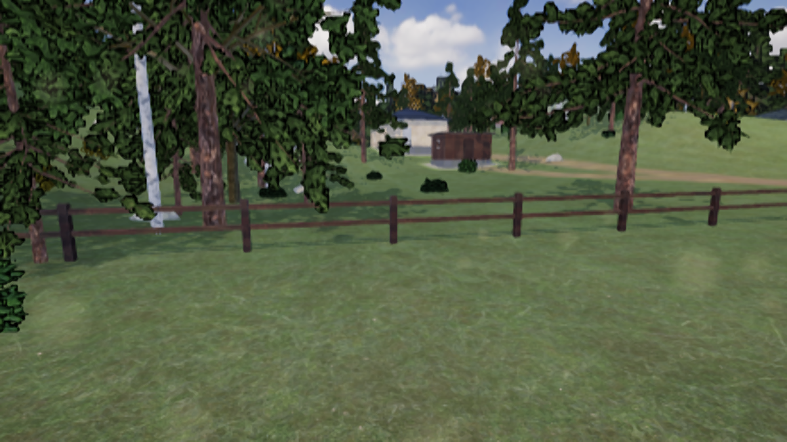 | 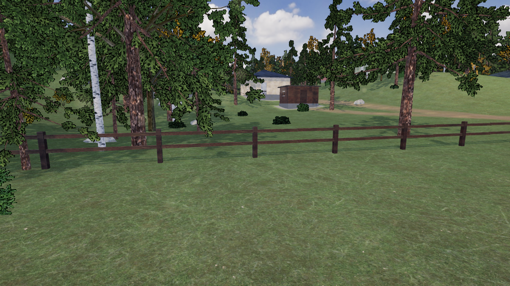 |
| 먼 울타리 | 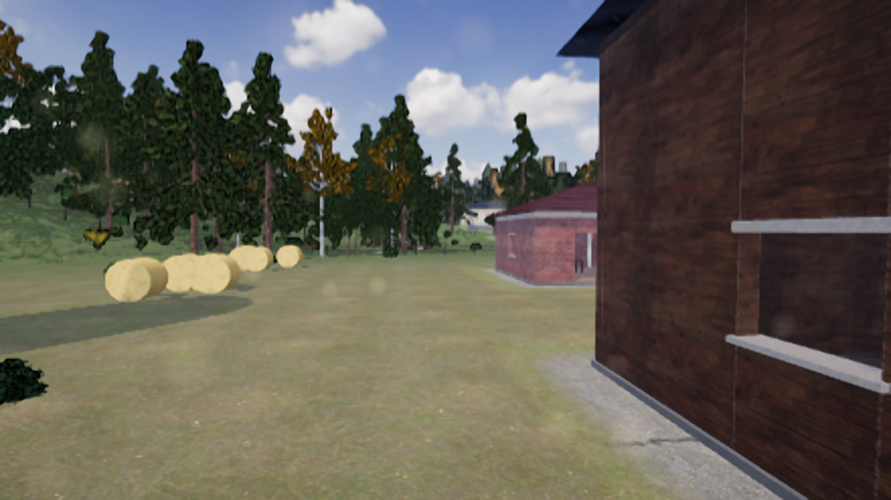 | 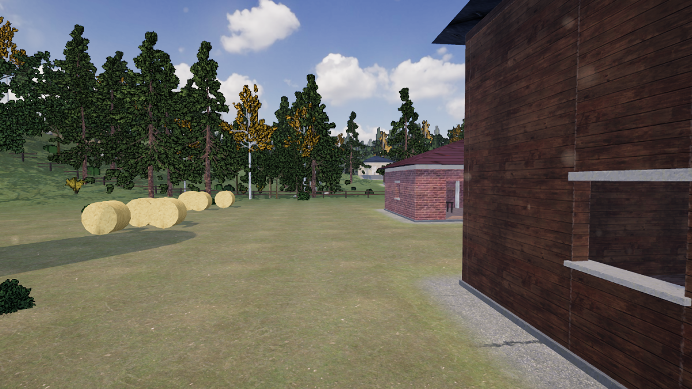 |
| 가까운 지붕 | 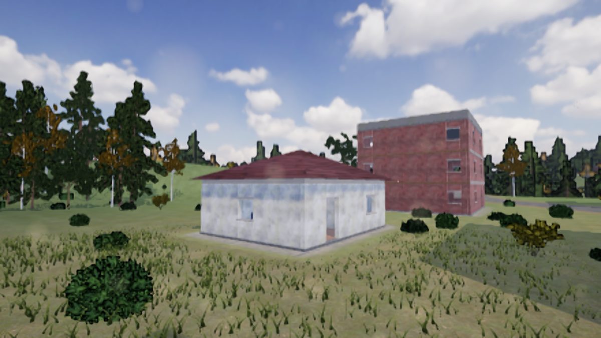 | 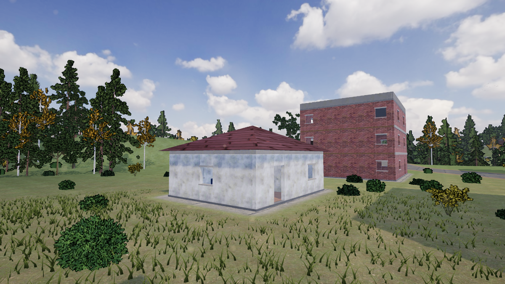 |
| 먼 지붕·건물 모서리 | 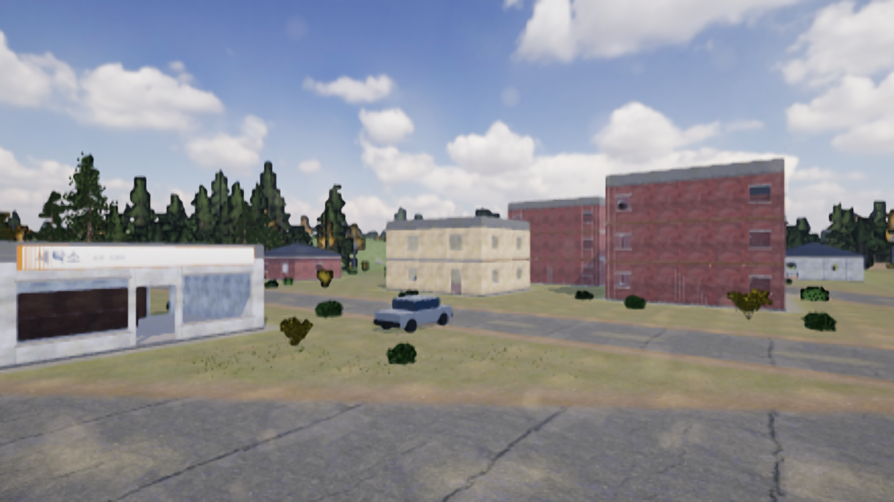 | 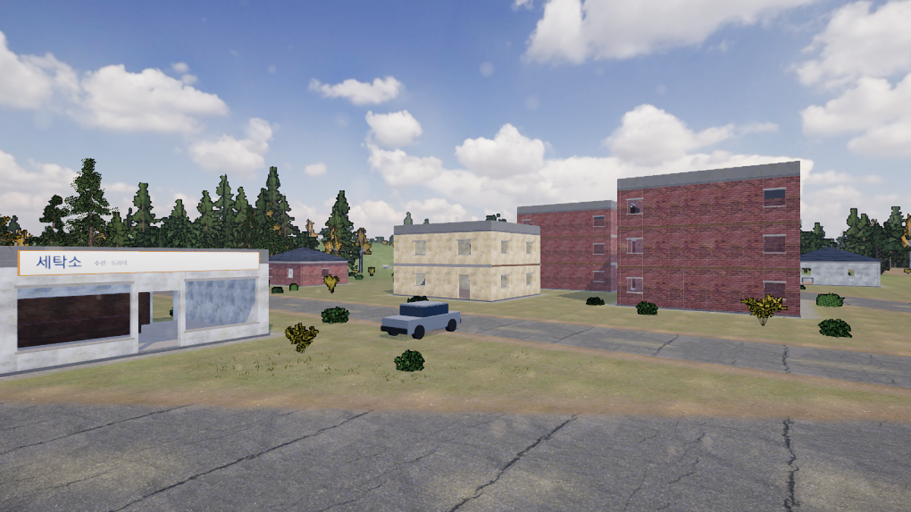 |

월드 코드에 별도의 가공 전선 생성기는 없었다. 전선 형태의 가는 메시 검증은 **게임의 `World.box` 빌더·재질·후처리를 그대로 사용한 별도 검사 장면**에서 6mm·20mm·80mm 막대로 재현했다. 낮음 품질, 거리 8m·35m, 카메라를 화면의 0·¼·½·¾픽셀씩 움직여 비교했다.

| 거리 | v80 | v81 |
| --- | --- | --- |
| 8m | 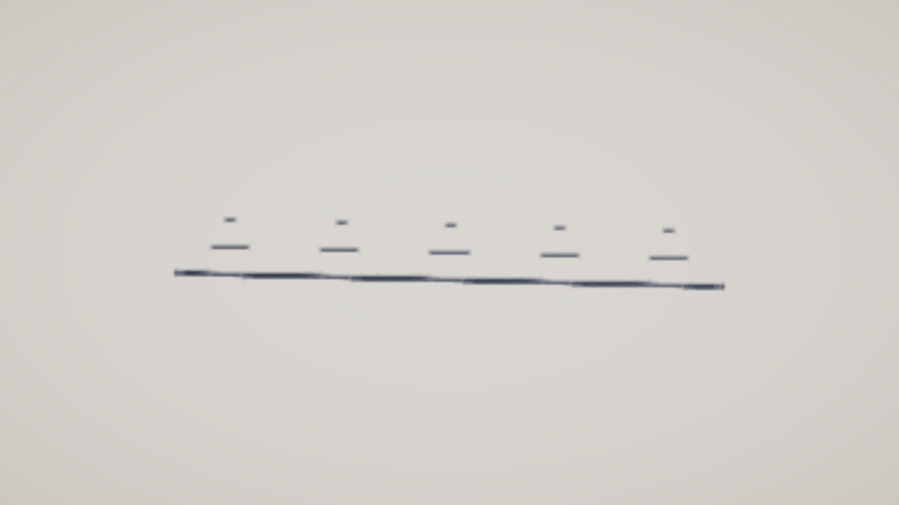 | 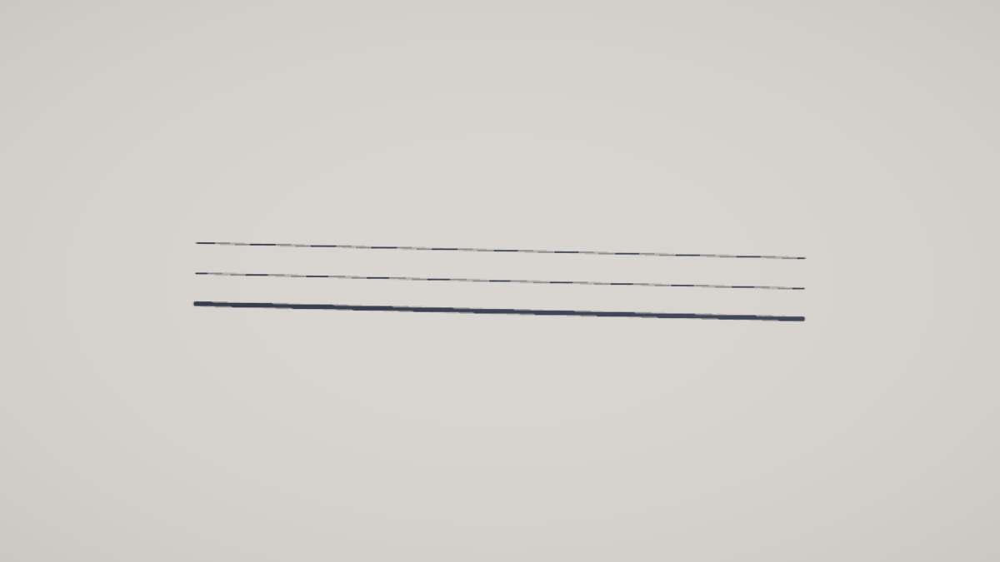 |
| 35m | 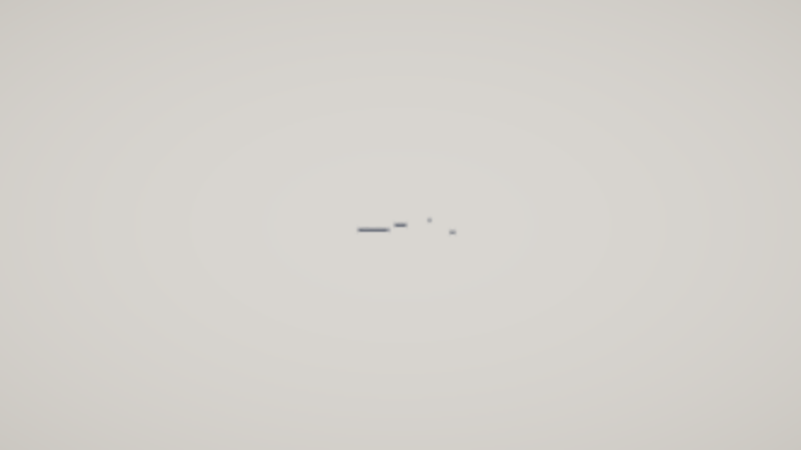 | 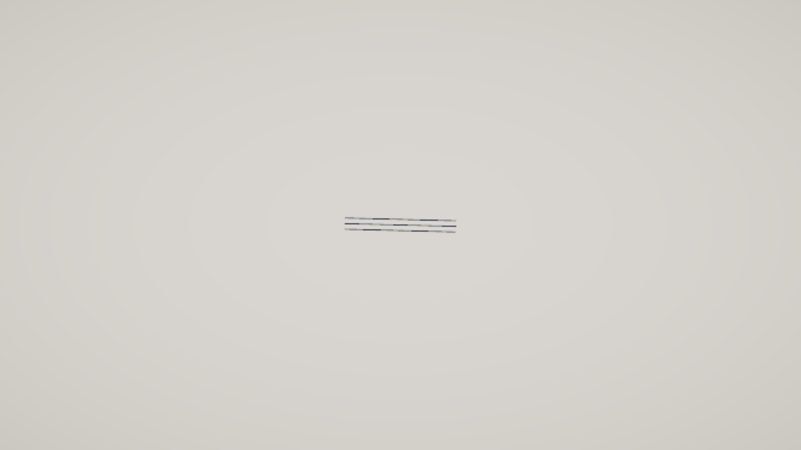 |

35m의 6mm 선에서 배경과의 대비가 8/255 미만인 구간은 네 카메라 위상에서 v80 **92.7~95.1%**, v81 **0%**였다. 20mm·80mm 선도 수정 후 네 위상 모두 0%였다. 이는 정해진 검사 장면의 선 연결성 지표이며 모든 배경에서 시간적 깜빡임이 완전히 없어졌다는 뜻은 아니다. [전체 위상·대비 수치](v81-line-contrast.json).

[네이티브 레드닷·HUD](v81-reddot-native.png) · [네이티브 4배 스코프](v81-scope-native.png)

## 품질별 성능 비용

Chromium 156 / ANGLE **SwiftShader 소프트웨어 GPU**에서 같은 먼 지붕 장면을 멈추고 측정했다. CSS 800×450, DPR 1.5, 준비 렌더 뒤 각 조건 3회 중앙값이다. GPU 작업 완료를 동기식 픽셀 읽기로 기다린 전체 렌더 시간의 역수를 표시한다. **실제 그래픽카드의 플레이 FPS나 성능 향상 수치로 해석할 수 없다.**

| 품질 | 자동 시작 FPS: v80 → v81 | DRS 하한 FPS: v80 → v81 |
| --- | ---: | ---: |
| 최저 | 2.47 → 1.24 | 3.47 → 2.09 |
| 낮음 | 1.86 → 0.55 | 2.66 → 0.69 |
| 중간 | 0.68 → 0.29 | 1.05 → 0.37 |
| 높음 | 0.39 → 0.26 | 0.74 → 0.32 |

화질을 위해 실제 처리 픽셀이 늘어 성능이 감소했다. 특히 DPR 1.5의 중간·높음 DRS 하한은 이전보다 훨씬 크다. 출력 해상도·장면 크기·드로콜·삼각형·원시 시간 표본은 [전후 벤치마크](v81-benchmark.json)에 기록했다.

같은 v81 낮음 하한 660×371에서 MSAA를 끄고 FXAA를 사용하면 1.33 FPS, MSAA 2x 요청 시 0.69 FPS였다. 이 드라이버는 RGBA16F에서 4샘플만 지원해 **2x 요청도 실제 4샘플**로 할당했다. 따라서 이 값은 2x를 실제 지원하는 GPU의 비용을 나타내지 않는다. 낮음의 기본값은 2x 요청으로 두고, MSAA가 없는 기기의 복구 경로를 검사했다.

## 검증과 재현

[렌더 계약 검사](v81-render-checks.json) · [레티클 검사](v81-reticle-checks.json) · [기존 화질·에셋 복구](v81-quality-checks.json) · [검사 목록](v81-checks.json)

새 렌더·레티클 검사와 기존 화질·보행·전투 환경·조준·손·장전·접촉 여유 검사 **9종을 통과**했다. 페이지·셰이더 오류는 없었다.

- DPR 1·1.25·1.5에서 출력 크기, 모든 품질 DRS 하한, 모든 고정 배율, 창 크기 변경, 설정 저장·재로드, FPS 문구를 검사했다.
- 자동 품질의 내림·복구, MSAA 0샘플 복구, 네이티브 선명화 타깃과 끄기, 늦게 업로드된 이미지와 데이터 텍스처 보존을 검사했다.
- 실제 GL에서 RT용 화면 복사·선명화 경로를 실행했다. RT의 크기 전달·조명 자동 품질 보존은 공개 API 대역으로 검사했다. 이 환경의 소프트웨어 GPU는 ThreeRT를 지원하지 않으므로 **실제 하드웨어 RT 화면·성능 검증은 수행하지 못했다.**
- 기존 정적 AO 394청크 일치, 네이티브 총 합성·미사용 타깃 해제, 압축 이미지·AO·모델 누락 복구와 전투·환경·보행·총기 검사를 수행했다. 개별 결과는 검사 목록을 따른다.

```sh
node tools/check-render-clarity.cjs
node tools/check-native-reticle.cjs
node tools/inspect-render-clarity.cjs /tmp/lz-render-clarity-after.json
node tools/bench-render-clarity.cjs before /tmp/lz-v81-clarity
node tools/bench-render-clarity.cjs after /tmp/lz-v81-clarity
python3 tools/compare-render-lines.py /tmp/lz-v81-clarity
```

Playwright·Three.js·Chromium 경로는 기존 검사와 같은 `NODE_PATH`, `THREE_DIR`, `CHROME_BIN`을 사용한다. PNG 대비 분석만 Pillow가 필요하다. 원본 벤치마크는 위 기준 커밋의 HTML과 전체 JS를 고정해서 제공하므로 작업 파일을 되돌리지 않고 재현할 수 있다. 새 렌더·레티클 검사를 GitHub Actions에도 추가했다.
