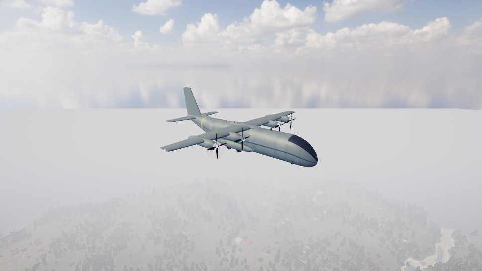
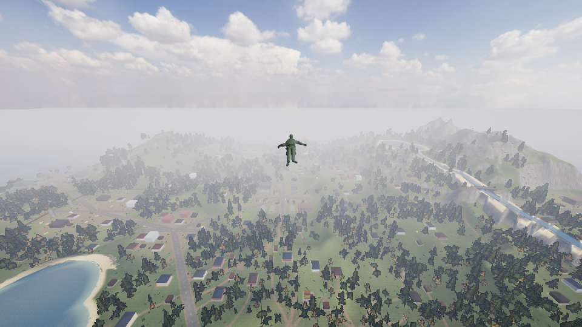
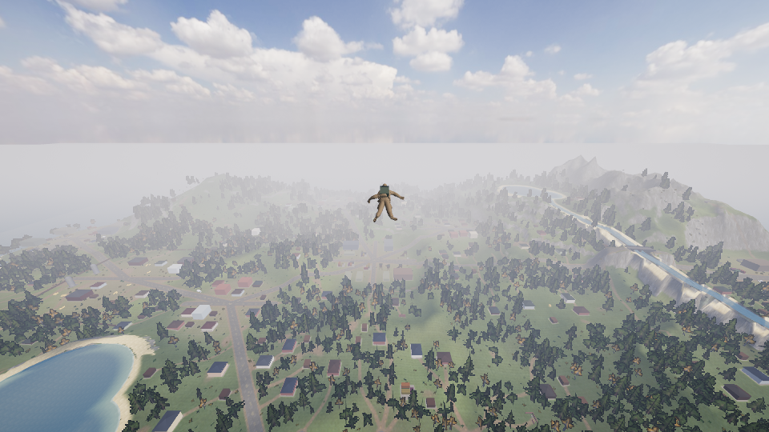
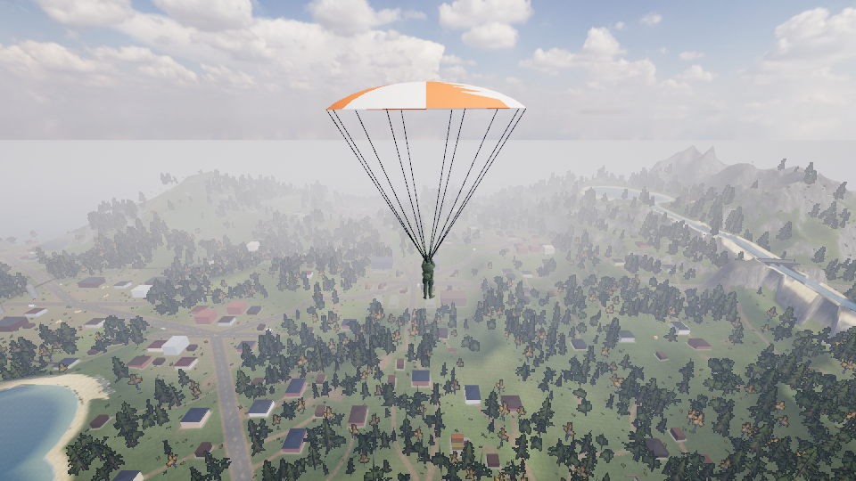
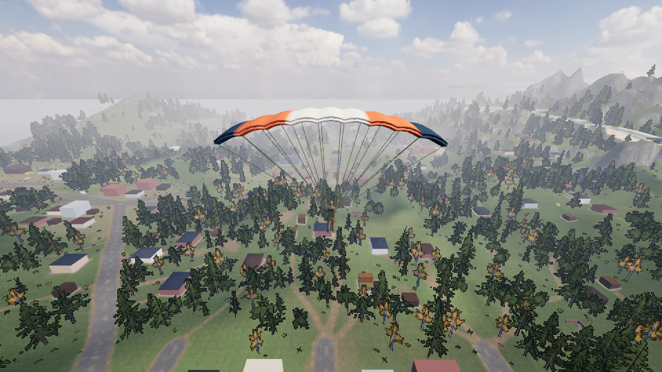
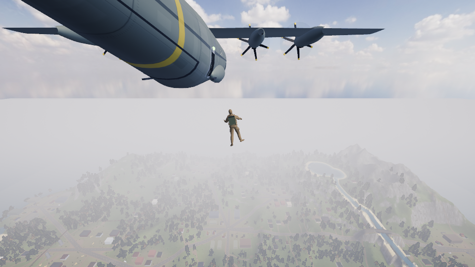
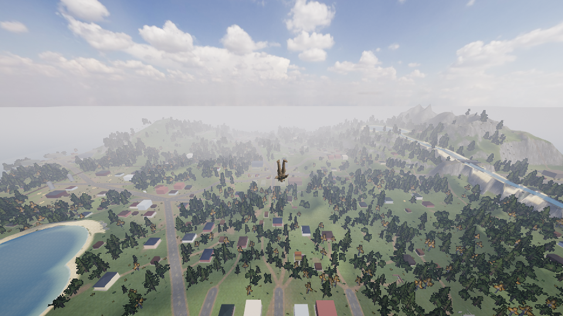
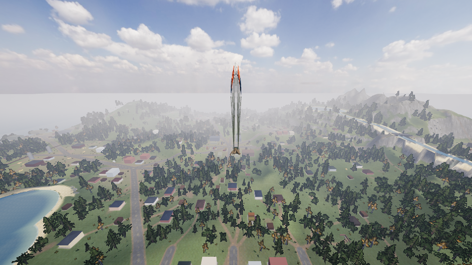

# v88 수송기·강하·낙하산 전개

기준은 v87 커밋 `a3fe0d5`다. 기존 맵·수면·차량 개선 위에 적용했다. 추가 다운로드 없이 기존 절차적 수송기와 캐릭터 뼈대를 사용한다.

## 확인한 원인과 변경

- `plane.js`의 곡면 조각 인덱스가 각도 진행 방향을 구분하지 않았다. 앞유리와 한쪽 객실 창·문이 안쪽을 향해 바깥에서 보이지 않았다. 수정 전 앞유리 표본의 외측 방향 내적은 약 −1.60~−1.90이었다. 수정 후 창·문 주변 33개 조각의 외측 방향 내적이 모두 양수다.
- 캐릭터는 이탈 직후 완성된 자유낙하 자세를 취했고, 낙하산은 `visible`만 켜졌다. 이제 강하문 이탈 → 팔다리를 펼친 자유낙하 → Shift 급강하 → 손잡이 당기기 → 줄 펴짐 → 천 팽창 → 활강으로 이어진다. 팽창은 약 1.15초이며 몸 자세와 항력도 전개 진행률에 맞춰 변한다.
- 이탈 위치가 기체 중심 아래의 무작위 좌표였다. 양쪽 강하문 바깥으로 옮기고 수송기의 전진 속도를 물려받는다. 비행 중 바퀴를 접은 외형, 6엽 프로펠러, 문 테두리·발판·신호등과 기체 표식을 적용했다. 같은 재질의 날을 병합해 네 엔진의 회전부 메시를 40개에서 16개로 줄였다.
- 강하 처리에 Shift 입력이 없었다. 양쪽 Shift와 달리기 키 재지정을 지원하고, 키를 놓으면 원래 속도·자세로 돌아간다. 모바일은 이동 스틱을 앞으로 끝까지 밀면 같은 입력을 사용한다. 하강 속도와 조작 안내도 HUD에 표시한다.
- 시점의 위치 전체를 보간하면 빠른 하강 때 카메라가 위로 뒤처졌다. 이동량은 즉시 따라가고 시점 간격을 보간한다. 전개 직후에는 천이 화면 밖으로 잘리지 않도록 팽창보다 먼저 시점을 넓힌다.

9셀 낙하산은 윗면·아랫면·공기 입구·끝단에 두께가 있다. 연결줄은 몸이 기울어져도 하네스에서 천까지 이어진다. 전개 상태는 플레이어와 봇이 공유하며, 착지하면 낙하산·강하 상태를 정리한다. 지상 캐릭터의 45m LOD는 유지하고 강하 중에는 150m까지 관절 자세를 표시한다. 낙하산은 캐릭터마다 한 번만 만들고 캐릭터 정리 시 해제한다.

## 하강 수치

W/S를 누르지 않은 상태에서 6초 후의 수직 속도다. 낙하산 항목은 완전히 펼친 뒤 시작한다. 아래의 30·60·144는 **시간 간격을 1/30·1/60·1/144초로 주어 검증한 조건**이며 실제 렌더 FPS 측정값이 아니다.

| 시간 간격 | 자유낙하 | Shift 자유낙하 | 낙하산 | Shift 낙하산 |
| --- | ---: | ---: | ---: | ---: |
| 1/30초 | 48.00m/s | 81.97m/s | 5.20m/s | 14.00m/s |
| 1/60초 | 48.00m/s | 81.97m/s | 5.20m/s | 14.00m/s |
| 1/144초 | 48.00m/s | 81.97m/s | 5.20m/s | 14.00m/s |

Shift 자유낙하는 기본 대비 약 71%, 낙하산 하강은 약 169% 빠르다. W/S의 기존 전진·감속 조작도 유지한다. 수동 전개 조건(고도 260m 미만·이탈 후 1초), 자동 전개 기준(110m 미만)은 유지했다. 평지 110.1m에서 82m/s로 시작해 Shift를 계속 누른 시험은 세 시간 간격 모두 자동 전개 후 3.50초에 체력 100으로 착지했고, 최저 높이는 0m였다.

## 브라우저 화면

Chromium 156·Three.js r160·SwiftShader, 960×540, medium·장면 해상도 100%로 직접 렌더했다. 수송기 비교는 같은 위치·시점이다. 낙하산 비교는 전개 물리가 달라 촬영 고도가 다르며, 캐릭터의 복장 색은 무작위다.

| 장면 | v87 | v88 |
| --- | --- | --- |
| 수송기 |  |  |
| 자유낙하 |  |  |
| 낙하산 |  |  |

| 강하문 이탈 | Shift 급강하 | 전개 초반 |
| --- | --- | --- |
|  |  |  |

[고도·하강 속도·Shift 안내 HUD](v88/after-hud.png)

## 검증

- `tools/check-airdrop.cjs`: 세 시간 간격의 속도·해제·자동 전개·착지, 실제 키보드 이벤트로 양쪽 Shift와 재지정한 P, 수동 F 전개, 양쪽 강하문 위치·기체 속도 상속, 팽창 진행률, 반복 표시 시 재생성 방지, 전개 중 시점, 봇 자동 전개·착지, 프로펠러 회전·병합을 통과했다. 군인 4종과 절차적 대체 캐릭터의 뼈대 행렬·연결줄 좌표에 비정상 값이 없었다. 브라우저·셰이더 오류 0건. [원본 결과](v88/after-checks.json).
- `tools/check-training-range.cjs`: 훈련장 표적 14개, 사격·엄폐·통로·부착물 획득, 차량 경사·추적 시점 24조건, 반복 훈련 진입과 일반 매치의 강하·전개·착지·정리 회귀 검증을 통과했다.
- `tools/check-startup.cjs`: 스크립트 중복 요청 없음, 총기 30종·군인 4종·정적 음영 406청크 준비, 에셋 지연·누락 시 대체 경로, 필수 스크립트 누락 시 한국어 오류 표시와 후속 실행 중단을 통과했다. [원본 결과](v88/startup-checks.json).
- 변경한 JavaScript의 `node --check`, `git diff --check`를 통과했다.

환경의 Playwright·Chromium·Three.js 경로를 설정한 뒤 재현할 수 있다.

```sh
source /workspace/.last-zone-fps-env/env.sh
node tools/check-airdrop.cjs
node tools/check-training-range.cjs
node tools/check-startup.cjs
# v87 비교 화면만 다시 촬영
AIR_BASELINE=1 node tools/check-airdrop.cjs
```
