# v89 비행기 모델 재제작

비교 기준은 v88 커밋 `635986c`다. 이번 작업은 `js/plane.js`의 기체 모델과 캐시 버전, 모델 확인용 테스트·기록에 해당한다.

## 새 외형

기존 4발 프로펠러 수송기를 LZ-89 대형 군용 제트 수송기로 다시 만들었다.

- 동체의 14개 기준 단면에서 기수·조종석 어깨·화물실·위로 들린 꼬리를 각각 설계했다. 동체가 굵어지고 앞부분이 짧고 높아져 기존 실루엣과 구분된다.
- 두께가 있는 후퇴익과 위로 올라간 윙렛, 날개 뒤쪽 플랩 경계·페어링을 만들었다. 수평 꼬리날개는 높은 수직 꼬리 위에 붙는 T자 형태다.
- 네 개의 엔진을 날개 아래 파일런으로 연결했다. 둥근 흡입구 테두리 뒤 약 1m 안쪽에 덕트·28엽 회전 팬·중앙 스피너를 배치하고, 뒤쪽에는 열린 배기구와 코어를 넣었다.
- 경사진 앞유리·옆 조종석 창·작은 관측창에 곡면을 따라가는 창틀을 만들었다. 도장에 패널·리벳·정비 덮개·오염을 넣고 꼬리에 식별 띠와 기체 표식을 배치했다.
- 양쪽 강하문은 동체 면을 제거해 실제 구멍을 냈다. 안쪽 벽·문틀·손잡이·발판을 연결하고, 모델의 이탈 기준점도 새 문 바깥에 맞췄다.

## 같은 시점에서 촬영한 전후 화면

브라우저에서 실제 게임의 `G.buildPlane()`으로 기체를 만들고, 같은 조명·시점·960×600 출력에서 렌더했다. Chromium 156 / Three.js r160 / SwiftShader를 사용했다. 아래 화면은 확인용 조명이며 마지막 인게임 화면은 실제 게임 렌더 경로다.

| 각도 | v88 | 새 LZ-89 |
| --- | --- | --- |
| 앞쪽 | 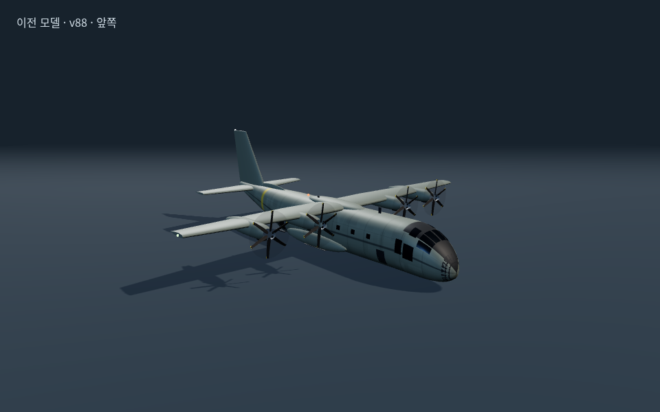 | 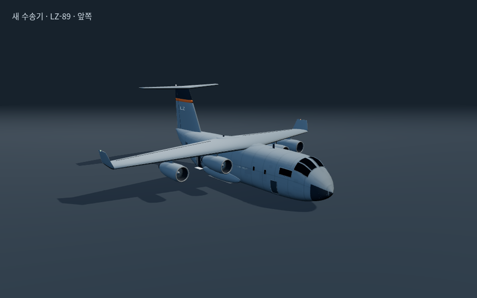 |
| 옆면 | 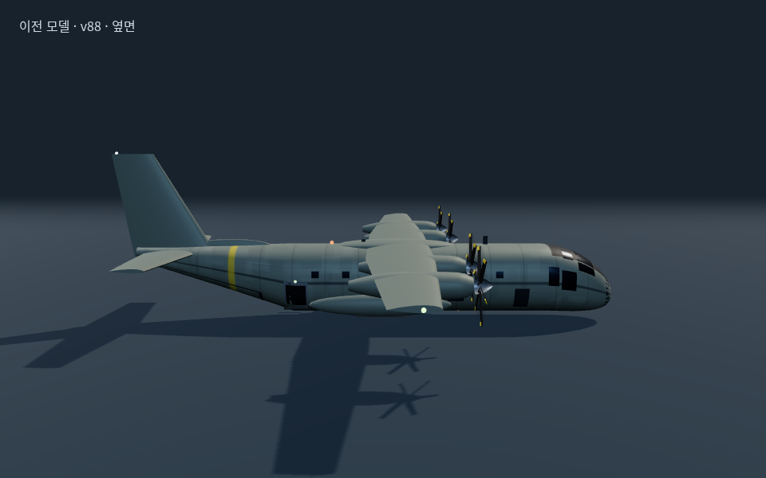 | 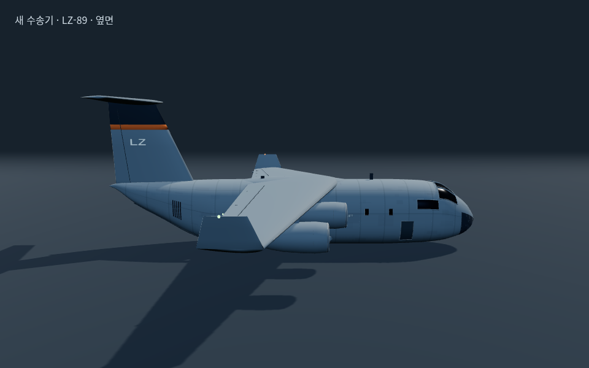 |
| 뒤쪽 | 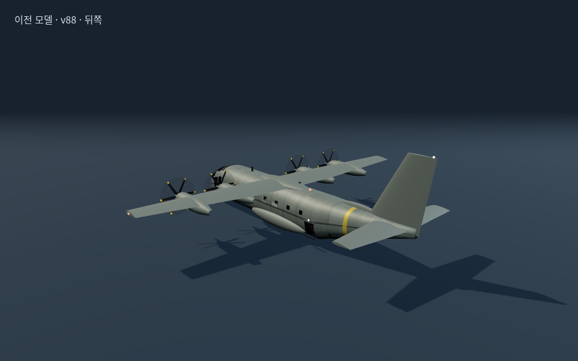 | 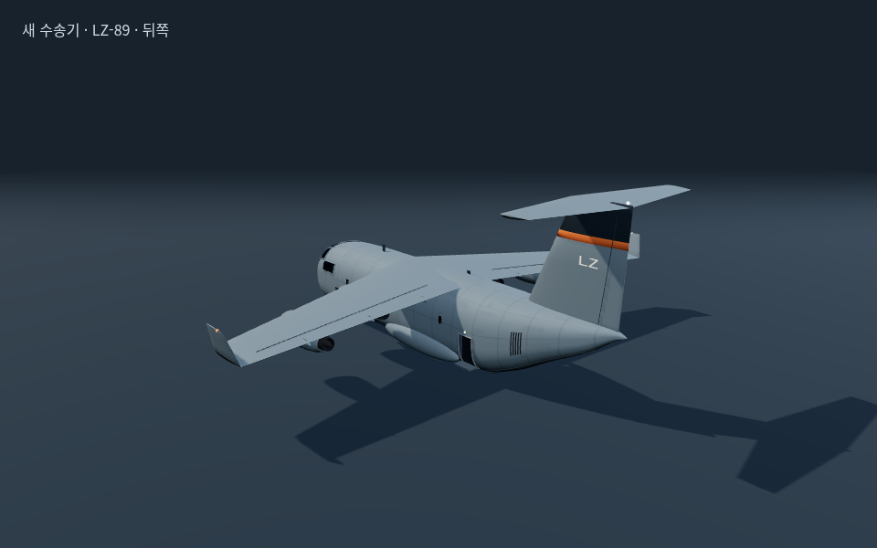 |
| 흡입구 | 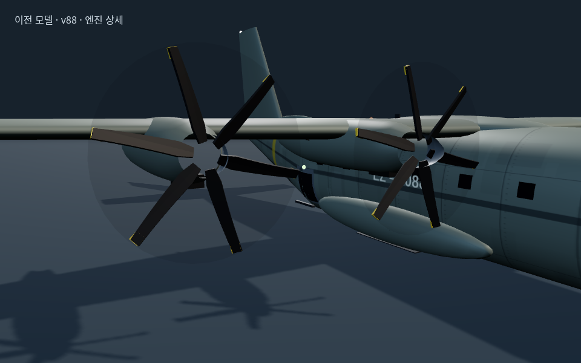 | 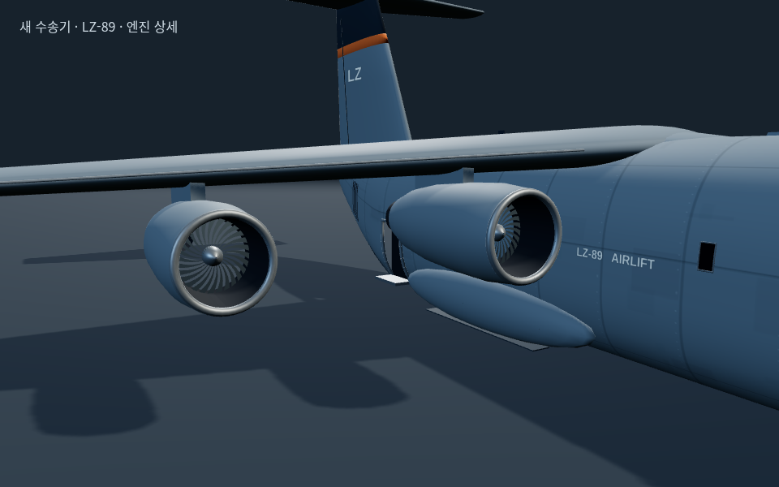 |
| 배기구 | 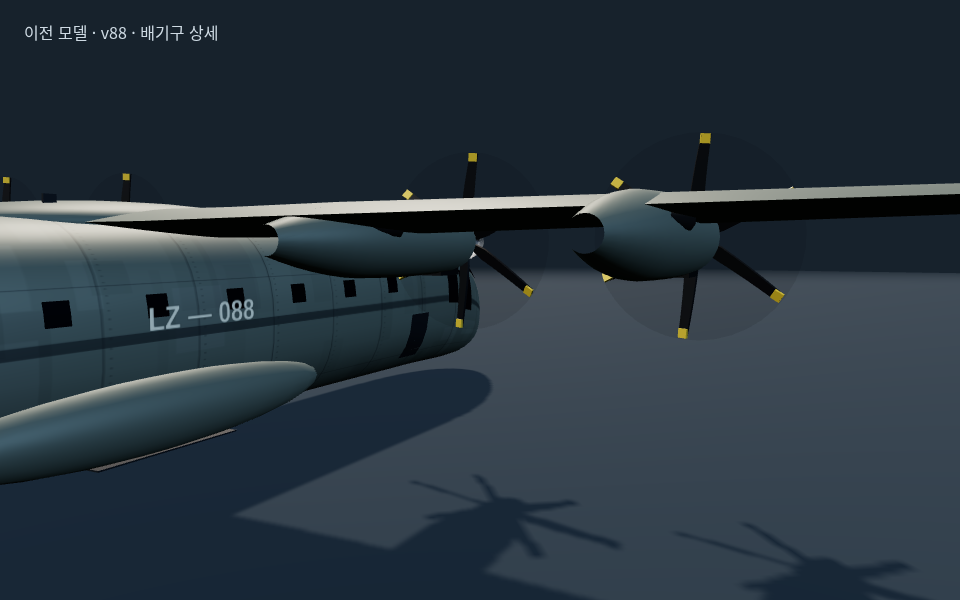 | 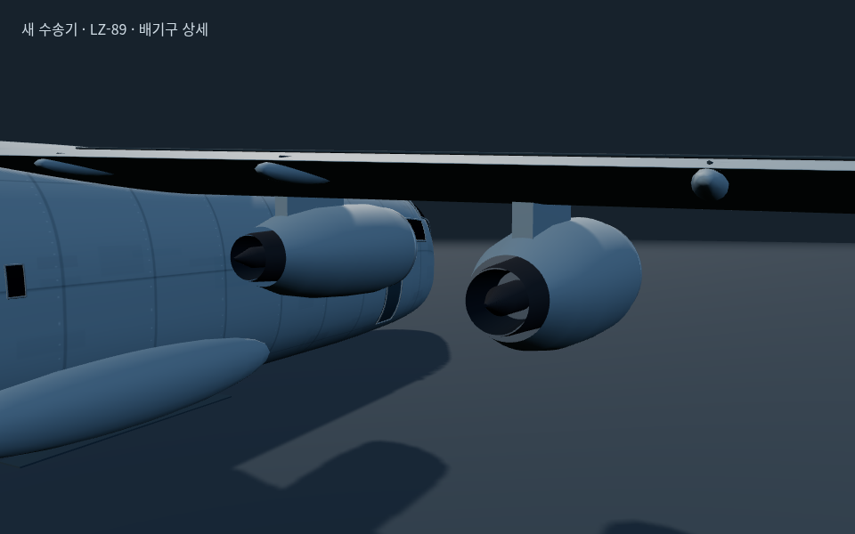 |

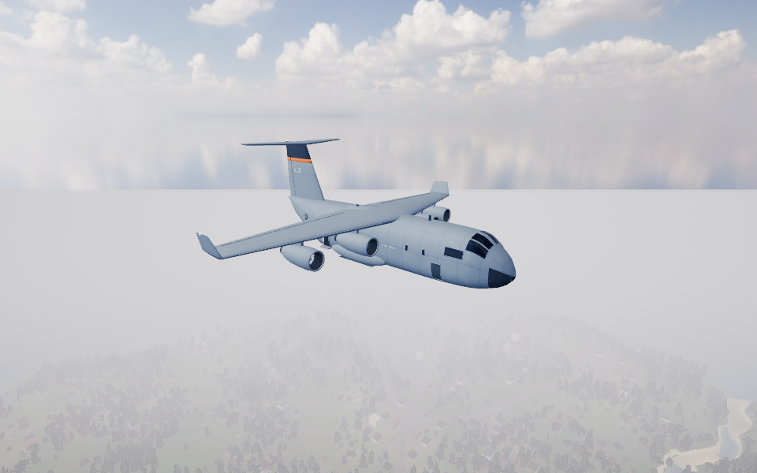

## 모델 비용과 확인 결과

| 항목 | v88 | LZ-89 |
| --- | ---: | ---: |
| 메시 수 | 88 | 26 |
| 고유 지오메트리 수 | 73 | 20 |
| 삼각형 수 | 15,488 | 45,190 |
| 기체 바운드 폭 | 40.36m | 42.14m |
| 기체 바운드 높이 | 12.56m | 14.72m |
| 기체 바운드 길이 | 38.80m | 37.20m |

세부 형상을 늘려 삼각형 수가 증가했다. 고정 부품은 재질별로 합치고 네 회전 팬은 팬당 메시 2개로 묶어, 전체 메시 수는 약 70% 줄였다. 이 수치는 모델 구조 비용이며 FPS 개선율을 의미하지 않는다. 외부 모델·텍스처 다운로드는 추가하지 않았다.

- 창문 정점의 바깥 방향 내적 최솟값은 1.621로 양수다. 위치·법선에 비정상 값이 없었다.
- 양쪽 강하문을 향한 광선 검사에서 문을 막는 동체 면이 없었다. 실제 매치에서도 두 문 바깥 `x=±3.65, y=−2.2, z=6.85`에서 자유낙하를 시작했다.
- 네 회전 팬이 기존 수송기 갱신 경로에서 움직인다. 모델을 반복 생성하고 정리했을 때 소유한 지오메트리 20개가 모두 해제됐다.
- 실제 게임의 medium·장면 해상도 100% 렌더에서 새 기체를 확인했다. 브라우저·셰이더 오류 0건이다. [모델 검사 원본](v89/checks.json).
- 기존 강하 검증도 통과했다. 양쪽 Shift·재지정 P, 수동 F 전개, 1/30·1/60·1/144초 간격에서의 자동 전개·착지, 봇 착지, 군인 4종과 대체 캐릭터를 확인했다. [강하 회귀 검사 원본](v89/airdrop-checks.json).

## 재현

```sh
source /workspace/.last-zone-fps-env/env.sh
node tools/check-plane-model.cjs
AIR_SHOTS_DIR=/tmp/lz-v89-airdrop node tools/check-airdrop.cjs
node --check js/plane.js
git diff --check
```
