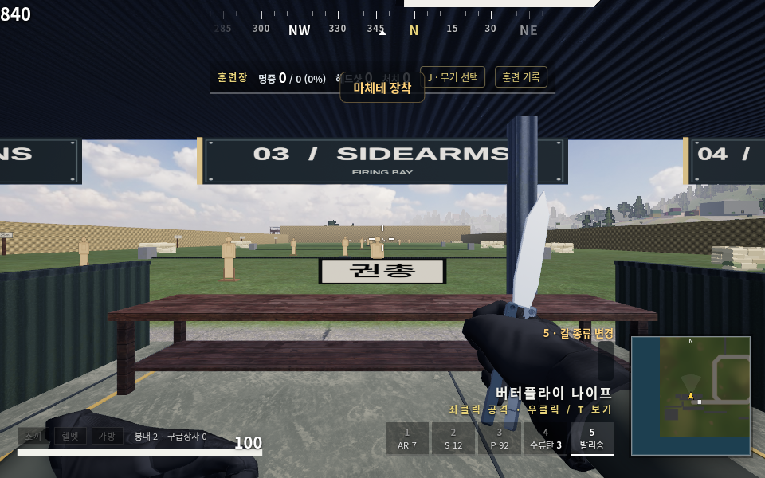
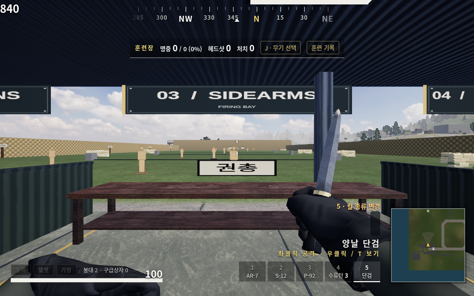
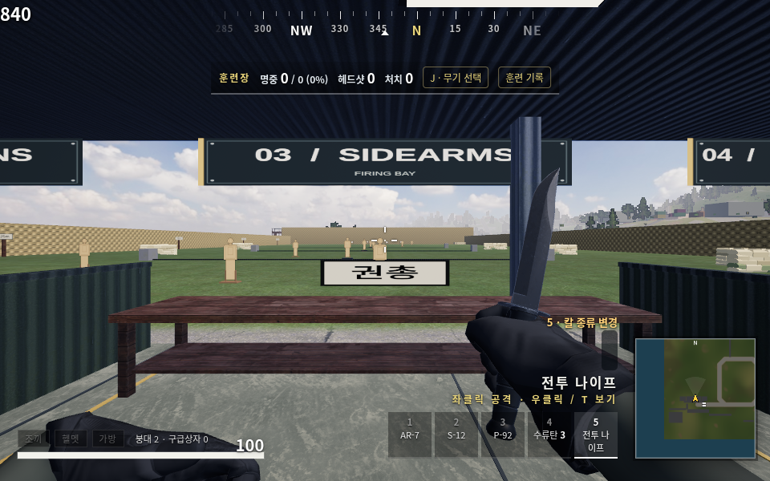
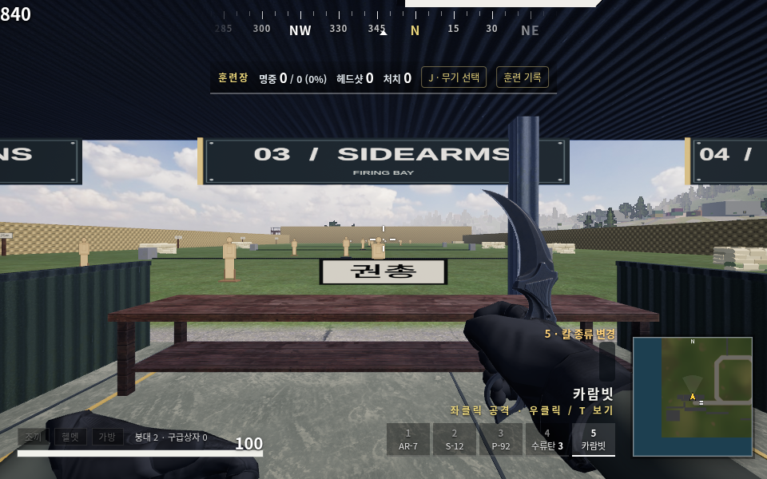
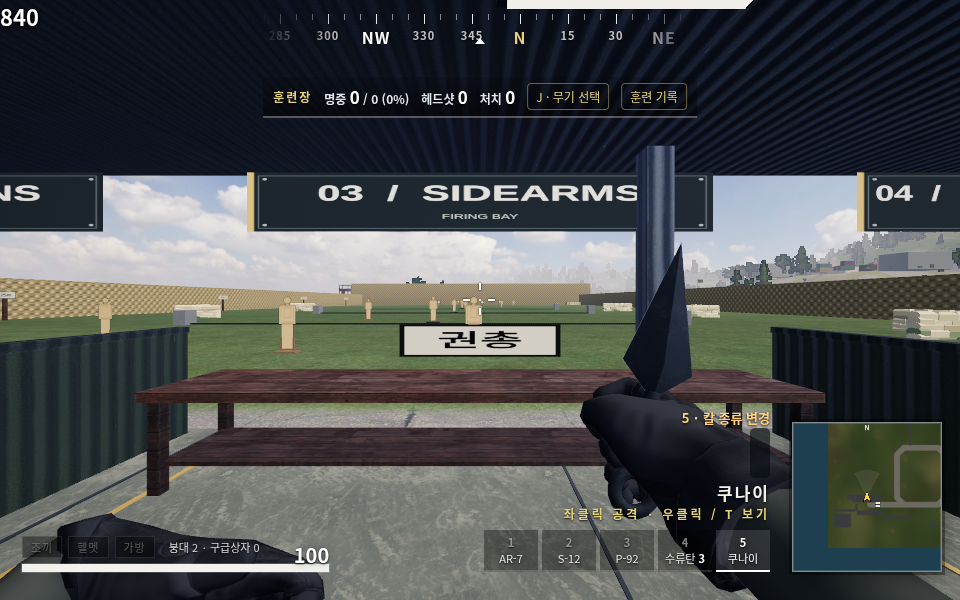
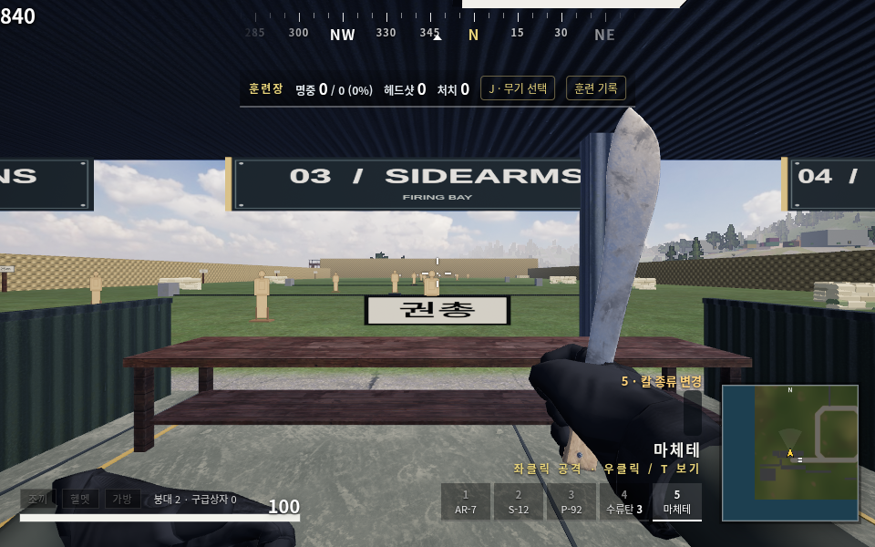
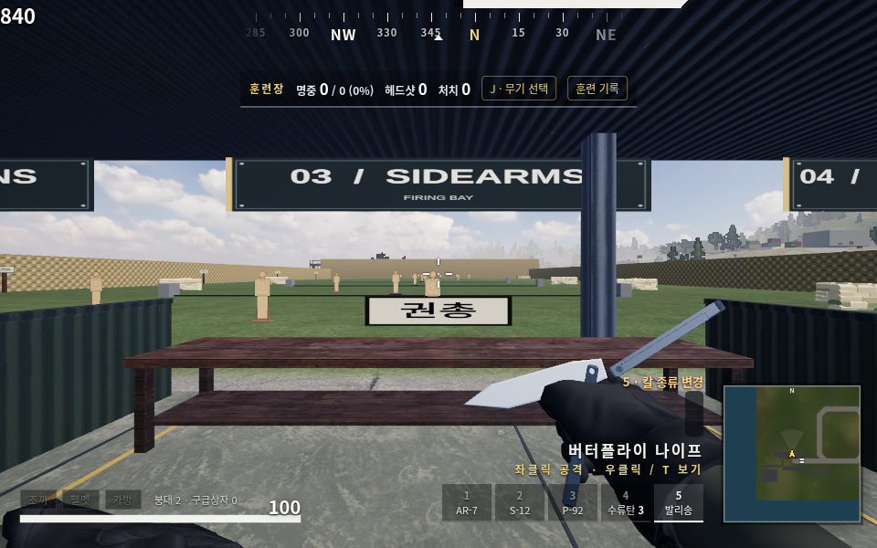
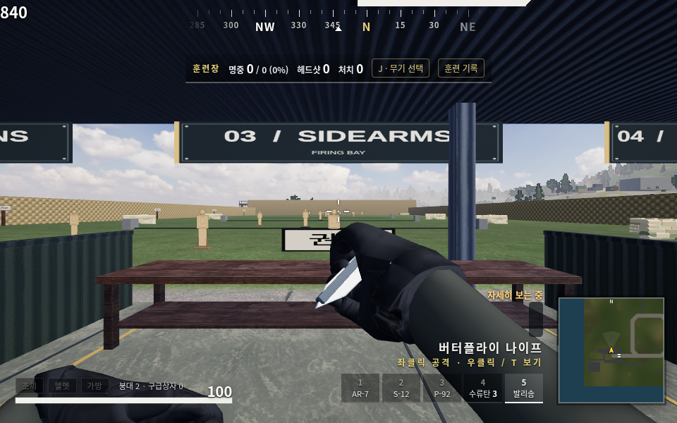
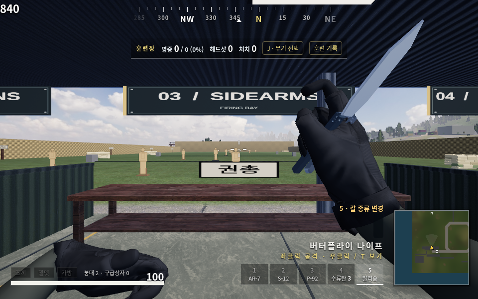

# v90 — 칼 6종과 꺼내기·휘두르기·자세히 보기

GitHub에서 배포된 칼 모델 6종과 공개 모션의 손목 곡선을 게임에 넣었습니다. 원본 파일을 실행 중에 내려받지 않고 게임 에셋으로 번들합니다. 모델의 합계는 **1,609,652바이트(약 1.61MB)**이며, 텍스처는 최대 1024px WebP, 메시에는 meshopt 압축을 적용했습니다.

## 조작

| 입력 | 동작 |
| --- | --- |
| `5` | 칼 장착; 이미 들고 있으면 다음 종류로 변경 |
| 좌클릭 유지 | 공격 간격에 맞춰 휘두르기 |
| 우클릭 또는 `T` | 자세히 보기 |
| 휠 | 기존 슬롯과 칼 슬롯 사이 전환 |
| 훈련장 `J → 칼 6종` | 모델·설명 확인 후 원하는 칼 장착 |
| 모바일 `칼` / `보기` / `발사` | 장착·종류 변경 / 자세히 보기 / 공격 |

설정에서 `5`와 `T`를 재지정할 수 있습니다. 칼은 탄약을 쓰지 않는 별도 장비이며, 총기 30종의 목록·탄약·장전 경로는 유지합니다.

## 종류와 실제 게임 화면

피해는 방어구 등 기존 게임의 피해 처리에 들어가기 전 기본값입니다. 각 공격의 43% 시점에 사거리·방향·벽 가림을 검사해 적 한 명에게 한 번만 적용합니다. 아군은 피해를 받지 않습니다.

| 종류 | 기본 피해 | 사거리 | 공격 간격 |
| --- | ---: | ---: | ---: |
| 버터플라이 나이프 | 40 | 1.75m | 0.61초 |
| 양날 단검 | 52 | 1.85m | 0.73초 |
| 전투 나이프 | 46 | 1.80m | 0.64초 |
| 카람빗 | 42 | 1.65m | 0.56초 |
| 쿠나이 | 38 | 1.70m | 0.54초 |
| 마체테 | 62 | 2.05m | 0.88초 |

버터플라이:



양날 단검:



전투 나이프:



카람빗:



쿠나이:



마체테:



## 모션과 손잡이 보정

- 꺼내기·검사는 Cransh의 FPS 소총 애니메이션에서, 휘두르기는 Quaternius `Sword_Attack`의 0~0.65초 구간에서 가져왔습니다. **칼 전용 원본 클립이 아니라 기존 팔 리그에 맞춰 재배치한 모션**입니다. 변위·손목 각도·타격 시각을 칼에 맞게 조정했습니다.
- 손목 목표를 팔이 닿는 거리 안으로 제한하고, IK로 계산한 실제 손의 접점에 칼을 붙입니다. 실사 팔을 불러오지 못하면 같은 위치의 기본 팔을 사용합니다.
- 3인칭 군인도 손목 대신 손바닥 중심에 칼을 붙이고 손가락을 쥡니다. 칼을 내리면 원래 손 자세로 복귀하며, 버터플라이의 접이 관절은 두 시점에서 같은 시각을 사용합니다.
- 화면 확인 중 손잡이가 미니맵 뒤로 치우친 것을 발견해 어깨와 대기 손 위치를 조정했습니다. 쿠나이는 칼날을 쥐지 않도록 방향·접점을 바로잡았고, 마체테는 1인칭 크기를 82%로 조정했습니다.
- 카람빗의 노멀맵에 쓰이는 접선도 메시와 함께 회전·직교화했습니다. 변환 중 노멀과 접선의 내적이 최대 1까지 어긋나는 문제를 확인해 수정하고, 직교 조건을 브라우저 검사에 추가했습니다.
- 버터플라이의 원본은 트레이너 칼날이어서 손잡이 메시를 유지하고 뾰족한 칼날을 새로 만들었습니다. 칼날과 움직이는 손잡이를 별도 회전축으로 분리해 꺼내기와 검사 중 접기·회전을 추가했습니다.
- 공격·검사는 무기 전환·치료·달리기·탑승·사망·다운·강하 시 중단됩니다. 파일을 못 읽어도 서로 다른 대체 칼과 기본 동작으로 플레이할 수 있습니다.

[실제 게임에서 렌더한 버터플라이 꺼내기 → 검사 → 공격 영상](v90/knife-motions.webm). 동작 구간을 고정 시뮬레이션 시간으로 캡처한 7.5fps 확인 영상이며 게임의 성능 측정값은 아닙니다.

| 꺼내는 중 | 자세히 보는 중 | 휘두르는 중 |
| --- | --- | --- |
|  |  |  |

## 출처와 재현

모델 원작자는 Ginsta·3dmodelscc0·Diamonddogkz입니다. 사용한 모델·클립·배포 저장소의 고정 커밋·라이선스와 가공 내역은 [에셋 출처](../../assets/models/knives/CREDITS.md)와 [소스 목록](../../tools/knives/sources.json)에 기록했습니다. 버터플라이 배포본의 CC Attribution은 버전 번호가 명시되지 않은 점도 그대로 기록했습니다.

```sh
python tools/knives/fetch.py /tmp/lz-knife-source
NODE_PATH=/path/to/dependencies/node_modules node tools/knives/build.cjs /tmp/lz-knife-source
```

외부 저장소의 게임 코드는 실행하지 않습니다. 고정 주소에서 에셋만 받고 SHA-256을 확인한 뒤 기존 변환 도구를 사용합니다.

## 검증

Chromium 156 · Three.js r160 · SwiftShader에서 실제 게임을 실행했습니다. 화면은 중간 품질, 렌더 해상도 100%에서 캡처했습니다.

- 칼 6종·모션 3개 로드, 원본 및 변환 에셋 SHA-256 확인.
- 30/60/144Hz × 6종의 공격 18건에서 중복 없는 기본 피해 확인. 아군·벽 뒤·사거리 밖 보호, 전환·사망 후 지연 피해 취소, 실제 훈련 표적 기록 확인.
- 실제 키보드 `5`·`T`, `T → Y` 재지정, 무기 도감의 칼 6종 모델·설명·장착 확인.
- 실제 터치 이벤트로 칼 장착·검사·공격·종류 변경 확인. 3인칭 6종의 손바닥 접점과 무기 전환 뒤 손가락 자세 복귀 확인.
- 칼 6종 × 꺼내기·공격·검사 × 31개 시점에서 유한한 행렬, 손과 손잡이의 연결, 팔 도달 범위·손목 제한 확인.
- 모든 칼 파일을 404로 차단한 상태에서도 같은 타격·입력·전환 검사 통과.
- 기존 시작 로딩·모델 지연·에셋 누락 복구·필수 스크립트 오류 처리 검사 통과.
- 기존 총기 30종과 확장 총기 15종의 도감·검색·장착, 훈련장 사격·충돌·반복 진입, 차량 경사면 24건 검사 통과.

[칼 검사 JSON](v90/checks.json) · [에셋 누락 검사 JSON](v90/fallback-checks.json) · [시작 로딩 검사 JSON](v90/startup-checks.json)

[터치 조작 검사 JSON](v90/touch-controls.json) · [훈련장 검사 로그](v90/training-checks.log) · [총기 도감 검사 로그](v90/catalog-checks.log)

```sh
node tools/check-knives.cjs
KNIFE_FALLBACK=1 KNIFE_SHOTS=/tmp/lz-v90-knives-fallback node tools/check-knives.cjs
# ffmpeg가 있으면 위 화면의 모션 영상을 함께 캡처
KNIFE_VIDEO=1 node tools/check-knives.cjs
node tools/check-startup.cjs
node tools/check-training-range.cjs
node tools/check-weapon-catalog.cjs
```
