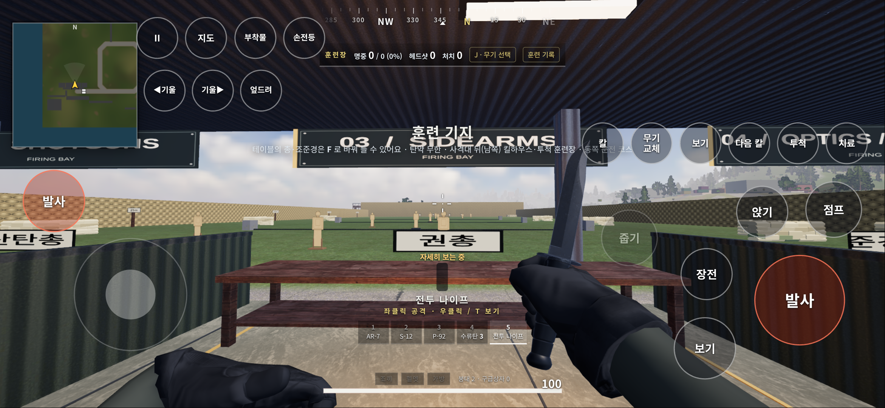

# v91 — 모바일 종료 위험과 그래픽 메모리 개선

갤럭시 S24 FE에서 게임이 종료된다는 제보를 받아 모바일 경로를 확인했습니다. **가상 화면을 축소하는 배율이 렌더러에 전달되지 않아 화면보다 큰 캔버스를 만들고, PC용 텍스처와 중복 MSAA 버퍼까지 유지하는 문제**를 확인했습니다.

실제 휴대폰의 종료 로그를 확보한 결과는 아닙니다. 아래 수치는 S24 FE의 화면 조건을 재현한 Chromium 156·SwiftShader 검사입니다. 휴대폰의 브라우저·GPU 드라이버·OS가 기록한 실제 VRAM이나 FPS 수치와 구분해야 합니다.

## 확인한 원인

### 1. 가상 화면 배율 누락

모바일의 `index.html`은 412×892 CSS 화면을 1559×720의 가상 PC 화면으로 바꾼 뒤 `body`에서 약 0.572배 축소·회전합니다. 기존 `outputPixelRatio()`는 이 배율을 무시하고 DPR 2.625를 그대로 곱했습니다.

| 항목 | 변경 전 | 변경 후 |
| --- | ---: | ---: |
| 가상 화면 | 1559×720 | 1559×720 |
| 화면 축소 배율 | 0.572162 | 0.572162 |
| 렌더러 픽셀 비율 | 2.625 | 1.501924 |
| 출력 캔버스 | 4092×1890 | 2341×1081 |
| 출력 픽셀 수 | 7,733,880 | 2,530,621 |

출력 픽셀 수를 **67.3% 줄여 실제 표시 픽셀에 맞췄습니다.** 모바일의 픽셀 비율은 `devicePixelRatio × __stageScale`입니다. PC에는 화면 축소가 없으므로 기존 DPR을 유지합니다. 회전·전체화면 크기 변경 시에도 다시 계산하며, 2D 스코프와 무기 도감에도 같은 기준을 적용했습니다.

### 2. 모바일에도 큰 텍스처를 전부 업로드

모바일도 PC와 같은 이미지·밉 체인을 GPU에 올리고 있었습니다. 이제 모바일의 일반 이미지 텍스처는 최대 512px로 줄여 업로드하고, 압축 텍스처는 512px 이하의 밉부터 유지합니다. 공유 이미지의 축소 결과는 재사용합니다.

데이터·깊이·렌더 타깃·큐브 텍스처는 이미지 축소 대상에서 제외합니다. 비등방성 필터·밉 필터와 MSAA 알파 커버리지를 유지합니다. 원본 에셋 파일과 다운로드 크기를 바꾼 것은 아니며, PC의 이미지 크기도 바꾸지 않습니다. HUD 문자·조준선은 DOM과 실제 화면 픽셀의 2D 캔버스로 그립니다.

### 3. 색보정 출력에도 중복 MSAA·깊이 버퍼

기존 `EffectComposer`는 장면용 HDR 타깃을 복제해 두 타깃 모두에 MSAA와 깊이를 배정했습니다. 모바일에서는 장면 타깃에만 이를 유지하고 후처리 출력 타깃은 MSAA 0·깊이 없음으로 만듭니다. 매 프레임 장면을 같은 타깃에 그리도록 읽기·쓰기 버퍼를 지정해, 색보정 타깃이 다음 프레임의 장면 타깃으로 바뀌지 않도록 했습니다.

중간·높음의 MSAA와 85% DRS 하한, 고정 해상도, 자동 품질 및 레이트레이싱의 크기 계약은 유지합니다.

## 같은 조건의 변경 전후 측정

낮음 품질·자동 렌더 해상도·같은 에셋·같은 훈련장 시점으로 비교했습니다. 변경 전 코드는 `4b5219e91a7ffe1fc58ed13d3e6eb0618457b8a3`에서 읽었습니다. 구버전의 `version.txt`도 함께 제공해 버전 확인에 따른 재로딩을 막았습니다.

| 단계 | 변경 전 GL 저장소 추정 | 변경 후 | 감소 |
| --- | ---: | ---: | ---: |
| 메뉴 | 1,098.5MiB | 273.8MiB | 75.1% |
| 훈련장·1인칭 무기 | 1,536.9MiB | 414.7MiB | 73.0% |

`texStorage2D`와 렌더 버퍼 저장소 호출의 크기·형식·밉 수·실제 샘플 수로 계산했습니다. 검사 환경에서는 2x 요청이 실제 4x 저장소로 할당되는 경우도 있어, 요청값 대신 GL이 보고한 샘플 수를 사용합니다. 압축 형식의 블록 크기도 반영하며 미확인 형식은 없었습니다.

이 추정에는 기본 캔버스의 화면 버퍼, 지오메트리 버퍼, 드라이버 내부 메모리, CPU의 이미지·모델 디코딩 메모리 등이 포함되지 않습니다. 따라서 **전체 VRAM 또는 휴대폰 메모리 사용량**을 뜻하지 않습니다. 실기기 FPS 향상 수치는 측정하지 않았습니다.

[변경 전 측정 JSON](v91/before-memory.json) · [변경 후 측정 JSON](v91/after-memory.json) · [모바일 검사 JSON](v91/mobile-checks.json)

저장된 JSON의 `gpu.storage`는 같은 종류·크기·형식·샘플 수별로 묶고 `count`와 `bytes`를 합산했습니다. 검사 도구가 만드는 `/tmp` 원본에는 개별 저장소 요청도 남습니다.

## 그래픽 연결 손실·복구

일반 렌더링에서도 `webglcontextlost`가 발생하면 입력과 게임 진행·렌더링·새 매치 시작·GPU 준비 작업을 멈추고 한국어 복구 화면을 표시합니다. 컨텍스트가 돌아오면 화면 크기·품질을 다시 적용하고, 진행 중이던 게임은 일시정지 화면으로 돌아갑니다. 사용자가 계속하기를 누르면 재개합니다.

이전 컨텍스트의 성능 측정 쿼리와 읽기 버퍼를 버리고 새 그래픽 컨텍스트에 연결합니다. 기존 레이트레이싱 손실 처리도 유지합니다. OS가 브라우저 프로세스 자체를 종료한 경우까지 이 이벤트로 복구할 수 있는 것은 아닙니다.

## 브라우저 검증

- Android 터치 UA·412×892 CSS·DPR 2.625로 별도 `touch=1` 강제 설정 없이 모바일 감지·진입 확인.
- 세로/가로에서 출력 캔버스가 실제 표시 픽셀과 일치하는지 확인.
- 화면에 표시되는 터치 버튼으로 사격·장전·칼 장착·검사 동작 확인.
- 2D 스코프 캔버스의 출력 크기, 4개 품질 단계, 고정/자동 해상도 확인.
- 일반 이미지·공유 이미지·압축 밉의 모바일 예산과 데이터 텍스처 보존 확인.
- 실제 `WEBGL_lose_context`로 손실·정지·복구·재개·훈련장 재진입 검사. 복구 후 GL 오류 0.
- 40명 매치 생성과 실제 자유낙하 후 도착·1인칭 화면 확인. 이번 경로는 호수로 내려와 입수했으며, 578회의 1/30초 갱신 뒤 지상/수영 상태로 전환됐습니다.
- PC DPR 1/1.25/1.5의 네이티브 출력·DRS·고정 설정·MSAA·샤프닝·텍스처 필터·RT 크기 검사 통과.
- PC 1/1.25/1.5/2 DPR과 2/4/8배 스코프의 HUD·레티클 검사 통과.
- 기존 시작 순서·지연 모델·누락 에셋 복구·필수 스크립트 오류 검사 통과.

[PC 화면 검사](v91/render-clarity.json) · [HUD·레티클 검사](v91/native-reticle.json) · [시작 로딩 검사](v91/startup-checks.json)

[검사 통과 로그](v91/validation.log)

모바일의 실제 터치 버튼과 게임 화면:



[변경 전 훈련장](v91/before-training.png) · [변경 후 훈련장](v91/after-training.png) · [그래픽 복구 후 일시정지](v91/restored.png) · [40명 매치 화면](v91/match.png)

## 재현

```sh
# 같은 화면 조건에서 변경 전/후 소스 비교
MOBILE_BASE_REF=4b5219e MOBILE_SHOTS=/tmp/lz-v91-before node tools/bench-mobile-memory.cjs
MOBILE_SHOTS=/tmp/lz-v91-after node tools/bench-mobile-memory.cjs
# 실제 모바일 입력·회전·복구·매치 검사
node tools/check-mobile-stability.cjs
# PC 회귀 검사
node tools/check-startup.cjs
node tools/check-render-clarity.cjs
node tools/check-native-reticle.cjs
```
