# v92 스코프·부착물 모델과 장착 접점

기준 커밋은 v91 `ac243789179442858aa02f7dcfb0e1db05e2fdd0`입니다. Chromium 156 / Three.js r160 / 소프트웨어 WebGL에서 실행했습니다.

## 확인한 원인과 변경

기존 일반 총기·M4·G-18·애니메이션 팩은 각자 크기·회전·고정 오프셋으로 부착물을 달았습니다. 4/8배율은 같은 모델을 확대/반전했고, 앵글/경량/하프 손잡이는 수직 모델을 기울이거나 줄였습니다. 일부 총구/하부 부품이 총몸과 떨어졌고, 접히는 가늠자를 레일로 읽으면 스코프도 뜰 수 있었습니다. 미리보기에는 숨겨진 예비 탄창이나 이전에 사용한 팩의 자세가 들어갈 수 있었습니다.

새 원형 21종은 전방 -Z·미터·접면 좌표가 같습니다. 외곽은 베벨, 스코프 안쪽은 비어 있는 튜브와 렌즈이며 링·조절 다이얼·클램프·나사를 넣었습니다. 레드닷/홀로/2배율 표식은 깊이 검사를 사용해 하우징을 뚫고 보이지 않습니다. 4/8배율 HUD는 기존 경로를 사용합니다.

장착 프로필은 실제 삼각형에서 한 번 측정해 캐시합니다. 접히는 가늠자는 제외하고, 레일 홈에서는 클램프 폭 안의 양쪽 접점을 찾습니다. 총구는 여러 반경의 단면을 확인합니다. 권총 도트는 슬라이드, 바닥판은 탄창 뼈를 따르며 장전 중 총몸에 남지 않습니다. 왼손은 장착한 손잡이에 맞춰 이동하고 장전 자유 손 경로로 블렌드합니다.

미리보기는 선택한 실제 총의 휴식 자세에서 보이는 메시만 굽고 플레이 자세를 복원합니다. 양자화된 정수 법선을 그대로 덮어써 검게 보이는 일이 없도록 실수 버퍼를 사용하며, 이전 미리보기 버퍼를 해제합니다.

## 전후 화면

같은 훈련장·화면 크기(1100×700)·허용 부품 조합으로 촬영했습니다. 변경 전은 기준 커밋의 HTML/JS를 라우팅해 실행했습니다.

| 총기 | 변경 전 | 변경 후 |
|---|---|---|
| AR-7 / M4 | 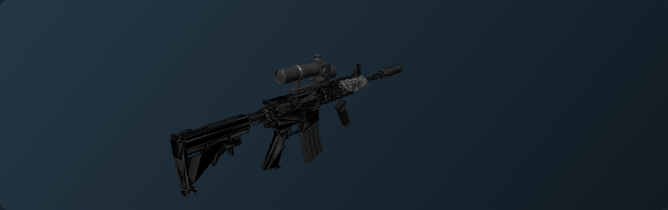 | 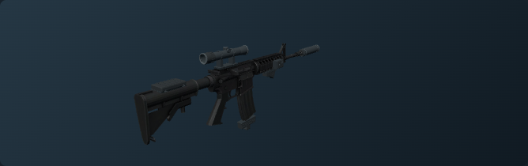 |
| G-18 | 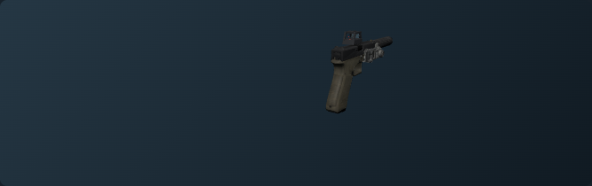 | 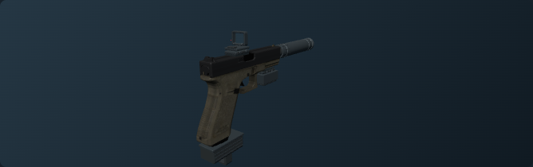 |
| KA-47 | 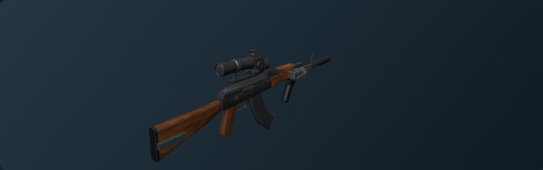 | 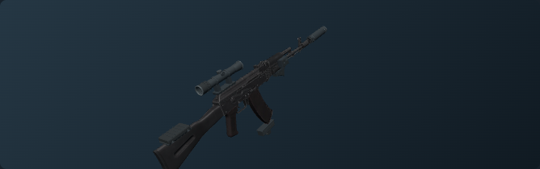 |
| KR-98 | 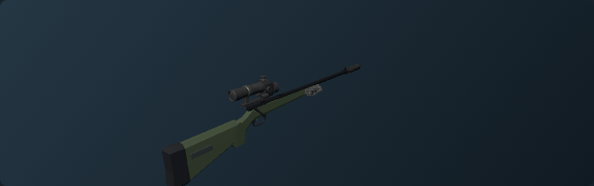 | 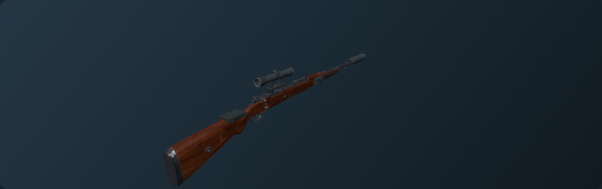 |
| MP-9 | 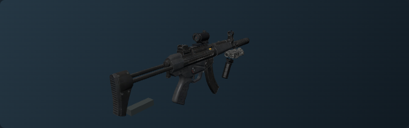 | 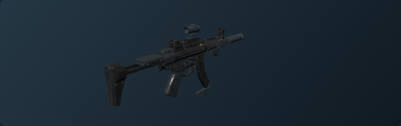 |
| LM-86 | 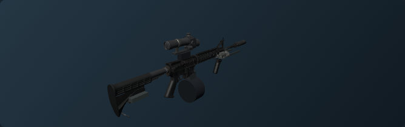 | 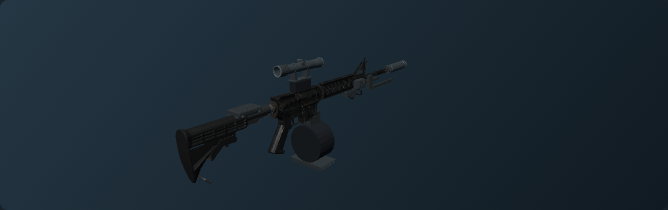 |

실제 1인칭 손잡이 자세: [M4 수직](v92-ar7-grip-hands.png), [M4 앵글](v92-ar7-angled-hands.png), [KA-47](v92-ka47-grip-hands.png), [MP-9](v92-mp9-grip-hands.png).

## 검증

- `node tools/check-attachments.cjs`: 총 30종, 조준경 101개 조합, 탄창 장전 24종, 부품 21종의 형상·접점·광축·하우징 가림을 검사합니다. 새 손잡이 선택과 비활성 총의 미리보기, 반복 렌더 시 버퍼 누적도 검사합니다. [검사 결과](v92-attachment-checks.json).
- `node tools/check-aim.cjs`: 16:9/4:3, 30/60/144 FPS에서 83개 가늠쇠/도트/홀로 조합을 검사했습니다. 10m/50m/100m 실제 마우스 조준·사격, 탄도 270조건, 장전 복귀 60조건과 반동 검사를 통과했습니다. 조준점 오차는 0.001픽셀 미만입니다.
- `node tools/check-hand-poses.cjs`: 총 30종의 대기·조준·이동·전력질주·사격·장전 및 반복 자세 검사 통과.
- `node tools/check-glock-import.mjs assets/models/viewmodels/glock17.fbx`, `node tools/check-m4-model.mjs assets/models/viewmodels/m4_animations.zip`: 원본 애니메이션, 사격, 장전, 조준, 미리보기, 교체/초기화 검사 통과.

새 GLB 합계는 694,160바이트(약 678KiB), 총 44,524삼각형이며 각 모델은 재질별 2~5개 메시로 병합했습니다. GPU에 21종 전체를 매번 복제 업로드하지 않고 같은 geometry/material을 공유합니다. 추가 이미지 텍스처는 없습니다. 실기기 FPS 향상 수치는 측정하지 않았습니다.

- `node tools/check-startup.cjs`: 지연 로딩, 누락 에셋의 기본 모델 복귀, 필수 스크립트 오류 처리 검사 통과.
- `node tools/check-mobile-stability.cjs`: S24 FE 화면 조건(412×892, DPR 2.625)에서 실제 출력 픽셀·512px 텍스처 예산, 터치 사격/장전/칼/스코프, 품질 4단계, 가로 회전, WebGL 연결 손실·복구·재개, 40명 매치 강하/착지 검사 통과. [수치와 복구 결과](v92-mobile-checks.json). 실기기 테스트는 아닙니다.

실제 사격 검사는 이전 발의 반동이 끝난 뒤 다음 표적을 조준하도록 대기 자세를 진행했습니다. 모바일 강하 검사의 상한은 지형 고도별 자동 낙하산 시간을 포함하도록 20초에서 30초로 잡았습니다. 게임의 반동·강하·낙하산 코드는 변경하지 않았습니다.

재현 환경은 기존 `NODE_PATH`, `THREE_DIR`, `CHROME_BIN` 설정을 사용합니다. 모델 재생성에는 `three`, `@gltf-transform/core`, `@gltf-transform/extensions`, `@gltf-transform/functions`, `meshoptimizer`가 필요합니다.

```sh
node tools/attachments/build-v92.cjs
REPORT=/tmp/attachments.json SHOTS=/tmp/attachments node tools/check-attachments.cjs
SHOTS=/tmp/attachments-view node tools/capture-attachments.cjs
```

`capture-attachments.cjs`의 `BASELINE_DIR`에 기준 커밋의 HTML/JS 디렉터리를 지정하면 같은 부품 조합의 이전 화면을 재현합니다.
