# v93 실사 스코프·본체와 받침 연결 수정

기준은 v92 `11dfc533f0ff3f4896f5e9031f0bdb2378d0087e`입니다. Chromium 156·Three.js r160에서 실행했습니다.

## 확인한 원인

v92의 레일 접점 검사는 조준경 밑바닥과 총의 연결을 확인했지만, 조준경 자체의 본체와 받침이 이어지는지는 검사하지 않았습니다. 도트는 본체 하단과 지지대 사이 약 4.5mm, 홀로는 약 3.5mm, 2배율은 약 10mm가 떨어져 있었습니다. 소형 도트에도 작은 분리가 있었습니다. 긴 조준경의 기존 지지대에는 광축을 가로지르는 면이 있었습니다.

독립적인 삼각형 검증을 추가해 이 문제를 재현했습니다. 실제 불투명 삼각형을 1mm 복셀로 만들고 바닥에서 본체까지 연결되는지를 검사합니다. v92 도트·홀로·2배율의 상부 연결 비율은 0%, 소형 도트는 약 39%였습니다. 이전의 장착 높이 검사만으로는 이 결함을 찾을 수 없었습니다.

## 변경

라이선스가 확인된 도트·홀로·ACOG·장거리 원형을 다시 변환했습니다. 4배율은 ACOG형 본체로, 2배율은 같은 계열의 소형 프리즘으로 구분했습니다. 권총은 별도 소형 도트를 사용합니다. [원본·저작자·라이선스](../../assets/models/attachments/CREDITS.md).

렌즈의 실제 중심과 접면을 기준으로 좌우 광축·앞뒤 방향·높이를 보정했습니다. 본체의 불필요한 투명 설정을 없애 깊이 정렬로 부품이 비어 보이지 않게 했고, 렌즈 면은 별도 유리 재질로 분리했습니다. 총기와 같은 표면 마감을 적용하고, 체결부는 낮은 검은 금속 어댑터로 만들었습니다. 원본 받침 면부터 총 레일까지 이어지는 면을 포함합니다.

원형과 대체 모델 모두 본체 연결 비율 97% 이상이며, 주요 상부 본체는 바닥으로 연결됩니다. 반사식 도트·홀로는 중앙 광선을, 배율식은 접안부 20mm 안의 가림을 확인합니다. 배율식의 확대 영상은 기존 스코프 HUD 경로를 사용합니다. [모델 검사 결과](v93-scope-model-checks.json).

## 동일 카메라 전후 접사

모든 화면은 같은 총기·조준경 선택·660×320 미리보기·동일한 카메라로 촬영했습니다. 전체 무기를 작게 보는 대신 본체와 체결부를 확대했습니다.

| 조합 | v92 | v93 |
|---|---|---|
| AR-7 도트 | 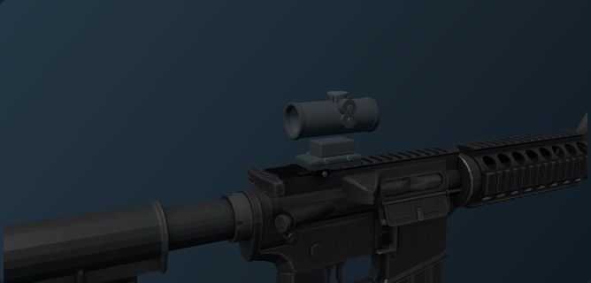 | 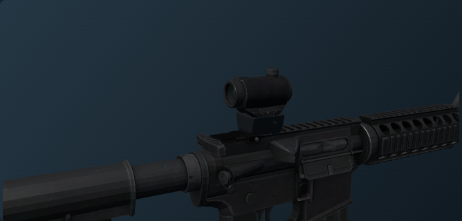 |
| AR-7 홀로 | 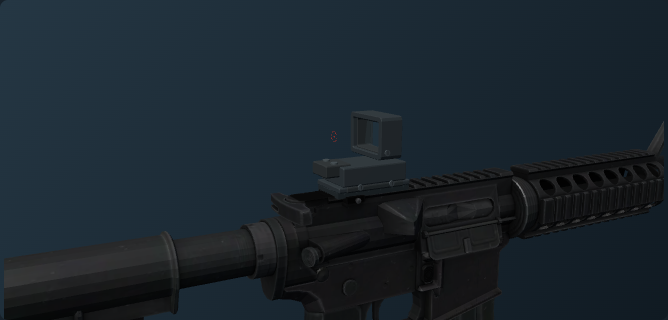 | 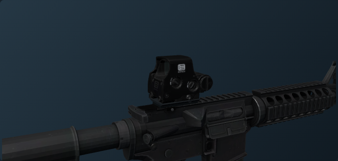 |
| AR-7 2배율 | 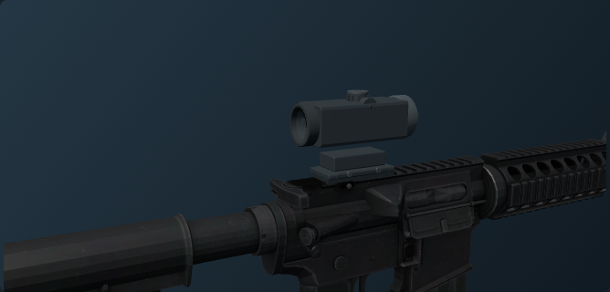 | 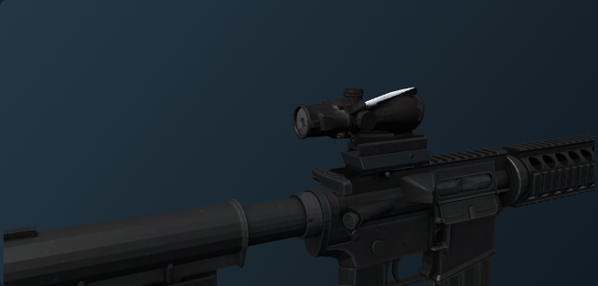 |
| AR-7 4배율 ACOG | 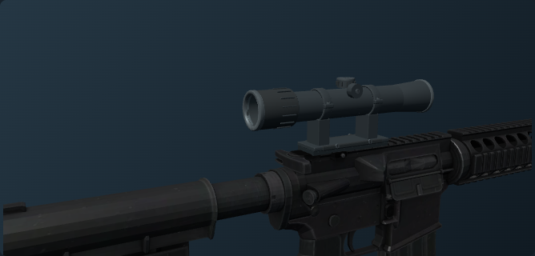 | 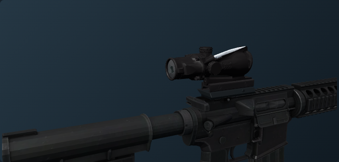 |
| AR-7 8배율 | 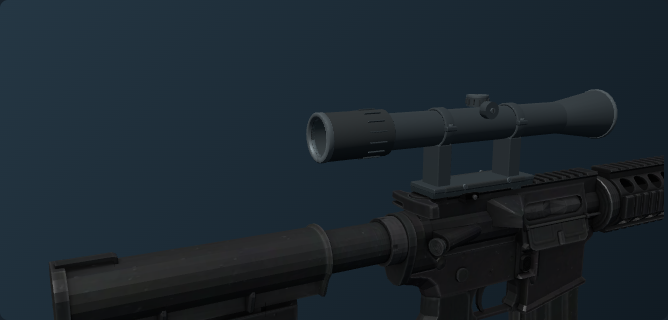 | 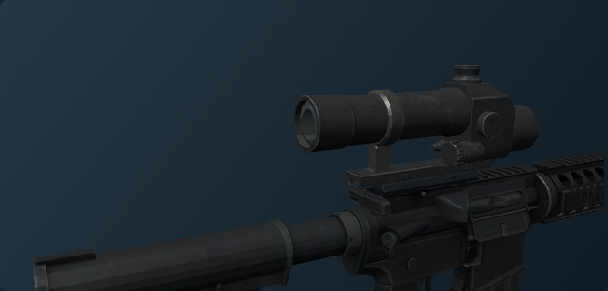 |
| G-18 소형 도트 | 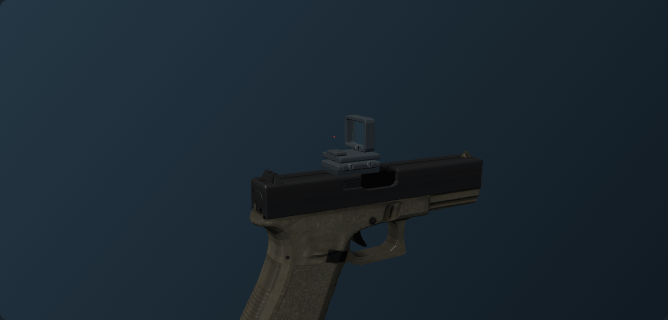 | 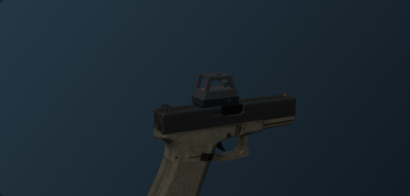 |
| MP-9 도트 | 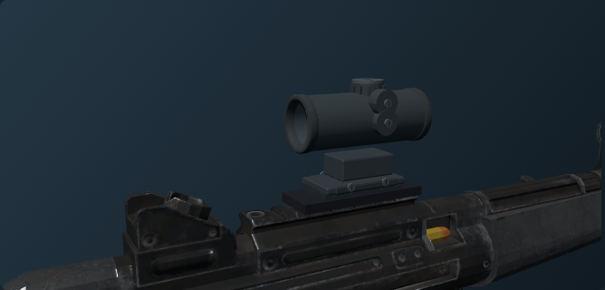 | 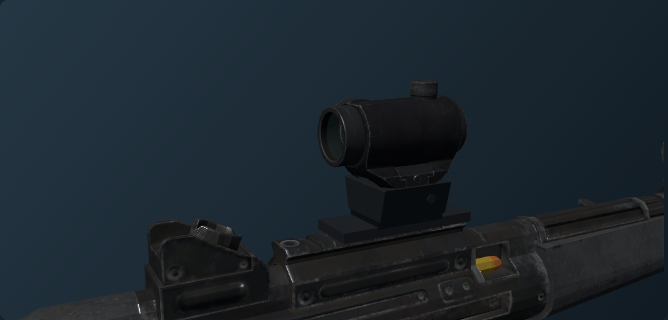 |

## 검증과 예산

- `node tools/check-scope-models.mjs`: 실사 6종과 누락 시 대체 6종의 연결·접안부 검사 통과. 이전 v92 모델 4종의 분리를 함께 재현합니다.
- `node tools/check-attachments.cjs`: 총기 30종·조준경 101개 조합·탄창 장전 24종, 레일 접점·광축·가림·비활성 총 미리보기·반복 미리보기 버퍼 검사 통과. [기록](v93-attachment-checks.json).
- `node tools/check-aim.cjs`: 16:9/4:3, 30/60/144 FPS의 가늠쇠/도트/홀로 83조합 검사 통과. 실제 마우스 사격으로 10m·50m·100m 표적을 맞췄으며, 탄도 270조건·장전 복귀 60조건·반동 검사도 통과했습니다. 최대 조준점 오차는 0.001픽셀 미만입니다.
- Glock/M4 원본 FBX/ZIP 검사: 사격·장전·조준·미리보기·교체/초기화 검사 통과.
- `node tools/check-startup.cjs`: 지연 로딩·누락 에셋·필수 스크립트 오류 처리 통과.
- `node tools/check-mobile-stability.cjs`: S24 FE 화면 조건에서 스코프 6종을 실제 렌더링해 텍스처를 모두 업로드한 뒤 저장소 추정치 최대 약 449.3MiB로 550MiB 예산을 지켰습니다. 터치·품질 4단계·화면 회전·연결 손실/복구·40명 매치 착지까지 통과했습니다. [모바일 기록](v93-mobile-checks.json). 실기기 VRAM/FPS 측정은 아닙니다.

새 스코프 6개 GLB는 합계 659,932바이트입니다. 원형 텍스처는 최대 512px이며 메시·재질을 공유합니다. 광축 제원은 `js/scope-profiles.js`에 생성하며, 나머지 부착물 15종은 기존 v92 파일을 사용합니다.

```sh
# 기존 NODE_PATH/THREE_DIR/CHROME_BIN 환경 사용
node tools/attachments/build-v93.cjs
REPORT=/tmp/scope-models.json node tools/check-scope-models.mjs
REPORT=/tmp/attachments.json node tools/check-attachments.cjs
SHOTS=/tmp/scope-closeups node tools/capture-scopes.cjs
```

변경 전 접사는 v92 기준 소스로 촬영하고 보존했습니다. 빌드 도구에는 `three`, `@gltf-transform/core`, `@gltf-transform/extensions`, `@gltf-transform/functions`, `meshoptimizer`가 필요합니다.
