# v95 — 칼 동작과 손잡이 접점 수정

칼 6종의 꺼내기·공격·자세히 보기를 다시 구성하고, 실제 장갑 메시와 손잡이를 기준으로 그립을 맞췄다. 발리송은 **펼친 칼을 허리 아래에서 들어 올리는 0.68초 꺼내기**를 사용한다. 꺼내기·공격·검사에서 칼날과 두 손잡이는 잠긴 상태를 유지하며, 공중 회전이나 접었다 펴는 트릭은 사용하지 않는다.

## 확인한 원인

- 이전에는 모든 칼에 맨손 자세에서 얻은 같은 손목 보정을 적용했다. 손잡이 길이 축이 실제 손의 가로축에 맞지 않아 손등·손가락 사이를 지나갔다.
- 실사 팔 복제 시 이미 재생 중인 Idle의 손가락 회전을 ‘편 손’으로 저장했다. 이 회전과 쥔 손 회전이 거의 같아서 굽힘 값을 바꿔도 손가락이 제대로 펴지지 않았다. 칼에는 스킨의 역바인드 행렬에서 구한 실제 기준 자세를 사용한다. 총기용 기존 보간은 유지한다.
- 발리송 칼날·손잡이가 각각 고정된 원점에서 회전했다. 손잡이와 칼날 탱의 연결 구조를 바로잡고, 사용 중에는 전개된 형상을 고정했다.
- 소총 꺼내기·검사와 3인칭 검 공격에서 가져온 손목 곡선은 칼의 그립과 타격 방향에 맞지 않았다. 현재 실행 동작은 칼 전용으로 작성한 곡선을 사용한다. 원본 에셋과 라이선스 표시는 보존한다.

## 동작과 그립

발리송·전투 나이프는 준비 → 대각선 베기 → 후속 동작 → 대기로 이어진다. 단검·쿠나이는 전방 찌르기, 카람빗은 짧은 갈고리 베기, 마체테는 넓고 무거운 베기를 사용한다. 타격 시점은 기존 공격 시간의 43%이며 피해량·사거리·공격 주기는 유지한다.

손잡이 위치·기울기·손가락 마디별 굽힘을 칼별로 맞췄다. 전투 나이프의 엄지는 가드 옆으로 돌아 잡고, 마체테의 접점은 손잡이 중심으로 조정했다. 손목 IK 목표뿐 아니라 화면에 보이는 실제 손 뼈의 변환에 칼을 부착한다. 검사 도중 공격하면 현재 자세에서 첫 공격 구간으로 보간한다. 3인칭 팔의 공격·검사 움직임과 무기를 내린 뒤 손 자세 복귀도 확인했다.

모델 로딩 실패 시에는 동일한 기본 손잡이에 맞춘 별도 그립을 사용한다. 장갑·칼의 삼각형 검사는 **실제 1인칭 스킨 메시**를 대상으로 한다. 3인칭 검사는 손잡이 기준점·손가락 자세·복귀 동작을 확인한다.

## 전후 화면

동일한 960×600 브라우저 장면에서 실제 게임의 1인칭 메시를 렌더링했다. 아래 접사는 각 동작의 40% 지점이다.

| 발리송 | 이전 | 이후 |
| --- | --- | --- |
| 꺼내기 | 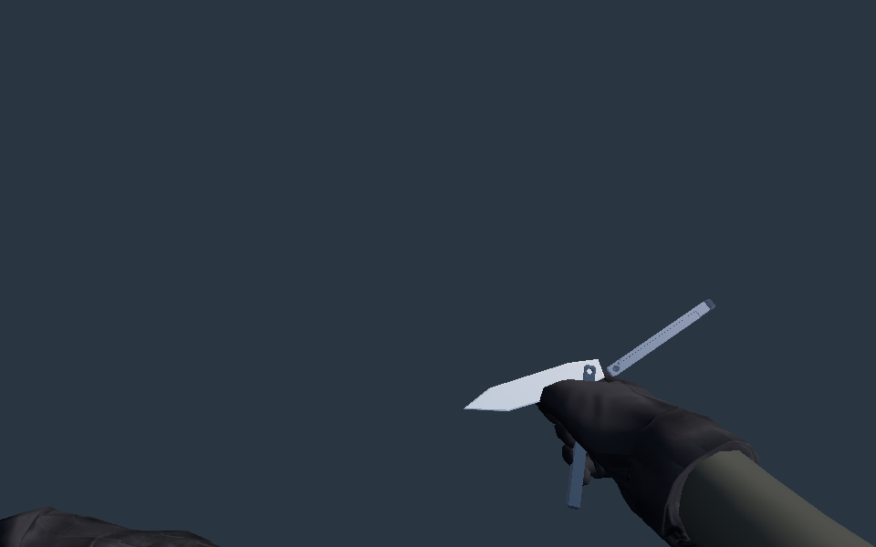 | 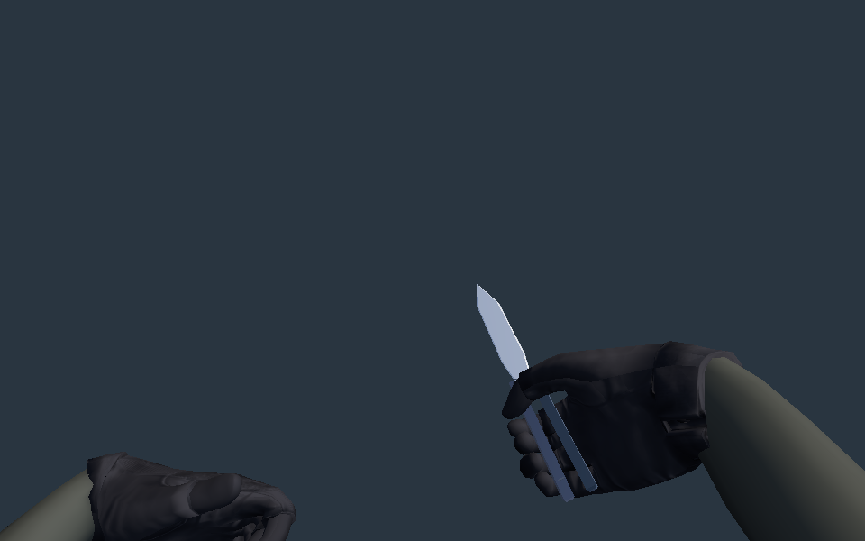 |
| 공격 | 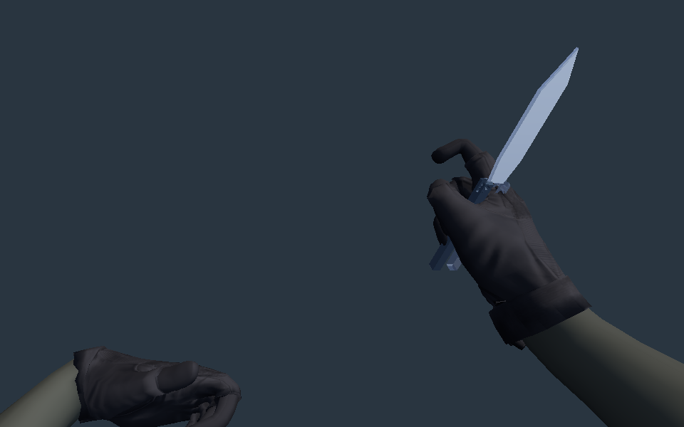 | 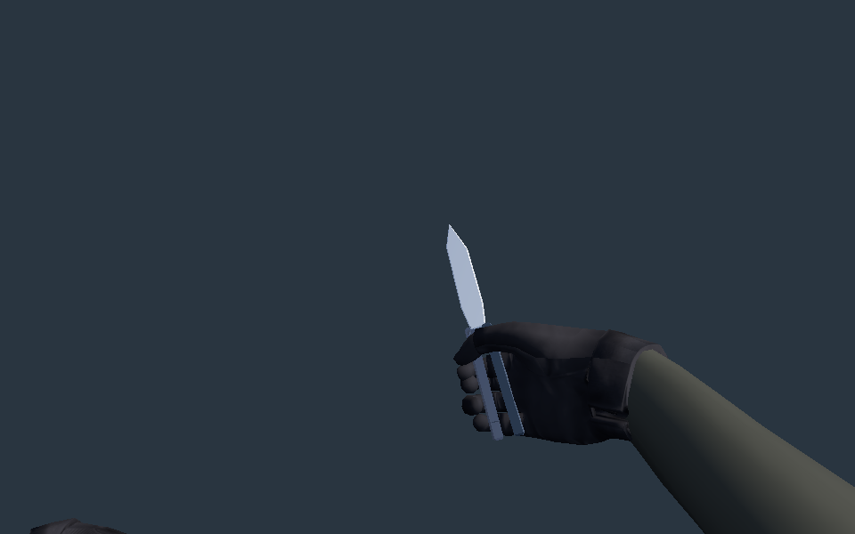 |
| 검사 | 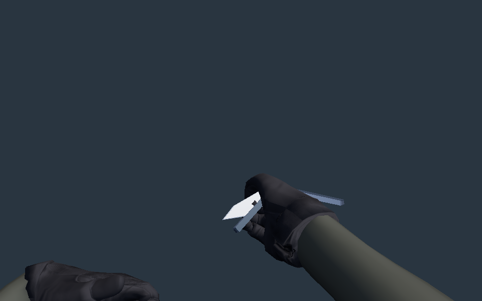 | 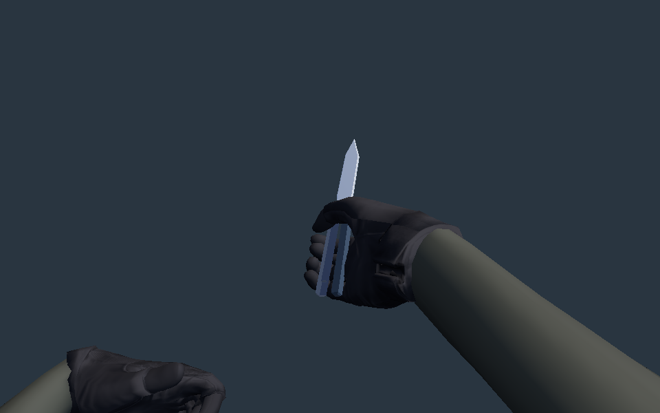 |

연속 동작: [이전 영상](v95/butterfly-before.webm) · [수정 영상](v95/butterfly-after.webm)

훈련장에서 확인한 최종 자세:

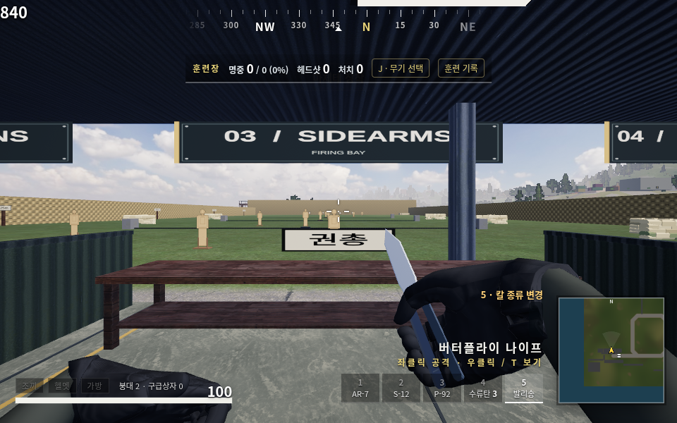
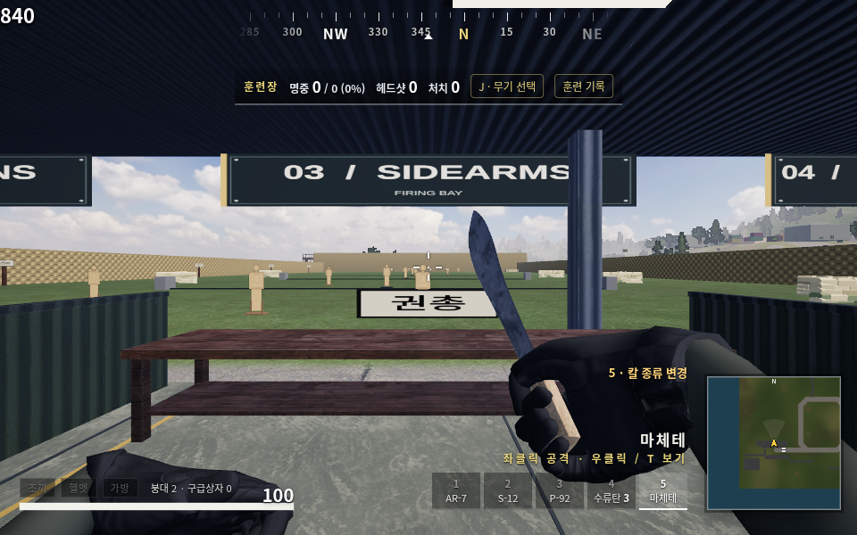

| 단검 | 전투 나이프 | 카람빗 | 쿠나이 |
| --- | --- | --- | --- |
| 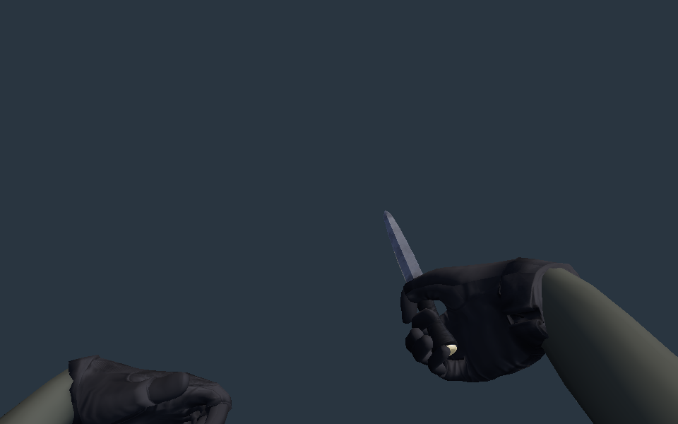 |  | 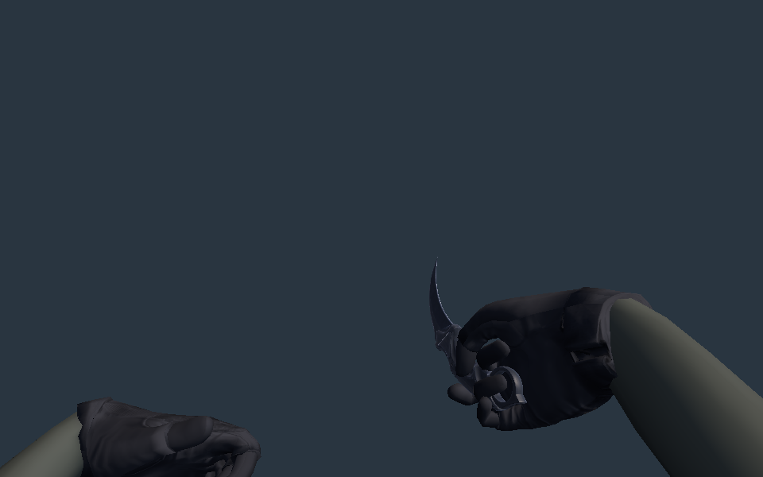 | 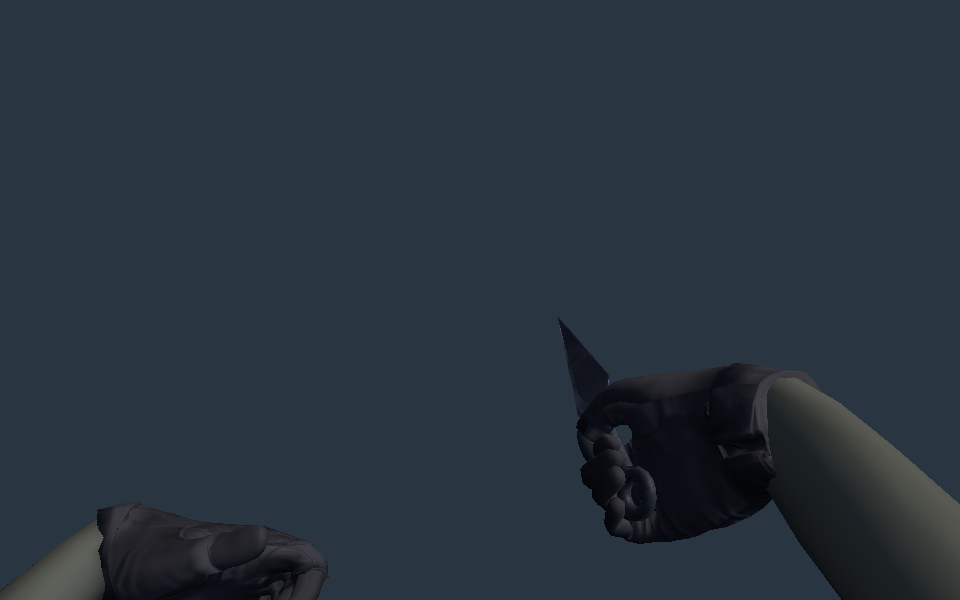 |

## 검사 결과

실제 스키닝된 장갑과 칼의 삼각형을 BVH로 비교했다. 조준점이나 IK 접점 일치만으로 합격 처리하지 않는다. 열린 에셋의 접촉면을 고려해 0.5mm 이하 교차와 접선 접촉을 제외하고, 장갑 접촉 허용치는 2mm로 두었다. 아래의 0은 이 검출 문턱을 넘는 유효 교차가 없다는 뜻이다.

| 칼 | 이전 최대 교차 깊이 지표(mm) | 이후(mm) |
| --- | ---: | ---: |
| 발리송 | 12.71 | 0 |
| 단검 | 9.58 | 0 |
| 전투 나이프 | 8.86 | 0 |
| 카람빗 | 5.86 | 0.712 |
| 쿠나이 | 5.25 | 0 |
| 마체테 | 5.19 | 0 |

이전은 v94(`c503e39`)의 행동별 11개 시점, 총 198개 사례를 측정했다. 이후에는 대기·꺼내기·공격·검사 **824개 시점**을 검사했다. 발리송 꺼내기는 121개 시점으로 더 촘촘히 검사했다. 기본 모델 대체 경로도 824개 시점을 검사했으며 검출 문턱을 넘는 교차가 없었다.

- 30·60·144FPS 간격에서 칼 6종 × 동작 3종, 54개 연속 동작과 대기 복귀 검사 통과. 검사 → 공격 전환 6종의 칼끝 변위는 최대 약 0.05mm였다.
- 각 프레임 간격에서 칼 6종의 공격당 1회 피해, 아군 보호, 벽 가림, 사거리, 무기 전환·사망 시 취소, 훈련 표적 타격 통과.
- 5번 장착·종류 변경, T 검사·키 재지정, 도감 장착, 3인칭 손잡이 접점과 무기를 내린 뒤 복귀 통과.
- 모델 GLB 체크섬과 노멀·접선 검사 통과. 브라우저·셰이더 오류 없음.

30·60·144는 실제 프레임 간격으로 진행한 **동작 시뮬레이션**이다. Chromium/SwiftShader 진단 환경이며 실기기 FPS 벤치마크 수치는 아니다. 게임 실행 경로에는 BVH 관통 검사를 추가하지 않았다.

[측정·연속 동작 기록](v95/checks.json) · [게임 동작 검사](v95/gameplay.json) · [모델 누락 경로 검사](v95/gameplay-fallback.json)

## 재현

Node, Playwright, Three.js r160, three-mesh-bvh 0.7.8과 Chromium이 필요하다. 현재 클라우드 환경에서는 다음과 같이 실행한다.

```sh
source /workspace/.last-zone-fps-env/env.sh
KNIFE_SHOTS=/tmp/lz-v95-gameplay node tools/check-knives.cjs
KNIFE_SHOTS=/tmp/lz-v95-gameplay-fallback KNIFE_FALLBACK=1 node tools/check-knives.cjs
KNIFE_SHOTS=/tmp/lz-v95-motions node tools/check-knife-motions.cjs
KNIFE_SHOTS=/tmp/lz-v95-motions-fallback KNIFE_FALLBACK=1 node tools/check-knife-motions.cjs
KNIFE_SHOTS=/tmp/lz-v95-capture KNIFE_VIDEO=1 node tools/capture-knife-motions.cjs
```
