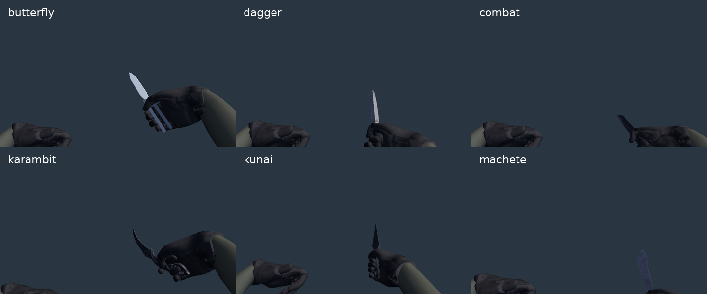
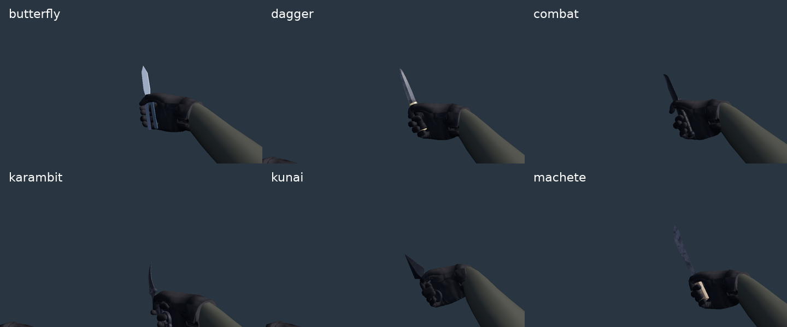
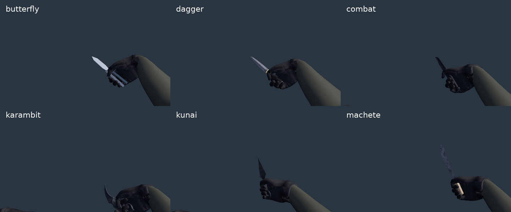

# v96 — 칼 6종의 고유 꺼내기·공격 동작

칼의 모양에 더해 실제 손의 궤적과 회전, 준비·타격·회수 리듬을 다르게 구성했다. 꺼내기 6개·공격 12개·자세히 보기 6개, 총 **24개 독립 동작**을 사용한다. 5번으로 칼을 선택하고 좌클릭을 이어 누르면 각 칼의 두 공격이 번갈아 나온다. 우클릭 또는 T는 해당 칼의 검사 동작이다.

## 칼별 구성

| 칼 | 꺼내기 / 시간 | 첫 공격 → 두 번째 공격 | 자세히 보기 | 영상 |
| --- | --- | --- | --- | --- |
| 발리송 | 손목을 비틀어 날 정렬 / 0.82초 | 빠른 수평 베기 → 되돌려 긋기 | 날 양면·잠금 확인 | [발리송](v96/butterfly.webm) |
| 양날 단검 | 중앙으로 뽑아 세우기 / 0.58초 | 깊은 직선 찌르기 → 아래에서 올려 찌르기 | 양날·가드 확인 | [단검](v96/dagger.webm) |
| 전투 나이프 | 옆 칼집에서 꺼내는 사선 동작 / 0.66초 | 오른쪽 위에서 내려베기 → 왼쪽 아래에서 되받아 베기 | 손등 쪽으로 날 확인 | [전투 나이프](v96/combat.webm) |
| 카람빗 | 작은 원을 그려 갈고리 정렬 / 0.74초 | 안쪽으로 짧게 걸어베기 → 바깥쪽으로 감아 긋기 | 곡선 날·고리 확인 | [카람빗](v96/karambit.webm) |
| 쿠나이 | 아래에서 빠르게 올려 잡기 / 0.50초 | 오른쪽 사선 찌르기 → 왼쪽 낮은 사선 찌르기 | 끝을 세워 균형 확인 | [쿠나이](v96/kunai.webm) |
| 마체테 | 긴 칼을 크게 들어 올리기 / 0.94초 | 무거운 내려베기 → 반대쪽 넓은 수평 베기 | 넓은 날을 천천히 기울이기 | [마체테](v96/machete.webm) |

콜옵의 전술적인 인출·단검, 배그의 마체테 무게감, 발로란트의 빠른 손목 제시를 연출 방향으로 삼았다. 공개 소스는 [GambelStrike2의 고정 커밋 `ccde7d5`](https://github.com/erqf1/GambelStrike2/blob/ccde7d5e021cb80f3e2a6889b145f6d6fe59725c/js/viewmodel.js)을 읽어 칼별 꺼내기·검사·반대 방향 공격을 구분하는 구성을 참고했다. 상용 게임 클립이나 해당 저장소의 코드·키프레임을 복사하지 않고 이 게임의 팔과 그립에 맞춰 곡선을 직접 작성했다. 외부 공식 동작 영상을 직접 재생해 대조한 검증은 아니다.

발리송은 **펼친 상태의 잠긴 손잡이**를 유지하고 손목·팔의 회전으로 구분한다. 공중 던지기·접었다 펴기·고리만 잡고 돌리기는 포함하지 않는다. 모델·팔 리그·출처 표시는 [기존 크레딧](../../assets/models/knives/CREDITS.md)을 유지한다.

## 연결 방식

이전 v95에서는 대부분의 꺼내기와 모든 칼의 검사가 공통 곡선을 사용했고, 단검·쿠나이의 공격도 같았다. v96에서는 오른손의 위치 3축·회전 3축과 왼손의 보조 이동을 칼·동작별로 나눴다. 칼별 대기 위치·각도, 꺼내기·검사 시간도 따로 지정한다.

곡선은 모양을 보존하는 3차 Hermite 보간을 사용한다. 중간 키를 지날 때 속도가 매번 0이 되던 멈칫거림을 줄이고, 양 끝은 속도를 0으로 연결한다. 기울기는 초기화할 때 한 번 계산하며 프레임마다 키 배열을 만들지 않는다. 꺼내기 첫 프레임은 화면 아래 시작 자세에서 출발한다.

공격이 끝난 뒤 0.45초 이내에 다시 공격하면 두 번째 동작으로 이어지고, 잠시 멈추면 첫 공격으로 돌아간다. 검사·칼 변경·다른 무기·달리기 등으로 전환하면 연속 순서를 초기화한다. 검사 중 공격은 현재 자세에서 보간해 연결한다. 피해량·사거리·공격 시간과 **공격 진행률 43%의 1회 타격 판정**은 유지한다. 실제 손 뼈를 따르는 1인칭 그립과 3인칭 팔에도 같은 동작 선택을 적용한다.

## 브라우저 화면·영상

Chromium에서 실제 게임의 팔·칼 리그를 960×600으로 렌더링했다. 영상은 **꺼내기 → 첫 공격 → 두 번째 공격 → 검사** 순서이며, 각 구간 앞에 대기 상태를 준비했다. 30FPS로 저장했으며 구간별 시작·끝 프레임은 [타임라인](v96/timeline.json)에 기록했다.

아래 비교 화면은 각 동작의 40% 지점이다. 위쪽은 발리송·단검·전투 나이프, 아래쪽은 카람빗·쿠나이·마체테다.





칼별 연속 접사: [발리송](v96/butterfly-sequence.png) · [단검](v96/dagger-sequence.png) · [전투 나이프](v96/combat-sequence.png) · [카람빗](v96/karambit-sequence.png) · [쿠나이](v96/kunai-sequence.png) · [마체테](v96/machete-sequence.png). 각 접사는 위에서부터 꺼내기·첫 공격·두 번째 공격·검사, 왼쪽부터 진행률 20·40·60·80%다.

## 검사 결과

원본 모델과 파일을 404로 차단한 기본 대체 모델을 각각 검사했다. 모델 길이나 기본 자세 차이만으로 동작이 다르다고 판정하지 않도록, 대기 자세를 뺀 **실제 오른손의 이동·회전**을 41개 진행률에서 비교했다.

| 검사 | 결과 |
| --- | --- |
| 꺼내기 6개 간 15쌍 | 위치 궤적의 최소 RMS 차이 55.9mm |
| 공격 12개 간 66쌍 | 위치 궤적의 최소 RMS 차이 49.1mm |
| 검사 6개 간 15쌍 | 위치 궤적의 최소 RMS 차이 20.6mm; 해당 쌍의 회전 RMS 차이 0.719rad |
| 실제 스키닝된 장갑·칼 삼각형 | 원본 1,070개 시점 + 대체 1,070개 시점 통과 |
| 30·60·144FPS 간격의 연속 동작 | 칼 6종 × 꺼내기·공격 2종·검사 = 72개 사례, 원본·대체 모두 통과 |
| 검사 중 공격 전환 | 6종 모두 통과; 첫 프레임 칼끝 변위 최대 약 0.057mm |
| 연속 공격·대기 후 복귀 | 3개 프레임 간격 × 6종 = 18개 사례, 원본·대체 모두 0 → 1 → 대기 → 0 및 공격당 1회 피해 통과 |
| 기존 게임 동작 | 아군 보호·벽 가림·사거리·무기 전환·사망 취소·훈련 타격·5번 장착·T/키 재지정·도감·3인칭 그립 복귀 통과 |
| 브라우저·셰이더 오류 | 없음 |

실제 삼각형 교차 검사는 0.5mm 이하 접촉을 검출 문턱으로 제외하고, 장갑 접촉 허용치를 2mm로 두었다. 원본 카람빗의 최대 교차 깊이 지표는 0.712mm이며 나머지 5종은 검출 문턱을 넘는 교차가 없었다. 기본 대체 모델은 6종 모두 문턱을 넘는 교차가 없었다. 발리송은 모든 시점에서 경첩 연결·축 간격·잠금 상태를 확인했다.

30·60·144는 동작을 진행한 **프레임 간격 시뮬레이션**이다. Chromium 156/SwiftShader에서 검사했으며 실기기 성능 벤치마크 수치가 아니다. BVH 삼각형 검사는 검사 도구에서만 수행한다.

[접촉·궤적 차이·연속성 측정](v96/checks.json) · [원본 게임 검사](v96/gameplay.json) · [대체 모델 게임 검사](v96/gameplay-fallback.json)

## 재현

Node, Playwright, Three.js r160, three-mesh-bvh 0.7.8, Chromium과 영상 저장용 ffmpeg가 필요하다.

```sh
source /workspace/.last-zone-fps-env/env.sh
KNIFE_SHOTS=/tmp/lz-v96-gameplay node tools/check-knives.cjs
KNIFE_SHOTS=/tmp/lz-v96-gameplay-fallback KNIFE_FALLBACK=1 node tools/check-knives.cjs
KNIFE_SHOTS=/tmp/lz-v96-motions node tools/check-knife-motions.cjs
KNIFE_SHOTS=/tmp/lz-v96-motions-fallback KNIFE_FALLBACK=1 node tools/check-knife-motions.cjs
KNIFE_SHOTS=/tmp/lz-v96-capture KNIFE_VIDEO=1 node tools/capture-knife-motions.cjs
```
