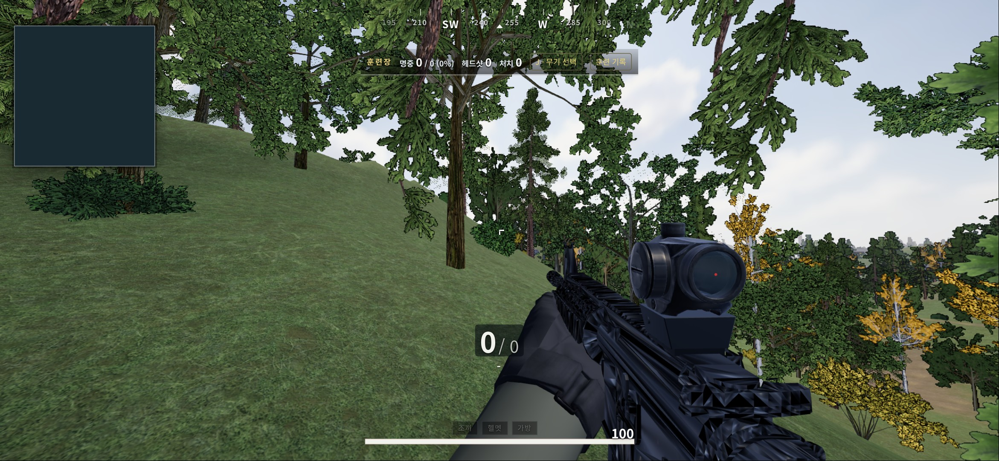
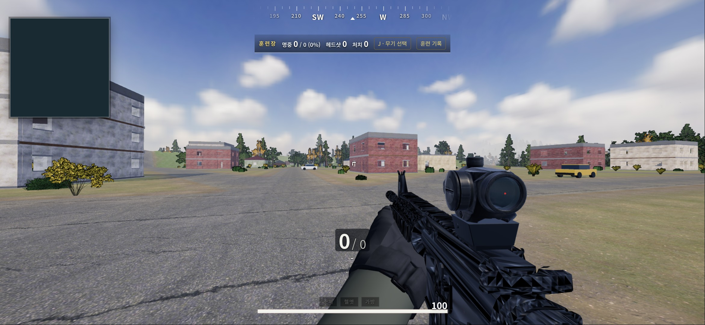
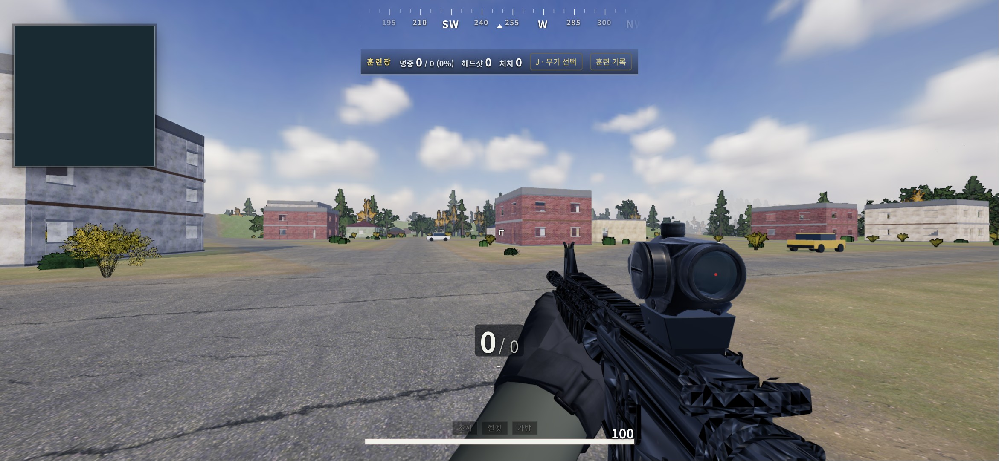
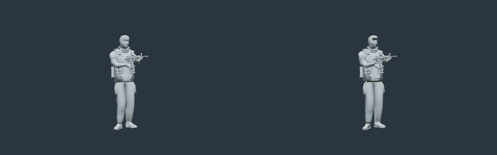
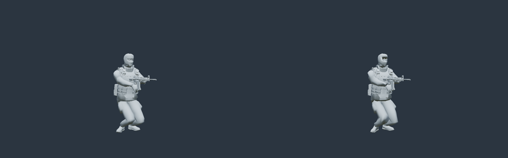
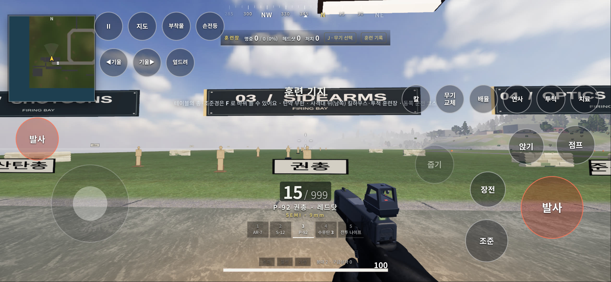

# v97 모바일 맵·모델 최적화

갤럭시 S24 FE / Chrome에서 10~20FPS가 나온다는 제보를 기준으로 모바일 렌더링 경로를 조사했습니다. 기준은 `main`의 `801c393`(v95), 변경은 `feat/mobile-map-model-v97`입니다. 별도 발리송 실험 폴더는 이 변경에 포함하지 않았습니다.

## 확인한 원인과 수정

### 숨긴 건물·가구도 정점을 제출하던 맵

기존 맵은 250m 청크마다 재질을 병합하고 `lodk`와 정수 텍스처로 건물 상세·가구·대체 외곽의 표시 여부를 결정합니다. 표시하지 않을 메시를 정점 셰이더에서 숨겨도 원래 정점과 삼각형은 제출됩니다.

모바일은 기존 병합 메시 안의 삼각형을 125m 공간과 표시 종류로 나눠 인덱스 목록을 만듭니다. 실제 LOD 상태·카메라 시야·빛의 절두체에 필요한 목록만 재사용 버퍼에 복사합니다. 낮은 태양 각도의 시야 밖 그림자도 유지하며 재질별 호출 수를 늘리지 않고 정적 AO·정점 색·UV를 보존합니다. 이동·회전·투영·LOD 상태가 바뀔 때만 갱신하고, RT 캡처 전에는 전체 인덱스로 복귀합니다.

맵 생성 시드, 집과 나무의 위치, 물, 충돌은 바꾸지 않았습니다. 기준과 변경 모두 충돌 상자 **29,188개**, 건물 영역 **860개**이며 정적 AO **406개 적용 / 거부 0개**입니다.

### 가까운 나무와 먼 소품의 높은 모델 비용

모바일에도 PC의 입체 식생 예산이 적용됐고, 작은 훈련장 상자는 개당 **18,320개 삼각형**을 먼 섬에서도 제출했습니다.

- 군인: **20,698 → 12,770개 삼각형**, 약 **38.3% 감소**. 66개 뼈·뼈 행렬·스킨을 유지합니다. 파일은 약 805KiB → 265KiB입니다.
- 나뭇가지 9종 합계: **24,088 → 14,686개 삼각형**, 약 **39.0% 감소**. 잎·생성 시드·원거리 수관 사진은 원래 결과를 사용합니다. 가지 UV를 보존하고 누락 검사도 추가했습니다.
- 모바일의 입체 나무 최대 반경은 최저 40→28m, 낮음 58→40m입니다. 그 밖의 나무는 같은 위치의 기존 수관 사진판으로 전환합니다. 중간·높음도 모바일 예산을 따로 사용합니다.
- 원거리 사진판은 수관 높이·회전 폭을 포함한 셀 경계로 시야 밖 제출을 줄입니다. 이동과 작은 회전을 고려한 여유 경계를 두고 시야가 바뀌면 갱신합니다.
- 상자·모래주머니는 각각 45m·110m 이후 간단한 외곽으로 전환하고 10% 전환 여유를 둡니다. 확대 조준은 상세 모델 거리를 확대합니다. 충돌은 원본 모델의 경계를 유지합니다.
- LOD 전환에서 버릴 픽셀은 텍스처 미분 계산 뒤, 조명 계산 전에 제외합니다.

이 변경은 중거리 나무와 먼 소품의 세부 묘사에 비용을 덜 쓰는 선택입니다. PC는 기존 모델·식생 예산·소품 경로를 사용합니다. 모바일 모델 다운로드가 실패하면 원본으로 복귀합니다.

### 사용하지 않는 지형 텍스처도 읽던 셰이더

기존 지형은 잔디뿐인 픽셀에서도 풀·흙·모래·바위·포장의 색과 노멀을 모두 읽습니다. 색 지도와 가중치를 포함하면 픽셀당 **13번**의 텍스처 읽기입니다.

모바일은 원래 가중치 지도에서 주변 재질 목록을 미리 구합니다. 삼각형 경계에서 32텍셀 여유와 공유 정점의 목록 합집합을 사용하고, 먼 두 LOD는 원래 전체 목록을 유지합니다. 목록은 삼각형 안에서 일정한 값으로 전달해 기존 밉·비등방성 필터를 사용합니다. 비스듬한 시야에서 필터가 사전 여유 범위를 넘어 다른 재질을 읽으면, 실제 가중치와 분기 전 UV 미분으로 해당 레이어를 복구합니다. 순수 잔디 영역은 **5번**으로 줄어듭니다. 원래 높이 기반 경계 혼합·색·거칠기 계산은 유지합니다. 정점 397,120개 중 329,983개에 전체보다 적은 목록이 적용됐습니다.

### 아주 느린 프레임을 자동 품질에서 제외하던 조건

`DRS.frame()`은 원래 `ms > 100`인 프레임을 모두 무시했습니다. 10FPS 아래로 실제 플레이가 느려지면 자동 품질이 이를 반영하지 못했습니다. 숨긴 탭과 1초를 넘는 긴 중단만 제외하도록 바꿨습니다. 합성 150ms 프레임 검사에서 자동 품질이 중간에서 최저로 내려갑니다. 모바일 자동 시작은 과거에 저장한 높은 자동 단계 대신 최대 낮음에서 시작하며, 수동 설정은 유지합니다.

출력 캔버스·HUD·조준선·스코프의 네이티브 해상도, 중간 이상 DRS 85% 하한, 고정 렌더 해상도, MSAA와 PC 품질 단계는 유지합니다.

## 동일 조건 전후 측정

휴대폰 원격 실측 장비는 없습니다. 아래 시간은 **Chromium / SwiftShader 소프트웨어 렌더러**에서 GPU 완료를 기다리며 측정한 구간 시간입니다. 이를 S24 FE의 실제 FPS나 10~20FPS가 몇 FPS로 바뀌는지의 예측으로 환산하지 않습니다. GPU 제출 삼각형은 실제 WebGL 제출을 집계했습니다.

- 모바일 Chrome UA, 가로 CSS 892×412, DPR 2.625. 출력은 전후 모두 **2341×1081**입니다.
- 장면 해상도: 최저 **1404×648**, 낮음 **1756×811**. 전후의 해상도와 MSAA는 같습니다.
- 같은 맵 시드·카메라·난수 시드 9701, 훈련장의 숲·도시·원거리 3개 시점입니다. 식생 전환을 150회 갱신하고 워밍업 2회를 거친 뒤 각 조건 3회를 평균했습니다. 낮음의 주기적 그림자 갱신도 같은 간격입니다.
- DRS와 자동 품질을 고정하고 전후를 순차 실행했습니다. 다른 브라우저/GPU 작업과 병행하지 않았습니다. CPU 봇 전투 부하의 장시간 FPS 검사가 아니며, 40명 매치는 별도로 기능을 검사했습니다.

| 품질 / 시점 | GPU 삼각형 전 → 후 | 감소 | 호출 전 → 후 | 구간 시간 전 → 후 | 시간 감소 |
| --- | ---: | ---: | ---: | ---: | ---: |
| 최저 / 숲 | 439,052 → 260,435 | 40.7% | 142 → 130 | 3,758 → 3,595ms | 4.3% |
| 최저 / 도시 | 383,291 → 219,194 | 42.8% | 396 → 391 | 2,615 → 2,706ms | -3.5% |
| 최저 / 원거리 | 450,620 → 320,320 | 28.9% | 166 → 156 | 2,068 → 2,116ms | -2.3% |
| 낮음 / 숲 | 700,054 → 386,973 | 44.7% | 150 → 148 | 8,475 → 7,905ms | 6.7% |
| 낮음 / 도시 | 437,006 → 276,524 | 36.7% | 406 → 405 | 5,873 → 5,232ms | 10.9% |
| 낮음 / 원거리 | 647,774 → 421,515 | 34.9% | 185 → 181 | 4,544 → 4,376ms | 3.7% |

낮음 품질의 구간 시간은 약 4~11% 줄었습니다. 최저 품질에서는 도시 약 3.5%, 원거리 약 2.3% 증가가 측정됐습니다. 제출량 감소가 모든 조건의 시간 감소를 보장하지는 않았으며, 실제 휴대폰 FPS는 실기기 확인이 필요합니다.

전체 기록: [기준 측정](v97/before.json), [변경 측정](v97/after.json). `mobileMap.sourceTriangles`는 섬 전체 입력량이며 기존 프레임 제출량이 아닙니다. 비교 표는 렌더러가 집계한 `tris`를 사용합니다. 레이블별 `topBufferCapacity`는 전체 인덱스 버퍼의 용량 진단이며 제출량이 아닙니다. 시간은 작은 표본이며 소프트웨어 렌더러의 특성도 포함됩니다.

## 전후 화면

같은 낮음 품질·같은 해상도·카메라의 실제 게임 렌더입니다. 숲은 중거리 입체 모델 전환 차이를 확인할 수 있습니다. 맵 배치와 충돌은 같습니다.

| 시점 | 변경 전 | 변경 후 |
| --- | --- | --- |
| 숲 |  |  |
| 도시 |  |  |

군인은 중립 재질로 외곽·관절을 비교했습니다. 각 사진의 왼쪽은 원본 20,698개, 오른쪽은 모바일 12,770개 삼각형입니다. 텍스처 품질 비교 사진은 아닙니다.





## 검증 결과

- [모바일 맵 검사](v97/scene-checks.json): 도시 가까이/멀리·숲·해안 4개 시점, 시점당 2,530,621픽셀. 맵 인덱스 최적화 켜기/끄기 비교는 모든 픽셀의 RGB 차이가 0입니다. 지형 재질 읽기 켜기/끄기 및 사전 목록을 강제로 비워 필터 복귀를 거치는 비교에서도 채널 차이 8을 넘는 픽셀은 0개였습니다. 식생/모델 경량화를 원본과 완전히 동일한 화면으로 판정한 검사는 아닙니다.
- 같은 검사에서 낮은 태양 각도의 낮음·중간 품질 그림자 비교, 소품 근접·원거리·확대 LOD, 150ms 느린 프레임 자동 품질, 전체 인덱스 복귀, 모바일 에셋 누락 시 원본 복귀, PC 원본 경로를 통과했습니다.
- [모델 검사](v97/model-checks.json): SHA-256, 군인 66개 뼈, 세계 행렬 오차 0, 전체 외곽 크기 오차 0, 피부 가중치 합 오차 <0.005, 나뭇가지 9종 UV·노멀 존재 및 삼각형 감소를 확인했습니다.
- [모바일 통합 검사](v97/mobile-checks.json): 세로/가로 회전, 터치 사격·장전·칼·검사, 스코프, 4단계 품질, 고정 100%와 자동 복귀, 모바일 그래픽 저장소 예산, 실제 WebGL 컨텍스트 손실·복구·재개·재진입, **40명 매치 강하·착지**, GL 오류·페이지 종료 없음을 통과했습니다. 저장소 예산은 텍스처·렌더 버퍼 요청 추정치이며, 지오메트리 버퍼·드라이버·OS 메모리나 실제 휴대폰의 메모리 한도를 보증하는 검사는 아닙니다.
- [PC 해상도 검사](v97/clarity-checks.json): DPR 1 / 1.25 / 1.5, 출력 해상도·DRS 85% 하한·고정 설정·MSAA·선명화·텍스처·RT 크기 통과.
- [시작 검사](v97/startup-checks.json): 에셋 병렬 준비·메뉴 준비 차단·즉시 훈련 진입, 누락 에셋 복귀, 필수 스크립트 오류 처리 통과.

모바일 가로 화면과 터치 버튼 확인:



원본과 모바일 모델의 출처·라이선스·변환 값은 [SWAT 크레딧](../../assets/char/swat/CREDITS.md), [나뭇가지 크레딧](../../assets/models/mobile/CREDITS.md), [매니페스트](../../assets/models/mobile/manifest.json)에 기록했습니다.

## 재현

Node.js, Chromium, Playwright와 프로젝트의 Three.js 도구 의존성을 준비합니다. 생성 도구에는 `@gltf-transform/core`, `@gltf-transform/extensions`, `@gltf-transform/functions` 4.3.0 및 `meshoptimizer` 0.24.0을 사용했습니다. 브라우저 검사는 프로젝트의 `tools/optimize/browser-fixture.cjs`를 사용합니다.

```bash
node tools/check-mobile-models.cjs
MOBILE_SHOTS=/tmp/lz-mobile-scene node tools/check-mobile-scene.cjs
MOBILE_BASE_REF=801c393 MOBILE_SHOTS=/tmp/lz-mobile-before node tools/bench-mobile-scene.cjs
MOBILE_SHOTS=/tmp/lz-mobile-after node tools/bench-mobile-scene.cjs
MOBILE_SHOTS=/tmp/lz-mobile-stability node tools/check-mobile-stability.cjs
node tools/check-render-clarity.cjs
node tools/check-startup.cjs
```

브라우저 명령은 동시에 실행하지 않습니다. 별도 도구 폴더에 설치했다면 `NODE_PATH`를 그 폴더의 `node_modules`, `THREE_DIR`를 그 안의 `three`, `CHROME_BIN`을 Chromium 실행 파일로 설정합니다. 모델 재생성은 `node tools/optimize/build-mobile-models.cjs`입니다. 게임 배포에는 Node.js나 새 런타임 의존성이 필요하지 않습니다.
