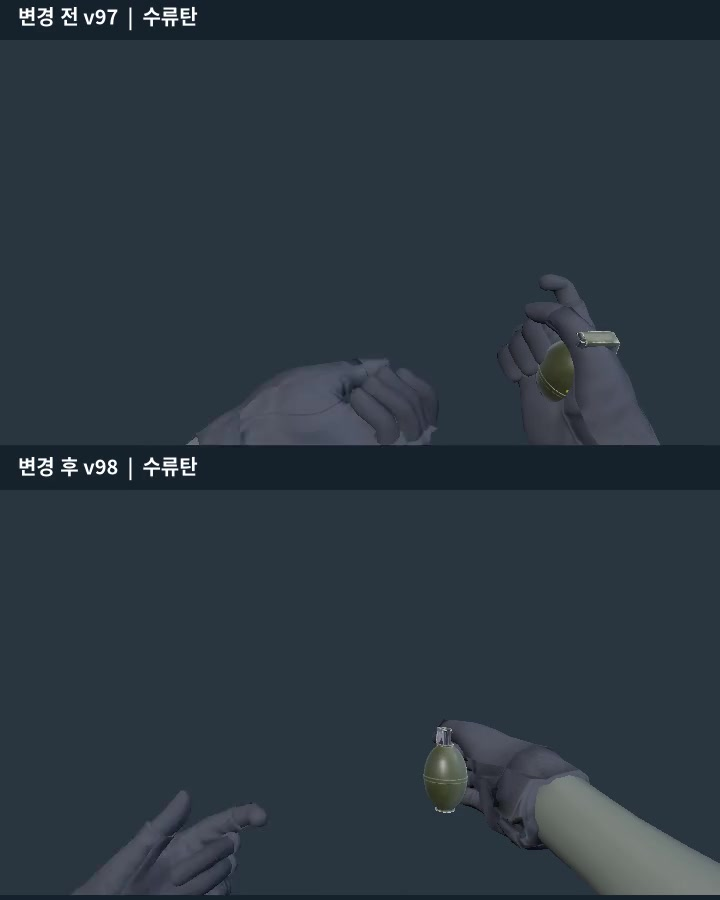

# v98 투척 4종 손·애니메이션·연막 위치

기준: `4a5a0136569f10a6807eb24d2059efed6e79897f`의 v97. 수류탄·화염병·연막탄·섬광탄의 손과 투척 동작을 수정하고, 위로 던진 연막이 공중에 남는 문제를 재현해 고쳤습니다.

## 전후 비교 영상

[MP4 재생/다운로드 — 20초, 720×900, 30FPS](v98/throwable-comparison.mp4)



- 위는 변경 전 v97, 아래는 변경 후 v98입니다. 휴대폰에서 보기 쉽도록 세로로 배치했습니다. 무음 H.264 MP4이며 600프레임, 1배속 20초입니다.
- 0~3초 수류탄, 3~6초 화염병, 6~9초 연막탄, 9~12초 섬광탄, 12~20초 위로 던진 연막입니다.
- 손 부분은 같은 카메라·조명·배경에서 **실제 플레이어 투척 상태와 게임 손 리그**를 고정 시간 간격으로 렌더링했습니다. 누르고 준비 → 안전핀 조작 → 버튼을 놓아 투척 → 복귀를 같은 시각에 입력합니다. 화염병에는 안전핀 조작을 적용하지 않습니다.
- 마지막 장면은 같은 사격장·관찰 카메라·초기 위치·위쪽 속도 23.6m/s·중력에서 실제 투척 물리와 연막 입자를 렌더링했습니다. 물리는 1/60초, 영상은 15FPS로 촬영해 최종 30FPS에 맞췄습니다. 실시간 게임 성능 측정 영상은 아닙니다.

## 확인한 원인

기존 `buildHands('throw')`는 물체를 든 손 그룹 아래에 정적인 팔을 넣었습니다. 손 그룹을 회전하면 어깨·팔꿈치까지 통째로 움직였으며 네 종류가 같은 손가락 자세를 썼습니다. 안전핀은 핀 메시의 원점을 잡았고, 실제 검지 장갑과의 접촉이 보장되지 않았습니다. 실제 방출 시각은 `.33s`, 손에서 물체를 숨기는 시각은 `.68 × .55 = .374s`라서 방출 뒤 잠시 두 물체가 함께 보일 수 있었습니다.

기존 연막은 착지 확인 없이 `o.t >= o.fuse`에서 발화했습니다. 기본 퓨즈는 1.6초이고, 발화 순간 `pos: p.clone()`을 연막 중심으로 저장했습니다. 탄이 떨어져도 넓은 연막 중심은 공중에 남고, 탄에서 나오는 작은 분사만 지상으로 이동했습니다. `inSmoke()`에는 높이의 하한도 없었습니다.

수정 전 실제 재현값은 **1.617초, 지면 위 16.088m**에서 첫 연막이 시작됐습니다. 이후 탄 중심은 **0.060m**에 내려왔지만 연막 중심은 **16.088m**에 남았습니다.

## 변경

### 손 모델과 동작

- 기존 실사 팔·장갑의 투척 전용 복제 메시를 만듭니다. 손·손가락 영향이 70% 이상인 정점의 나머지 팔뚝 영향을 손목으로 옮겨 큰 스윙 중에도 그립 형태를 유지합니다. 원본 위치·UV·재질·가중치 합은 유지하며 다른 무기로 전환하면 원래 지오메트리를 사용합니다. 복제 지오메트리는 재사용하고 팔 모델 해제 시 정리합니다.
- 어깨는 뷰모델 공간에 두고 두 관절 IK로 팔꿈치·손목을 풉니다. 손과 팔 전체를 물체의 자식으로 회전시키던 경로를 없앴습니다.
- 수류탄의 둥근 몸통, 연막·섬광탄의 원통, 화염병 병목에 각각 다른 접촉점과 손가락 마디 굽힘을 사용합니다. 대체 모델에도 별도 보정값을 적용합니다.
- 물체는 화면에 보이는 실제 손 뼈의 전체 변환을 따릅니다. 안전핀의 연결 성분을 분석해 고리 부분을 찾고, 고리 윗부분을 실제 검지 장갑 표면으로 걸어 당깁니다. 다른 손가락은 몸통을 가로지르지 않게 접습니다.
- 위/아래 투척을 구분하고, 준비·가속·방출·후속 동작·다음 투척물 꺼내기를 연결합니다. 종류별 무게감에 맞춰 시간과 손목 회전을 다르게 적용합니다.
- 자동 안전핀 제거를 마친 뒤 투척하며, 실제 방출 상태와 손의 물체 숨김을 맞춥니다. 생성 위치는 손의 물체 위치를 카메라 시야각에 맞춰 옮기고 벽 너머에 생성되지 않게 검사합니다.

### 연막

- 퓨즈 만료와 실제 분사 시작을 분리했습니다. 공중에서는 대기하고, 가까운 지지면과 수직 속도를 확인해 바닥·지붕·경사면에서 시작합니다. 수면에 닿으면 떠서 분사합니다. 지붕의 연막을 아래 지형으로 강제로 내리지 않습니다.
- 연막 입자·시야 차단 중심은 탄 위치를 계속 따라갑니다. 연막 아래 멀리 떨어진 플레이어가 연막 안으로 판정되지 않도록 높이 하한도 추가했습니다.
- 분사 수명은 실제 분사 시작부터 계산합니다. 분사하지 못한 비정상 장기 비행은 별도로 정리합니다.
- 연막 안전핀은 사용할 수 있지만 손에서 폭발하는 쿠킹 대상으로 취급하지 않습니다. 안내는 `준비`와 `착지 후 연막 분사`를 표시합니다. 수류탄·섬광탄의 수동 쿠킹, 화염병의 충돌 발화는 유지합니다.

수정 후 같은 상향 투척은 **3.383초, 지면 위 0.093m**에서 분사를 시작했습니다. 이후 탄과 연막 중심은 모두 **0.060m**로 일치합니다. [촬영 기록](v98/video.json)

## 검증

환경: Chromium / SwiftShader, Three.js r160. 실제 휴대폰 FPS를 측정한 검사는 아닙니다.

- [실사 모델 검사](v98/checks.json): 4종 × 위/아래 × 수동/자동 안전핀 × 30/60/144FPS = **48개 조합**. 한 번 생성·한 개 소모, 방출 시 물체 숨김, 실제 손 뼈 고정, 손목 범위·변환·동작 연속성, 쿠킹·미개봉 취소·핀 제거 후 떨어뜨리기·빠른 투척 후 무기 복귀를 통과했습니다.
- 실제 장갑·물체 삼각형 교차를 검사한 **36개 자세**의 최대 깊이는 **0.75mm**입니다. 공통 그립의 강체 변환을 제거한 좌표에서 측정해 시야나 손목 회전에 따른 부동소수점 오차를 줄였습니다.
- [대체 모델·절차적 팔 검사](v98/fallback-checks.json): 같은 48개 조합과 36개 자세 통과. 최대 교차 깊이 **1.08mm**입니다.
- 두 검사에서 바닥·지붕·수면의 상향 투척, 공중 발화 금지, 탄과 연막 중심 일치, 연막 아래 제외, 분사 종료 정리를 확인했습니다. 연막 안전핀을 뽑고 4초간 들고 있어도 손에서 분사·소모되지 않으며 놓치면 한 개만 떨어집니다.
- [모바일 검사](v98/mobile-checks.json): S24 FE Chrome 화면 조건에서 실제 터치 버튼으로 4종을 투척해 각각 한 개 생성·한 개 소모·종료를 확인했습니다. 세로/가로 회전, 4단계 품질, 스코프, 그래픽 연결 손실·복구·재진입, 40명 매치·강하·착지를 통과했습니다.
- [총기 손 회귀 검사](v98/gun-hands-checks.json): KA-47·P-92의 들기·조준·걷기·달리기·사격·장전과 반복 자세를 30/60/144FPS에서 검사했습니다. 124개 자세, 전환 4개, 실패 0개입니다.
- [기존 차량·수류탄·화염병 VFX 검사](v98/vfx-checks.json): 충돌 발화, 중복 발화 방지, 피해·지속시간, 4단계 품질, 효과 풀·정리·대체 효과를 통과했습니다.
- [영상 형식과 재생 기록](v98/playback.json): MP4 전체 디코딩과 Chromium 재생·탐색을 확인했습니다.

출처는 기존 [팔·장갑 크레딧](../../assets/models/viewmodels/CREDITS.md)과 [투척물 크레딧](../../assets/models/throwables/CREDITS.md)을 유지합니다. 새 외부 에셋을 추가하지 않았습니다.

## 재현

기존 도구 환경의 `NODE_PATH`, `THREE_DIR`, `CHROME_BIN`을 설정합니다. 촬영·인코딩에는 FFmpeg와 Noto Sans CJK 폰트를 사용합니다.

```bash
node tools/check-throwable-motion.cjs
THROW_FALLBACK=1 node tools/check-throwable-motion.cjs
node tools/check-mobile-stability.cjs
HAND_IDS=ka47,p92 node tools/check-hand-poses.cjs
node tools/check-vehicle-throwable-vfx.cjs
node tools/capture-throwable-motion.cjs before
node tools/capture-throwable-motion.cjs after
node tools/encode-throwable-comparison.cjs
```
