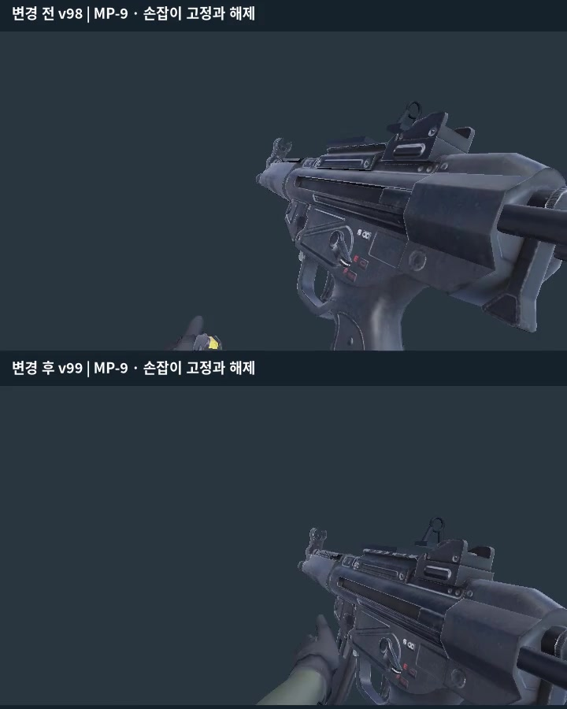

# v99 신규 총기 조준·장전과 기존 손 모델

기준: v98 `d0d18317c3726787f712728b3b60a842ef77aa4e`. 신규 총기 15종의 조준 전환·장전을 기존 M4 장갑·소매와 원본 애니메이션 곡선에 맞췄습니다.

## 확인한 원인

- v98에도 신규 총기의 원본 장전 데이터가 있었지만, `reload-assets.js`는 자유 손의 위치 보정을 축당 3.5cm로 제한했습니다. 손목 회전을 옮기지 않았고, 여러 총기가 같은 `reloadBase` 경로를 사용했습니다.
- MP-9·CX-9는 MP5 기반 모델인데 SCAR식 탄창 교체 뒤 손잡이를 당기는 순서를 사용했습니다. SIG MCX 기반 모델과 Vector·UMP 계열도 빈 총의 조작부를 따로 구분할 필요가 있었습니다.
- 손에 든 탄창의 위치는 손 접촉점을 따르지만 회전은 X축만 사용했습니다. 실제로 푼 손목의 3차원 회전과 차이가 나면 탄창과 장갑이 겹쳤습니다.
- 공유 M4 손 리그의 최초 휴식점을 기준으로 장전 중 손 보정 비율을 다시 추정했습니다. 신규 총기의 IK가 전달한 접촉 상태를 덮어써, 먼저 들었던 총에 따라 보정이 달라질 수 있었습니다. 권총부터 든 뒤 AR-416으로 바꾸는 재현에서는 들기 자세의 정점 좌표가 약 6.99mm 달랐습니다.
- 원본에서 추출한 일부 회전에는 같은 자세를 뜻하는 `q`·`-q`의 부호 전환이 있었습니다. 인접 회전을 그대로 선형 보간하면 0에 가까운 회전값을 통과할 수 있었습니다.

## 적용

| 총기 | 조준·장전 동작 |
|---|---|
| MP-9, CX-9 | 빈 총에서 손잡이를 뒤로 당겨 고정 → 탄창 교체 → 손잡이 해제. 전술 장전은 손잡이를 유지 |
| V-45, SM-45 | 각 원본의 SMG 장전 곡선과 직선 탄창 교체. 빈 총에서 볼트 멈치 조작 |
| AR-416, SG-56, MS-56 | AR 계열 원본 곡선, 직선 탄창 교체와 빈 총의 볼트 멈치 |
| LM-86 | 무거운 드럼을 들어 올려 직선 삽입. 총 무게에 맞춘 자세·복귀 |
| RK-762 | AK 원본의 탄창 앞턱 걸기·젖혀 넣기와 오른손 장전 손잡이 |
| MG-60 | 급탄 덮개 열기·탄통 교체·탄띠 배치·덮개 닫기·빈 총의 손잡이 |
| SR-25, DM-56 | AR 지정사수와 SCAR 계열의 탄창·조작부 경로를 구분 |
| M-24 | 교체식 탄창과 오른손 볼트. 전술 장전에서는 불필요한 볼트 조작 생략 |
| SP-12 | 원본 샷건의 시작·한 발 주기·종료 곡선과 배출구·튜브·펌프 접촉 |
| P-226 | 권총 원본의 꺼내기·탄창 교체와 빈 총의 슬라이드 해제 |

- 조준 전환은 원본의 들어 올리기 곡선을 눈·어깨 위치에 맞춥니다. 완전 지향/조준에서 추가 변위가 0이 되어 기존 가늠쇠·조준경 광축을 유지합니다.
- 20개 원본 구간에서 총몸·양 손목·손가락 굽힘을 60Hz로 추출했습니다. 위치와 회전을 접촉 사건 사이에 연결하고, 잡는 순간에는 실제 부품에 맞춥니다. 자유 손 보정은 사건 경계에서 위치·속도가 이어지도록 감쇠합니다.
- 기관총은 급탄 덮개를 잡기 전에 손바닥을 돌립니다. 덮개에 다가갈 때의 접촉 여유와 고정 그립을 연속으로 바꿔 손목 꺾임을 줄입니다.
- 손에 든 새 탄창은 실제로 푼 손목의 전체 회전을 따릅니다. 탄창 삽입 전에는 탄창집의 자세로 복귀합니다. SG-56의 탄창 접촉점은 실제 장갑 삼각형 검사로 맞췄습니다.
- 기존 M4 손 메시의 위치·UV·재질을 재사용합니다. 손·손가락 영향이 큰 정점의 팔뚝 잔여 영향을 손목으로 옮기는 기존 접촉용 복제 스킨을 공유합니다. 신규 총기 15종마다 별도 팔을 만들지 않고 한 쌍을 재사용합니다.
- 각 총의 실제 받침점에 가까워질수록 고정 그립 보정을 적용해, 선택 순서와 장전 종료·취소에 따른 손 이동을 안정화했습니다. 추가 총기의 보정 회전 기준을 표준 M4 소총 그립으로 고정해, 권총을 먼저 들어도 그 회전을 물려받지 않습니다.
- 원본 회전 부호를 정리하고 인접 회전 5,198쌍을 검사합니다. 손바닥·손가락 방향으로 회전을 옮겨 큰 회전의 짧은 축이 뒤집히는 현상을 막습니다.
- 신규 곡선 파일은 약 0.5MB입니다. 새 손 모델 다운로드를 추가하지 않았으며, 곡선이 누락되면 기존 장전 곡선·접촉 경로를 사용합니다.

[원본별 저작자·라이선스·변환 기록](../../assets/animations/reloads/EXPANDED-MOTION-CREDITS.md)

## 영상

[전후 비교 영상 — 19초, 720×900, 30FPS](v99/gun-motion-comparison.mp4)



위는 v98, 아래는 v99입니다. MP-9 → AR-416 → MG-60 → P-226 순서로 같은 시각의 조준·빈 총 장전·복귀를 촬영했습니다. 실제 플레이어 장전 상태와 게임 손 리그를 1/60초로 진행해 30FPS로 렌더링한 1배속 무음 H.264 영상입니다. 실시간 게임 성능 측정 영상은 아닙니다.

## 검증

환경: Chromium / SwiftShader, Three.js r160. 모바일은 S24 FE Chrome의 화면·터치 조건을 에뮬레이션했습니다.

- [실제 장전 검사](v99/motion-checks.json): 15종 × 빈 총/전술 × 30/60/144FPS = 90개 조합. 탄약 보존·장전 완료, 원본 M4 손 형상 재사용, 손목 범위·연속성, 조작부 동작과 모든 조준경의 완전 조준 광축을 확인합니다. 기관단총·권총·산탄총·저격소총으로 먼저 시작한 뒤 AR-416의 들기·장전 손 정점을 비교합니다.
- [곡선 누락 대체 경로](v99/fallback-checks.json): 같은 90개 조합과 선택 순서 검사를 통과했습니다. [구버전 곡선 파일만 빠진 경로](v99/legacy-pack-missing.json)에서도 신규 15종의 준비 상태와 실제 장전을 확인했습니다.
- [손 메시 회귀 검사](v99/hand-checks.json): 신규 15종의 954개 자세와 전환 30개. 들기·조준·이동·달리기·사격·장전과 취소 복귀를 실제 스킨 삼각형으로 검사합니다. 기존 장갑 접촉 허용치(고정 손바닥 6.5mm, 장전 손바닥 10mm 등)를 유지합니다.
- [기존 총기 검사](v99/original-hand-checks.json): AR-7·G-18·KA-47·DB-2의 272개 자세, 전환 8개를 통과했습니다.
- [전체 장전 검사](v99/reload-checks.json): 30종의 빈 총·전술 장전 60개, 연속 팔 동작, 탄약·소리 720개 사례와 원본·대체 경로를 검사합니다. 손에 든 탄창 접촉은 전체 회전을 포함해 측정합니다.
- [모바일 검사](v99/mobile-checks.json): 신규 15종의 실제 터치 장전과 기존 손 표시, 사격·투척 4종·칼·스코프, 4단계 품질·화면 회전·그래픽 연결 복구·40명 매치 강하/착지를 확인했습니다. 실기기 FPS를 측정한 검사는 아닙니다.
- [영상 기록](v99/video.json): 원본 커밋·총기별 실제 프레임 수·장전 후 탄 수·영상 형식을 기록합니다. [Chromium 재생·탐색 기록](v99/playback.json)과 MP4 전체 디코딩을 확인했습니다.

## 재현

기존 도구 환경의 `NODE_PATH`, `THREE_DIR`, `CHROME_BIN`을 설정합니다. 원본은 기존 크레딧과 해시 고정 목록에 있는 에셋을 사용합니다.

```bash
node tools/guns/build-expanded-motion.cjs /path/to/verified/v77/sources
node tools/check-expanded-motion.cjs
MOTION_FALLBACK=1 node tools/check-expanded-motion.cjs
HAND_IDS=mp9,v45,cx9,sm45,ar416,sg56,ms56,lm86,rk762,mg60,sr25,dm56,m24,sp12,p226 node tools/check-hand-poses.cjs
node tools/check-reloads.cjs
node tools/check-mobile-stability.cjs
GUN_VIDEO=1 node tools/capture-expanded-motion.cjs before
GUN_VIDEO=1 node tools/capture-expanded-motion.cjs after
node tools/encode-expanded-motion.cjs
```

영상 인코딩에는 FFmpeg와 Noto Sans CJK 폰트를 사용합니다. 검토용 장전 화면은 `tools/reloads.html`입니다.
